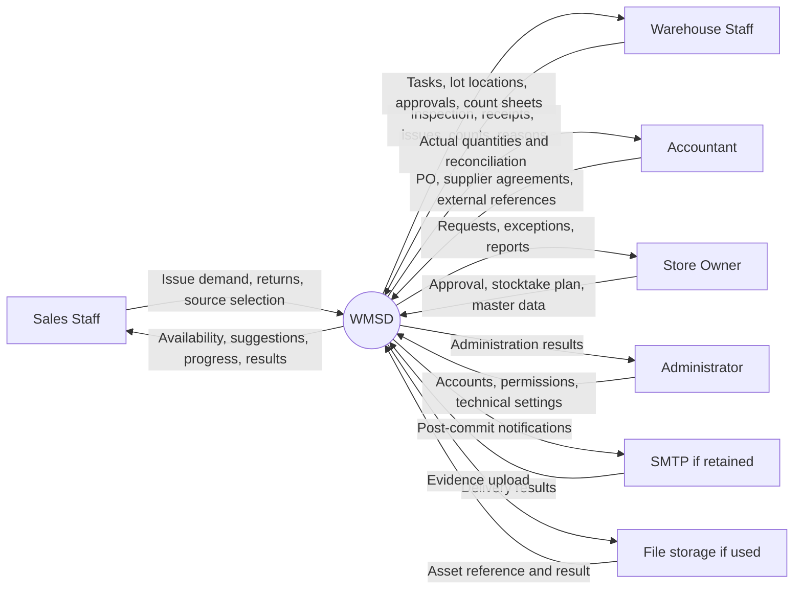
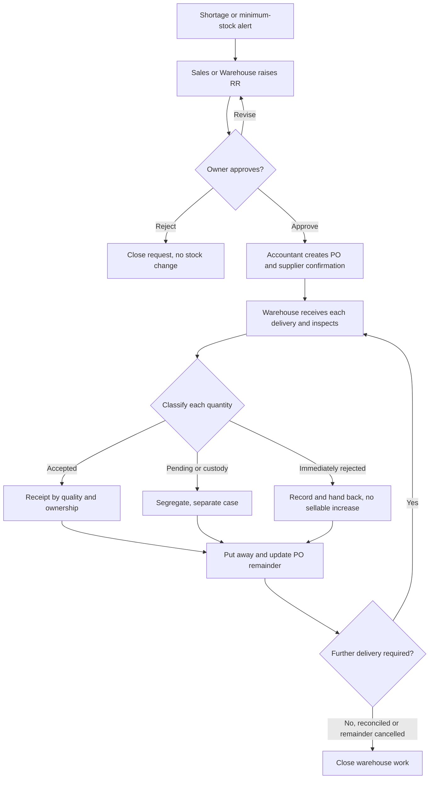
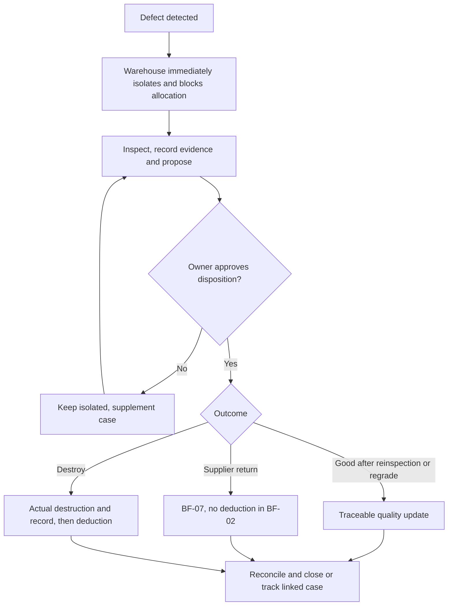
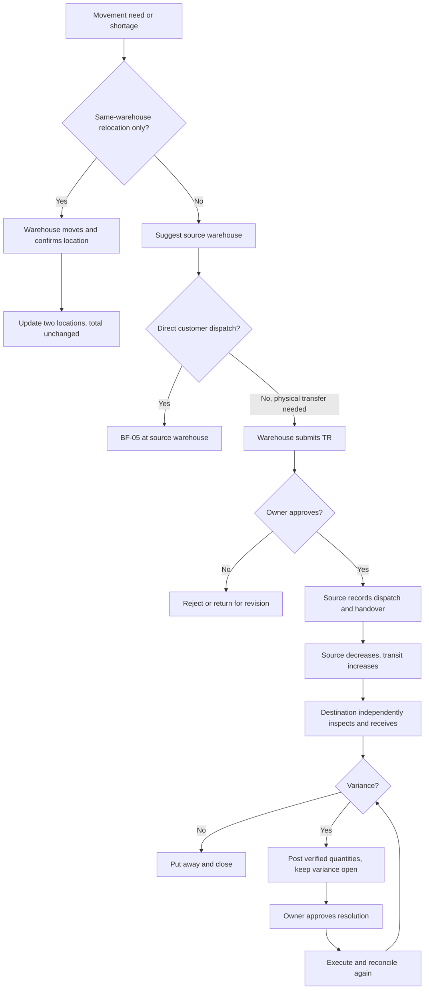
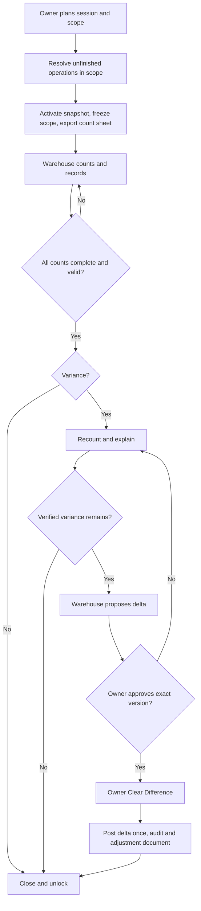
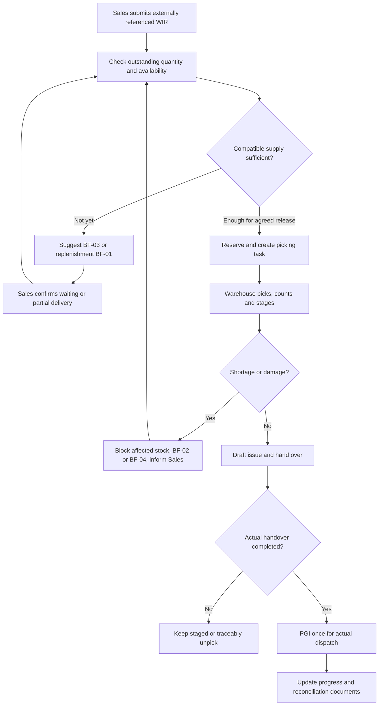
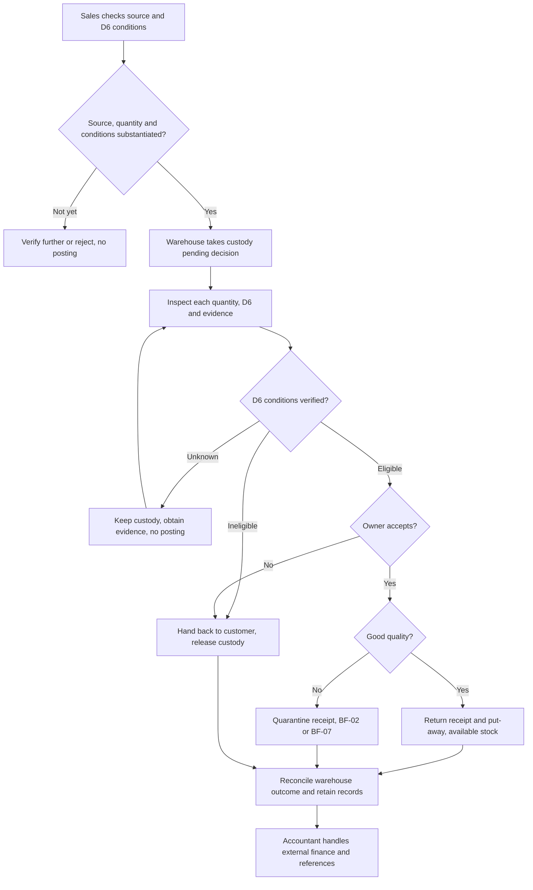
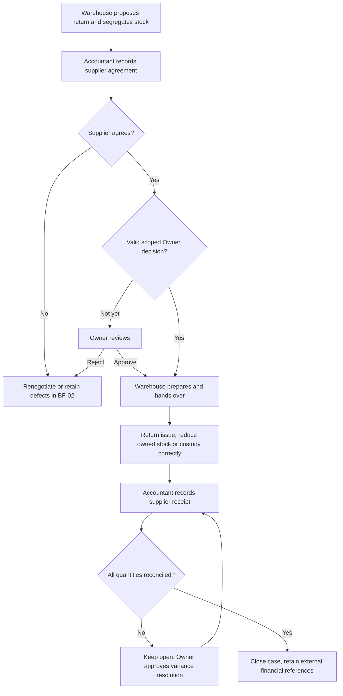

# Process Proposal 2 — WMSD — English

Updated: 21 October 2026. This version carries forward the 17 October review and 19 October additions, and incorporates one survey response submitted at 09:04:25 on 20 October 2026 (GMT+7) and the user's D1–D8 decisions. This is the **To-be selected for this documentation update**, not a claim that the store already follows or has approved every software control.

The original proposal remains unchanged. The 21 October update synchronizes the complete Report 1/Report 3 `.docx.txt` extracts, both process and database proposals, and reference SQL under D1–D8; each BF gains alternate/exception paths. Word `.docx`, embedded images and draw.io are not edited in this round; the text and Mermaid in this set specify the current behavior. Vietnamese version: [de_xuat_quy_trinh_2_VI.md](de_xuat_quy_trinh_2_VI.md). Change log: [change_logs.md](../../change_logs.md).

**19 October additions carried forward:** warehouse terminology, document catalogue and posting rules. Database details remain in the [database design proposal — EN](../03_thiet_ke/de_xuat_database_design_EN.md). SQL is a reference model; actual persistence remains MongoDB (NoSQL).

## Warehouse terminology

| Term | Meaning and use in WMSD |
|---|---|
| WMS — Warehouse Management System | Manages physical warehouse operations, locations and quantities. Does not replace the entire sales/accounting system. |
| Warehouse / Location / Bin | Physical warehouse / location within it / storage bin or rack. Receiving, sellable storage and quarantine at one site are normally locations, not three warehouses. |
| SKU — Stock Keeping Unit | Product/specification identifier; one SKU can have several lots, tones and calibres. |
| Lot / Batch | Production or identifiable traceability lot. Proposed identity: product + manufacturer lot + tone + calibre. |
| Tone / Shade | Actual batch shade/code. The same tile design can differ in tone between lots. |
| Calibre | Actual size group after production, distinct from nominal dimensions such as 600 × 600 mm. Do not automatically mix calibres for a construction project. |
| UoM — Unit of Measure | PIECE, BOX, m². Tiles use pieces as the proposed stock base unit; product conversion factors are versioned. |
| On-hand | Store-owned goods physically in warehouse locations, including good, pending-inspection, quarantined and staged goods. |
| Usable / Available | Usable meets quality/location requirements. Available is the usable quantity still free for new demand after reservations and stocktake locks. |
| Reservation | Reserves specific stock for demand. It is not a goods issue; its link follows stock when relocated. |
| Allocation | Links demand to supply. Planned PO/transfer supply may be allocated without being available for dispatch. |
| Receiving / Put-away | Receiving area / moving goods from receiving to storage. Put-away does not increase total inventory a second time. |
| Picking / Staging | Picking the correct goods, lot and location / staging for handover. Picked stock remains on-hand until actual dispatch. |
| Quality / Quarantine | Goods condition / isolation area. One lot may have 90 good pieces and 10 damaged pieces in separate balances. |
| In-transit | Dispatched from source but not fully received/resolved at destination. It is a transport state, not a quality grade. |
| Custody | Customer/supplier-owned goods held by the store. Track physical responsibility but exclude from store-owned and available stock. |
| Replenishment Request — RR | Sales/Warehouse proposal for additional stock, approved by Owner. Does not increase stock. |
| Purchase Order — PO | Accountant's order against approved demand, tracking ordered/confirmed quantities and multiple receipts. |
| Goods Receipt — GR | Warehouse receipt document; use “Goods Receipt”, not “Good Receipt”. Posting increases the quantity accepted into store ownership at its actual quality/location. |
| Goods Issue — GI / Post Goods Issue — PGI | Issue document / posting actual dispatch. PGI deducts the physically handed-over quantity exactly once. |
| Transfer Request — TR | In **WMSD**, a request between physical warehouses requiring Owner approval. SAP WM's *Transfer Requirement* is a different concept; do not translate them as the same thing. |
| Transfer Order — TO | In **WMSD**, an internal task for put-away, picking, relocation, quarantine or unpick. Technical table: `warehouse_task`. It is not another inter-warehouse approval. |
| Stock Transport Order — STO | Transport order between organizational units/warehouses in SAP examples. Distinct from an internal TO. WMSD uses an approved TR and does not implement full SAP STO functionality. |
| Transfer Dispatch — TD | Source dispatch document. Posting decreases source stock and increases in-transit stock. |
| Multi-warehouse Transfer Receipt — MWTR | **WMSD-specific name for an inter-warehouse receipt.** Each document belongs to one destination and one source dispatch. It does not credit multiple warehouses simultaneously; the references do not establish this as a universal WMS term. |
| Handover / POD | Handover record / Proof of Delivery. Carrier handover does not prove customer receipt. |
| Stocktake / Snapshot / Cutoff | Physical inventory count / immutable book-balance snapshot / reconciliation cutoff time. |
| Recount / Adjustment / Disposition | Recount / stock variance adjustment / decision on defective goods, such as continued quarantine, supplier return or destruction. |
| Posting / Reversal / Idempotency | Committing an inventory-affecting operation / traceable reversing document / repeated requests must not post twice. |
| FIFO | Prefer earlier receipts within compatible stock when picking. This is physical picking, not an accounting cost-valuation choice. |

## 1. Conclusion and design basis

**Retain the seven processes and BF-01–BF-07 identifiers from Report 3, narrow sales scope, correct responsibilities, separate inventory events and synchronize the documentation.** Defect handling stays BF-02; relocation belongs to BF-03 and FE-04. Defect handling is shared across receipt, issue, returns and stocktake.

The proposal prioritizes review1 feedback, Report 1's single-store context and the team's delivery capacity. It changes some existing scope commitments, particularly Sales Orders, selling prices, internal invoices and refunds. Record these differences explicitly rather than implying the earlier scope was identical.

### 1.1 Sources and their use

| Source | Use and limitations |
|---|---|
| [Tân Thương survey](../05_khao_sat/khao_sat_kho_gach.csv), 20 October 2026 | One response covering 26 questions; reference original question numbers. Q13 selects both transfer/no transfer; the user confirmed inter-warehouse transfers in D4. The original CSV remains unchanged. |
| User decisions D1–D8, 20 October 2026 | Retain PGI timing, departmental entry, five roles and frozen stocktake; add return conditions and supported facts; label other controls To-be. |
| [review1.md](D:/Ky_9/SEP490/review1.md) | Review-panel feedback; action items such as emailing the supervisor are document content, not instructions for this update. |
| [Online Report 1](https://docs.google.com/document/d/1kb36v5HuFrM75NFCTXvnJcsg6QnPjYkb/edit) | The original review recorded reading its contents and Drive modification time of 17 October 2026, 16:26:21 Vietnam time. Basis for store context, GAP, FE and LI. |
| [Online Report 3](https://docs.google.com/document/d/1HvhlCmYjfXj7766ZVNUBAU4J063Lmr71/edit) | The original review recorded checking text and context/flow figures; modification time 17 October 2026, 17:17:15 Vietnam time. Its baseline catalogue had 102 UCs, UC-01–UC-102. |
| SAP Global Bike WM I–IV v4.2 in [03_Case_Study](D:/Ky_9/SEP490/dóc/03_Case_Study) | The earlier review compared four main cases, overview pages and business steps. Data Sheets/Notes provide exercise context. Sample users, warehouse codes and organization are not Tân Thương requirements. |
| [MISA SME processes](https://helpsme.misa.vn/2022/kb/quy-trinh-nghiep-vu/) and eShop references below | References for documents, handover, stocktake and warehouse/accounting boundaries. Do not copy all finance modules or claim the store enables every feature. |
| [Store TikTok](https://www.tiktok.com/@gachoplattanthuong), [Store Facebook](https://www.facebook.com/p/Showroom-T%C3%A2n-Th%C6%B0%C6%A1ng-61567834853149/) | The earlier review could not obtain verifiable content. Do not infer warehouses, staffing, revenue, transport or return policy from these links. |

### 1.2 Baseline context

Report 1 describes Tân Thương as a tile store at Phố Tân An, Tân An commune, Yên Dũng, Bắc Giang, using MISA eShop. This is the reported address; current administrative naming was not verified. Customers buy for construction, renovation and installation. Survey Q1 confirms inaccurate stock and difficulty tracking reserved, defective and returned goods. Q5 confirms areas/racks and location codes; Q9 confirms recording lot, color and size in software and using carton information/photos. Do not continue describing the store as having no location structure or lot tracking. Whether “size” means actual calibre and whether tracking is consistent across workflows remain unverified.

Scope: **one store, at least three warehouses according to Q3, with inter-warehouse transfers confirmed by D4**. Do not infer a chain of branches. Exact warehouse count, names, addresses, distances and direct-dispatch permissions are unknown. Q4 only says “Kho gach”; functional area names are not confirmed. Receiving, sellable and quarantine areas at one site are not automatically three warehouses. BF-03B stays in scope; verify actual warehouse master data during configuration.

Retain tile-specific requirements: product + lot + actual tone/calibre, BOX/PIECE/m² conversion, counting each delivery, partial receipts/deliveries, segregated defects and compatible lots for project top-ups. Numerical examples are design examples, not store measurements.

### 1.3 Proposed WMSD boundary

| Inside WMSD | Outside WMSD; retain references where needed |
|---|---|
| Replenishment needs, Owner approval, PO for receipt planning and shortages | Complex commercial selection, supplier payment, debt and accounting |
| Inspection, classification, receipt, put-away, lot/location/status stock | Cost valuation, tax and general ledger |
| Issue requests, allocation, picking, counting, goods issue and handover | Commercial sales orders, quotes, discounts, collection and tax invoices |
| Physical returns, receipt/issue documents and reconciliation | Refund decisions/payments in sales/accounting; WMS retains outcome references |
| Transfers, transit, discrepancies, stocktake and audit history | Route optimization, GPS and fleet management |

**No live MISA integration in the baseline.** Sales/Accountant enters MISA references and attachments or validated imports within the agreed scope. Do not draw automatic API synchronization. WMS is authoritative for detailed physical warehouse events; MISA retains commercial/financial transactions. Accountant reconciles documents and quantities periodically. Do not let two systems independently generate the same warehouse transaction.

Proposed MVP retirements do not delete historical data: selling prices UC-23–25, internal invoices UC-59–62 and refund calculation/approval/completion UC-74–78. Replace refund processing with external outcome references. Keeping these functions would require an explicitly expanded scope and supervisor justification, rather than claiming the scope has been narrowed.

### 1.4 Survey comparison and selected decisions

| Decision | Reported practice / distinction | Selected To-be, 20 October 2026 |
|---|---|---|
| D1 | Q17: deduct stock when creating a sales order/delivery request. Whether the respondent means physical or available stock is unclear. | Retain reservation against availability and physical deduction only at handover/PGI. Reconciliation with MISA explains ordered-but-undelivered quantities. |
| D2 | Q21: Accountant/one shared data-entry person; Q22: update immediately during work. | Retain each department's own authorized entry/confirmation under personal userId. No proxy entry or shared accounts. Staffing must support this To-be difference. |
| D3 | Q6–7, 12, 20, 23: multiple responsibilities, purchasing/delivery personnel and delegated decisions. | Retain exactly five application roles. No purchasing/delivery role or new delegation workflow. Approval stays with Store Owner; multiple roles do not permit self-approval. External delegation does not automatically grant WMSD rights. |
| D4 | Q13 selects both transfers and no transfers. | User confirms inter-warehouse transfers. Preserve raw survey; retain independent source/destination confirmation and discrepancy records. |
| D5 | Q14–15: monthly counting, pausing the area, and recording movements separately if they continue. | Retain frozen scope until resolution. Monthly is an operational cadence, not a new scheduler job. Concurrent counting/movement is not selected. |
| D6 | Q18–19: return conditions and refunds recorded in MISA. | Add conditions to BF-06, BR-29 and UC-70–73; do not invent return days. WMS stores refund references only. |
| D7 | Q3–11, 20, 22, 24: warehouses, coded locations, lot/color/size, conversions, collaboration and phones. | Update supported facts without inventing addresses, actual calibre, SKU conversion factors or new rights. Departments update during work through phone-suitable screens. |
| D8 | Custody, staging/put-away, FIFO, idempotency, separation of duties, TR approval and no live MISA are not fully survey-confirmed. | Retain them as **To-be**, not verified current practice. |

**Units and packaging (Q10–11):** receipts/counts use boxes; sales use boxes/pieces/m². Factors are maintained in MISA/Excel; loose pieces are sold and counted in opened cartons. Torn packaging with intact tiles may still be sold; do not automatically classify it as DAMAGED. Retain PIECE as the proposed base unit and versioned conversions; SKU factors have not been supplied.

**Physical collaboration does not create software permissions:** Owner/Accountant may co-inspect arrivals (Q8), while Warehouse Staff records and confirms inspection. Owner/purchasing personnel may contact suppliers (Q20); Accountant records agreement/evidence, without a purchasing application role.

**Devices and entry:** responsive phone screens (Q24) support BOX/PIECE/m² entry, readable location codes and photo attachments. Do not infer native-app, offline or automatic scanning requirements. Individual logins and warehouse scope remain.

## 2. Differences identified in the earlier baseline

The table preserves the 17 October findings for traceability; not every item remains unresolved in the tables updated on 20 October. The complete Report 3 text and Report 1 text are synchronized on 21 October; original Word/embedded figures remain separate artifacts.

| Reviewed location | Finding | Correction |
|---|---|---|
| R3 I.2.1, UC-03, permission matrix; R1 purchasing | Accountant still creates replenishment needs. | Sales/Warehouse originates demand; Accountant handles PO/documents after approval. |
| R3 I.2.3, UC-40–43, BF-03 figure | TR → Owner approval → TO → TO confirmation; same-warehouse branch occurs after approval. | Branch local/inter-warehouse first. Local movement needs no Owner approval; approved TR proceeds to dispatch/receipt. |
| R3 I.2.5, FE-06, UC-45–62; R1 I.2/IV/V | WMS still owns Sales Orders and internal invoices. | Replace SO with externally referenced issue requests; remove billing from BF-05. |
| R3 I.2.4, UC-87–93 versus BF-04 | Text already has snapshot; UC-93 assigns Owner Clear Difference, but figure puts posting in Warehouse lane. | Do not claim snapshot is absent. Add count sheet/cutoff and align posting actor. |
| R3 I.2.6, UC-70–73 versus BF-06 | Text requires Owner acceptance before inspection; figure inspects before Owner disposition. | Use custody → Warehouse inspection → Owner acceptance → receipt by status. |
| Existing BF-06 figure | Already contains Goods reusable? with distinct outcomes. | Do not repeat an obsolete Yes/No criticism; check permissions, documents, ownership and complete branch endings. |
| R3 I.1 context | Cloudinary appears, but only SMTP API-01 is listed; upload/result arrows are reversed. | Add interface if used and correct direction; otherwise remove the external service. |
| Context versus permissions | Sales sends customer-return data and Accountant sends supplier-return requests, while UC-70/81 only authorize Inventory Staff. | Align arrows and permissions rather than merely renaming actors. |
| R3 I.3.2 entity descriptions | Old traceability: Goods Issue → UC-82–89, Stocktake → UC-70–76, PO → UC-27–32. | Remap using current catalogue/proposal without arbitrary renumbering. |
| R3 I.3.3 and V.1 | DR-04 has “UC-65–56”; GB-04 has “UC-65–50,92–95”; duplicate/invalid ranges. | Normalize IDs, deduplicate and verify each target. |
| R1 IV versus R3 I.2 | R1 has six proposed-solution figures, missing standalone BF-02. | Use seven common BF IDs/names in R1 To-be and slides. As-is may have a different count if clearly labeled. |

## 3. Actors and authorization

Retain five application roles. Use **Warehouse Staff** consistently instead of Inventory Staff in English; this is a naming alignment, not a sixth role.

| Actor | To-be responsibility |
|---|---|
| Store Owner | Approve replenishment, inter-warehouse transfers, customer acceptance, supplier returns, defects and variances; view reports. No routine shelf-change approval. |
| Sales Staff | Record issue/customer-return requests; confirm outstanding demand, partial deliveries and supply selection; obtain customer agreement for lot/tone substitution. No physical-quality confirmation. |
| Warehouse Staff | Inspect, pick, put away, receive/issue, relocate, count, quarantine and propose disposition within assigned warehouses. |
| Accountant | Create/track approved POs, record supplier agreements, reconcile documents and reference external invoice/refund outcomes. Does not decide operational replenishment needs. |
| Administrator | Accounts, permissions and technical settings. No automatic business approval, stock posting or audit-editing rights. |

Customer, Supplier and Carrier are business participants, potentially separate BPMN pools, with no default WMSD account. Source/destination Warehouse Staff are two warehouse responsibilities, not two application roles. Record actual users by userId, not just role labels.

**Approval and execution are distinct:** confirming a completed shelf move is not self-approval of a business proposal. The same person cannot create and approve their own replenishment/transfer/adjustment request. Inter-warehouse receipt requires someone independent from dispatch. Where staffing is limited, the Owner may be explicitly assigned independent inspection; verify that arrangement, never assume enough people or share accounts.

Authorization checks **role + operation + assigned warehouse + document state + creator/approver identity**. List access does not imply entry or approval.

## 4. Seven To-be processes

### BF-01 — Replenishment, purchasing and goods receipt

**Trigger:** (a) issue demand remains short after checking other warehouses; (b) availability falls below a fixed minimum; (c) stocktake/defect outcomes cause a replenishment proposal. Fixed-threshold alerts are proposed functionality, not AI forecasting or automatic purchasing.

**Main flow:**

1. Sales records customer shortages linked to issue demand; Warehouse records reserve-stock needs linked to alerts/counts. Show available/reserved stock, open POs, incoming transfers and need date.
2. Check existing supply coverage. Planned inbound supply offsets demand only if compatible, timely and not already allocated.
3. Submit RR. Owner approves, rejects or returns with reasons. No PO before approval.
4. Accountant creates PO and records supplier quantity/schedule confirmation. Changes beyond approval require renewed approval; do not overwrite executed documents.
5. For every delivery, Warehouse records PO-based arrival, actual quantity, product, BOX/PIECE, lot, tone, calibre, cracks and packaging. A PO may have multiple receipts. Q8 permits Owner/Accountant co-inspection recorded in evidence; GR posting stays with Warehouse. Torn packaging alone is not a tile defect; opened cartons require actual piece counts.
6. Split quantities into accepted good, pending inspection/agreement, defective, or rejected/immediately returned. Record short/over/wrong-product/wrong-lot evidence.
7. Receive only quantities accepted into store ownership at actual status/location. Custody/pending-supplier goods remain separate and unavailable. Owned defective goods enter BF-02; immediately rejected goods must not be fictitiously received then issued.
8. Suggest storage; Warehouse physically puts away and confirms. Accepted goods become allocatable only when quality/location checks pass.
9. Update cumulative received/accepted/outstanding quantities. Accountant reconciles PO, receipt and supplier documents; follow up or obtain Owner cancellation of undelivered remainder. Warehouse completion need not await accounting.

**Exceptions:** shortage leaves remainder open; over-delivery stays separate pending acceptance; wrong tone is not substituted merely because SKU names match; zero accepted quantity still has a discrepancy case; return of previously received goods uses BF-07; replacements are new linked receipts.

**Inventory effect:** RR/approval/PO do not increase stock. Posted receipt increases the correct stock category. Put-away changes location/allocation readiness, not total a second time.

**Documents:** RR, PO, arrival/inspection, GR, put-away task and discrepancy record. Reference: SAP WM I pp. 10–11, 18–22 and [MISA purchase receipt](https://helpeshop.misa.vn/kb/huong-dan-su-dung-tinh-nang-nhap-kho-tren-phan-mem-misa-eshop). Tone/calibre and permissions are WMSD-specific proposed controls.

#### 01.X — Alternate and exception flows

A denotes an alternate path and E an exception; step numbers refer to the main flow above. Apply outcomes per quantity rather than forcing one result for the whole document.

| ID | Condition | Responsible actor and action | Stock outcome / re-entry | UC |
|---|---|---|---|---|
| BF-01-A1 | Demand already covered | Sales/Warehouse checks allocations, timely PO/TD supply; submit only the uncovered balance, no duplicate RR. | No stock change; return to steps 1–2. | UC-03, UC-103 |
| BF-01-A2 | Owner rejects or requests revision | Retain reason; reject closes the proposal, revision creates a new version for review; Accountant cannot create an unapproved PO. | No stock change; step 3 or end. | UC-04 |
| BF-01-A3 | Supplier partial fulfilment | Accountant records quantities/dates; changes beyond approval need renewed review; Owner authorizes short closure; preserve posted GRs. | Receive each delivery at step 5; no fictitious receipt for cancelled quantities. | UC-07, UC-26 |
| BF-01-E1 | Over or wrong delivery | Warehouse separates quantities, records discrepancy/custody if held; no automatic substitution or excess PO receipt. Accountant coordinates; Owner authorizes required changes before acceptance. | GR only eligible quantities; remainder pending or handed back. | UC-26 |
| BF-01-E2 | Zero accepted quantity | Retain arrival/inspection, evidence and custody/handback outcome; PO outstanding and discrepancy remain open. | No zero-quantity GR; no increase in owned stock. | UC-10, UC-26 |
| BF-01-A4 | Torn/open boxes; replacements | Count actual pieces; inspect quality independently. Supplier replacement is a new linked arrival/GR; never rewrite the original GR. | After GR, put-away at step 8; no second receipt on placement. | UC-26, UC-33 |

### BF-02 — Defect detection, isolation and disposition

**Trigger:** cracks/quality defects discovered in BF-01/03/04/05/06 or routine work.

1. Warehouse records source, lot, location, quantity, symptoms, time and photos/record.
2. Immediately block allocation and quarantine. **Do not wait for Owner approval to block defective stock.** Replan affected reservations and notify shortages.
3. Verify condition and ownership/custody. Quarantine alone never transfers ownership.
4. Propose release after reinspection, conditional regrade, supplier return or destruction. Discounted sales remain in MISA; a discount does not make defective goods good quality.
5. Owner approves precise action/quantity or requests more evidence. Rejected proposals remain quarantined.
6. Warehouse executes. Supplier return continues in BF-07; destruction requires actual destruction evidence/quantity; regrade records before/after condition.
7. Post exactly once. Close only when every quantity is resolved or linked to an accountable open case.

**Inventory effect:** quarantine/regrade preserves store-owned totals. Destruction reduces actual destroyed quantity; supplier return deducts in BF-07, not again here. Previously deducted quantities cannot be deducted through another case.

**Documents:** defect case, inspection, disposition decision, destruction record/return issue. These controls address tiles and panel feedback; the four SAP cases do not provide this complete workflow to copy.

#### 02.X — Alternate and exception flows

A denotes an alternate path and E an exception; step numbers refer to the main flow above. Apply outcomes per quantity rather than forcing one result for the whole document.

| ID | Condition | Responsible actor and action | Stock outcome / re-entry | UC |
|---|---|---|---|---|
| BF-02-E1 | Defect in reserved or picked stock | Warehouse immediately blocks defective quantity, preserves demand linkage and informs Sales; seek replacement supply without awaiting quarantine approval. | Owned total unchanged; BF-05 waits/replans. | UC-65, UC-103 |
| BF-02-A1 | Ownership or cause unclear | Keep PENDING/BLOCKED quality and recorded owner; obtain evidence, never turn custody into store stock through a note. | Wait at steps 3–4; unavailable. | UC-65 |
| BF-02-A2 | Rejected or partial disposition | Record line/quantity/version decision; unapproved quantity stays isolated; Warehouse executes only the approved portion. | Return to step 4 or execute eligible portion at step 6. | UC-66, UC-67 |
| BF-02-E2 | Return or destruction not executed | Route to BF-07 with valid approval; supplier dispatch deducts at UC-82 only. Destruction needs actual quantity/evidence, not approval alone. | Keep open until execution; no duplicate deduction. | UC-67, UC-82, UC-106 |

### BF-03 — Relocation, inter-warehouse transfer and discrepancies

**Trigger:** rearrangement, shortage at the intended dispatch warehouse or balancing stock across the store's warehouses.

**Branch A — Within one physical warehouse:**

1. Warehouse selects lot/quality and source/destination; check movable quantity, location suitability and stocktake locks.
2. Physically move and confirm quantity/location/time. Preserve demand reservations rather than making moved stock free.
3. Atomically decrease source/increase destination by the same amount, preserving lot/tone/calibre/quality and audit history. **No Owner approval and no inter-warehouse TR.**

**Branch B — Between physical warehouses:**

1. Check compatible availability at configured warehouses. Suggest direct dispatch or transfer. Use simple warehouse priority and due date; do not claim distance optimization without distance data.
2. Sales confirms customer fulfilment. Warehouse submits TR if physical transfer is needed. Direct dispatch from another warehouse uses BF-05 there, **without a fictitious receipt at the main warehouse**.
3. Owner approves TR. Reserve source stock with concurrency checks. Do not add a redundant Transfer Order approval/confirmation.
4. Source staff pick, count and record dispatch/handover. Actual dispatch decreases source and increases transit.
5. Independent destination staff inspect quantity, lot/tone/calibre and condition and create MWTR. Verified receipt reduces transit/increases destination by actual quality. Preserve demand allocation throughout source → transit → destination; newly received allocated stock is not free for other requests.
6. If matched, put away and complete. For shortage/overage/damage/wrong lot, record evidence, post only verified quantities and keep unresolved amounts open for Owner decision.
7. Execute approved recovery, additional receipt, return-to-source with new documents, quarantine or evidenced loss. Close only when every dispatched quantity is accounted for.

**Example:** A dispatches 100 boxes; B receives 98: 95 good + 3 broken. B receives 95 good and 3 quarantined; 2 remain transit/unresolved. Do not leave all 100 in transit or treat the 3 physically present damaged boxes as lost. Owner-approved loss of 2 deducts that transit quantity through one resolution.

**Inventory effect:** store-managed total including transit is preserved by ordinary transfer; only valid loss/destruction/external issue reduces it.

**Documents:** relocation log, TR, TD, handover, MWTR, discrepancy case. SAP WM II distinguishes STO, issue/receipt and put-away TO. [MISA transfer](https://helpeshop.misa.vn/kb/huong-dan-cach-chuyen-kho-tren-phan-mem-misa-eshop) distinguishes warehouse moves within a branch and inter-branch transfers. WMSD applies physical warehouses of one store and review1's two-document requirement without inferring multiple branches.

#### 03.X — Alternate and exception flows

A denotes an alternate path and E an exception; step numbers refer to the main flow above. Apply outcomes per quantity rather than forcing one result for the whole document.

| ID | Condition | Responsible actor and action | Stock outcome / re-entry | UC |
|---|---|---|---|---|
| BF-03-A1 | Same-warehouse relocation | Warehouse validates same warehouse and lot/quality/owner; move reservations with stock, no TR or Owner approval. | Equal source/destination changes; total unchanged. | UC-36, UC-37 |
| BF-03-A2 | Direct issue from another warehouse | Sales agrees with customer; split OD by actual warehouse and run BF-05 there, no fictitious receipt at the requested warehouse. | No transit without physical transfer. | UC-51, UC-103 |
| BF-03-E1 | Rejected TR or unavailable resources | Owner records reason; Warehouse rechecks stock/freeze before dispatch. Wait or revise unexecuted quantity with authorization; absent an independent receiver, wait for staffing rather than using the dispatch user. | No posting without prerequisites; changed scope requires review. | UC-41, UC-43, UC-104 |
| BF-03-E2 | Partial or damaged receipt | Destination posts actual quantities by quality; shortages remain transit and later MWTRs may receive them. Damaged stock physically received is quarantine, not also lost transit. | TD100, receive95GOOD+3DAMAGED → transit2. | UC-104 |
| BF-03-E3 | Excess, wrong lot or evidenced loss | Record separate evidence; no negative transit or silent lot substitution. Owner resolves; Warehouse executes linked additional receipt, return or loss documents for authorized quantities. | Close only with accountable quantities; preserve original TD/MWTR. | UC-44, UC-43, UC-104 |

### BF-04 — Stocktake, reconciliation and adjustment

**Trigger:** monthly periodic stocktake per Q14, area counts or suspected discrepancies.

1. Owner plans scope by warehouse/location/lot/status, schedule and counters. Adjustment requester cannot approve their own request.
2. Resolve unfinished receipt/issue/transfer tasks in scope. Separate staged, quarantined, custody and transit stock; never count both ends of a transfer.
3. Activate an **immutable cutoff snapshot** and export/print a **count sheet** by location/lot/status. Allow newly found items. Prefer blind count sheets without book quantities.
4. **Selected MVP: lock quantity/location/status-changing transactions in the counted scope until the session is resolved.** Other areas continue. This replaces the earlier Report 3 post-cutoff reconciliation model. Do not implement partial locking without reconciliation.
5. Warehouse counts BOX/PIECE and condition with user/time. Blank means uncounted, not zero. Keep every recount attempt.
6. Compare valid counts to snapshot. Recount unfamiliar lots/discrepancies and investigate documents/reasons. Physically present damaged stock may be a quality variance, not missing quantity.
7. No variance: complete/unlock without a zero adjustment. Otherwise Warehouse proposes the delta against the correct version.
8. Owner approves or returns for recount/explanation, then separately performs UC-93 Clear Difference. Post the approved delta once with adjustment documents/audit; close/unlock after all variances resolve.

**Feasibility:** D5 selected locking; the following advanced alternative is **not selected**. Count small areas with Owner available to avoid prolonged locks. If operations must continue during counting, expected quantity at count time = snapshot + receipts after cutoff − issues after cutoff; delta = physical count − expected quantity. Apply delta to current stock, never replace current stock with an old count. This requires per-line count timestamps and late/backdated movement controls. These are distinct designs and cannot be mixed casually.

**Documents:** session, count sheet, counts/recounts, variance record, adjustment request, approval and increase/decrease documents. SAP WM IV pp. 2, 4–6, 12–17, 20–21, 26–27 supports freeze/recount/clearing concepts, not a requirement to implement SAP WM/MM dual books or value accounting. [MISA stocktake](https://helpeshop.misa.vn/kb/huong-dan-cach-kiem-ke-kho-tren-phan-mem-misa-eshop) informs quantity/reason/document handling; immutable snapshot and approval controls are WMSD To-be.

#### 04.X — Alternate and exception flows

A denotes an alternate path and E an exception; step numbers refer to the main flow above. Apply outcomes per quantity rather than forcing one result for the whole document.

| ID | Condition | Responsible actor and action | Stock outcome / re-entry | UC |
|---|---|---|---|---|
| BF-04-E1 | Open tasks or overlapping freeze | Owner/Warehouse resolve before activation; reject overlap with another frozen session. Freeze blocks receipt, issue, movement and quality changes in scope. | No snapshot until atomic freeze succeeds; other scope continues. | UC-86, UC-87 |
| BF-04-A1 | Blank, zero or newly found stock | Warehouse distinguishes uncounted from valid zero. Verified found stock gets a flagged found_after_cutoff row with book=0; original snapshot rows remain immutable. | Blank never implies total loss; recount appends a new attempt. | UC-87, UC-88 |
| BF-04-A2 | Quality variance or unexplained count | Warehouse recounts and checks lot/units/documents; damaged but present stock uses quality/BF-02, not an extra negative quantity adjustment. | Keep freeze; no final delta approval without evidence. | UC-88, UC-91 |
| BF-04-A3 | No variance or returned adjustment | No variance closes/unlocks without ADJ0. Owner rejection/revision keeps session open; Warehouse adds evidence/recounts and resubmits a new version. | Approval does not post; UC-93 posts authorized delta and unlocks only after resolution. | UC-92, UC-93 |
| BF-04-E2 | Interrupted clearing | Recover saved session/history and retain scope freeze. Check committed batch before retry with the same operation key; do not auto-unlock or switch to concurrent-movement counting. | Failed batch rolls back; committed batch returns prior result. | UC-87, UC-93 |

### BF-05 — Issue request, picking and handover

**Trigger:** Sales submits a Warehouse Issue Request from an externally processed commercial order. Store pickup and site delivery use the same stock controls; no new POS module.

1. Sales enters source order/line, quantity/unit, lot/tone/calibre requirements, need date, recipient/address and instructions. Prevent duplicates by source + line + delivery release. Q16 reports software, paper and Zalo/phone/verbal channels; normalize them into a verified WIR before dispatch. These channels are not automatic integrations.
2. Check cumulative issued, reserved and outstanding quantities and compatible availability. Shortages suggest BF-03 or BF-01. Demand remains waiting; no negative stock.
3. Sales confirms complete/partial delivery or waiting with the customer. Lot mixing or tone/calibre changes require agreement; never substitute solely on SKU.
4. Suggest location/lot picking and reserve stock. Prefer FIFO inside compatible stock; this does not choose accounting valuation.
5. Warehouse checks and picks actual quantities into staging, counts/packs and records partial cartons/loose pieces.
6. Physical shortage/damage: retain evidence, block suspect quantities, route defects to BF-02 and find compatible supply or notify Sales. Unexplained book/physical mismatch triggers targeted BF-04, not a direct balance overwrite.
7. Draft GI from counted quantity. At actual handover record recipient/carrier, time and evidence; PGI deducts exactly the dispatched quantity once. Failed handover before PGI leaves goods staged or returned by traceable unpick.
8. Update issued/outstanding quantities, notify Sales and provide warehouse documents for MISA reconciliation. Close on full issue or authorized cancellation of remainder. **Carrier handover is not proof of customer receipt.**

**After PGI:** cancellation does not restore stock. Physically returned goods require receipt/inspection and related documents; posting errors require traceable reversal/adjustment, never deletion.

**Inventory effect:** reservation reduces availability; picking moves bin → staging without reducing warehouse total; PGI reduces total and consumes the matching reservation. Creating requests, printing or emailing does not deduct.

**Documents:** WIR, delivery plan, picking task, shortage/defect record, GI and handover. SAP WM III p. 2 covers integrated SD–WM, pp. 12–17 picking and pp. 21–22 PGI; its WM instructions do not establish WMSD billing/payment scope. [MISA sales issue](https://helpsme.misa.vn/2022/kb/xuat_kho_ban_hang/) informs request/document/Warehouse responsibilities.

#### 05.X — Alternate and exception flows

A denotes an alternate path and E an exception; step numbers refer to the main flow above. Apply outcomes per quantity rather than forcing one result for the whole document.

| ID | Condition | Responsible actor and action | Stock outcome / re-entry | UC |
|---|---|---|---|---|
| BF-05-E1 | Unverified source, duplicates or stock race | Sales/Accountant verifies external source; reject duplicate source+line+release. Reserve atomically; later demand gets remaining supply or waits. | No fabricated source/internal SO; no negative availability. | UC-47, UC-51, UC-108 |
| BF-05-A1 | Partial, delayed or substituted delivery | Sales records customer agreement on quantities/compatible lots and splits OD releases; shortage uses UC-103→BF-01/03. Resolve bound tasks before changes. | Reserve covered quantity only; remainder stays outstanding. | UC-48, UC-51, UC-103 |
| BF-05-E2 | Picking discrepancy | Warehouse records actuals and isolates defects/BF-02; unexplained mismatch triggers targeted BF-04. Sales chooses replacement/waiting; no direct balance edit. | Picking changes position/reservation only, not total. | UC-55, UC-65 |
| BF-05-A2 | Cancelled or delayed handover before PGI | Keep staged stock or document Warehouse unpick to eligible storage; release corresponding reservation before Sales cancels unissued remainder. | No PGI without handover; warehouse total unchanged. | UC-48, UC-55, UC-58 |
| BF-05-E3 | Cancellation or return after PGI | Do not restore stock through status edits. Actual returned goods use BF-06/inspection; posting errors use eligible linked reversal/correction. | Retain reconciliation state; carrier handover is not customer receipt. | UC-58, UC-70, UC-73 |

### BF-06 — Customer return and classification for receipt

**Trigger:** customer requests return of dispatched goods. Commercial acceptance, physical quality and ownership are separate questions.

**D6 conditions from Q18:** sealed boxes and unused loose pieces are assessed case by case, never accepted automatically. Reject installed tiles, customer-caused damage and goods confirmed beyond the applicable return period. No specific number of days or deadline basis has been supplied: retain policy/agreement references; unverified deadlines remain pending, neither assumed overdue nor assumed valid. Supplier-defective goods may be considered and quarantined; do not equate them with customer damage. Torn packaging alone determines neither quality nor eligibility.

Sales checks commercial conditions before intake when evidence permits; Warehouse verifies physical condition. Proven ineligible requests may be rejected before physical receipt. Goods already physically received remain custody until handback, without GR-CR. Split quantities with different conditions into separate assessment lines.

1. Sales registers source order/GI, product, quantity and reason. For pre-WMS transactions, Accountant verifies external history; do not invent a historical GI merely to enable returns.
2. Validate dispatched, previously returned and pending-return quantities per line to prevent duplicate/excess returns. Sales checks documents/commercial conditions, not technical quality.
3. Warehouse physically receives into pending-inspection custody and records customer-owned quantity. This does not increase sellable stock or confirm a refund.
4. Count, verify lot/tone/calibre and classify good/defective/pending quantities; propose acceptance. Unknown origin is not assigned a sellable lot. Record packaging, installation/use, damage cause and deadline verification per line with assessment version/evidence. Unknown conditions remain pending.
5. Owner accepts all/some/none based on inspection and agreed conditions; do not approve stock acceptance for D6-ineligible or unverified lines. UC-71 is acceptance **after** inspection, not prior permission to inspect.
6. Accepted good quantities: source-linked GR-CR with correct lot/status, then put-away and availability.
7. Accepted defective quantities for which the store assumes responsibility: quarantine receipt linked to BF-02/07. Rejected quantities stay outside store-owned stock and are handed back; close custody on actual handback.
8. Sales communicates the result. Accountant uses warehouse evidence for external invoice/refund/offset handling. WMS stores references/status; it does not edit the original sale/invoice, calculate or pay refunds.
9. Close warehouse processing when every physically received quantity is accepted, handed back or linked to an accountable open case. Financial status remains independent.

**Branch per quantity/line, not one Yes/No for the entire delivery.** Example: 10 boxes returned; 7 good accepted, 2 defective accepted for supplier claim, 1 wrong-source rejected. Result: 7 good after put-away, 2 store-owned quarantine, 1 custody then handback; not 10 sellable.

**Invoice boundary:** the inherited proposal warns against applying SME 2022 instructions as definitive 2026 tax procedure. Its [Ministry of Finance reference](https://portal.mof.gov.vn/hoidapcstc/home/cthoidap/156063) discusses seller adjustment invoices and agreed buyer return invoices. Accountant determines the applicable external procedure for the actual case; WMSD supplies evidence/links and implements no tax workflow. This update does not independently revalidate that legal reference.

[MISA eShop invoice-linked returns](https://helpeshop.misa.vn/v1/kb/doi-tra-hang-cho-khach-theo-hoa-don-thi-thuc-hien-nhu-the-nao) informs source linkage and return receipts; automatic retail documents do not replace tile quality inspection.

#### 06.X — Alternate and exception flows

A denotes an alternate path and E an exception; step numbers refer to the main flow above. Apply outcomes per quantity rather than forcing one result for the whole document.

| ID | Condition | Responsible actor and action | Stock outcome / re-entry | UC |
|---|---|---|---|---|
| BF-06-A1 | Historical sale without WMS GI | Sales references external history; Accountant UC-108 verifies dispatched, returned and open quantities; never fabricate a historical GI. | Unverified → pending source; held goods stay custody. | UC-70, UC-108 |
| BF-06-E1 | Ineligible or unknown D6 conditions | Installed/customer-damaged/verified overdue → INELIGIBLE. Unknown without a proven exclusion → PENDING. Evidence-complete sealed/unused loose quantities → CASE_REVIEW, still subject to Owner decision. | No GR-CR for PENDING/INELIGIBLE; no invented return deadline. | UC-71, UC-72, UC-73 |
| BF-06-A2 | Mixed return or partial acceptance | Warehouse splits lines by conditions/quality; Owner decides after inspection. Accept7good+2supplier-defective, reject1 → owned+9, custody1 until handback. | Only GOOD after put-away can become available; supplier defects stay quarantined. | UC-71, UC-72, UC-73 |
| BF-06-E2 | Changed assessment or excess return | Serialize cumulative source claims. Changed conditions/quantities create a new assessment/document version and renewed review; old approval cannot authorize the changed receipt. | Reject over-claim/stale version; no half-posted failed batch. | UC-70, UC-71, UC-73 |
| BF-06-A3 | Withdrawn request or delayed handback | Before intake, Sales closes unexecuted demand with reason; after intake, Warehouse records actual handback. External finance may remain pending through UC-108. | No custody release on a promise; no refund workflow. | UC-70, UC-73, UC-108 |

### BF-07 — Supplier return and quantity reconciliation

**Trigger:** wrong/defective goods or other supplier-agreed returns from BF-01/02/06 or existing stock.

1. Warehouse proposes return linked to supplier, source PO/receipt, lot/location, quantity, reason and evidence. Defects are immediately blocked; good goods proposed for return are reserved for the case.
2. Accountant verifies documents and records supplier agreement/refusal, quantity, schedule, handover method and references. Q20 also permits Owner/purchasing personnel to contact suppliers externally; Accountant still records WMS evidence without a purchasing role. Supplier has no WMSD login.
3. Owner approves before dispatch. Reuse a BF-02 supplier-return decision only if its version/scope/quantity matches; do not approve the same decision twice.
4. Warehouse picks/counts/drafts issue. Both internal authorization and supplier agreement are required. Otherwise keep open; supplier refusal does not make defective goods sellable.
5. Record actual handover/issue. Store-owned stock deducts once; goods rejected at arrival and held for supplier custody only reduce custody.
6. Accountant records supplier receipt evidence; Warehouse provides transport evidence. Compare dispatched versus acknowledged quantity. Short/damaged/partially refused amounts remain open; do not rewrite dispatch to the supplier's desired quantity.
7. Owner approves variance resolution. Goods coming back increase stock only after actual receipt/inspection; compensation money does not recreate quantities.
8. Accountant reconciles external finance and stores references. Owner or the system acting on the recorded decision closes only when every quantity is accounted for; closure does not deduct again.

**Inventory effect:** request/approval does not reduce total. Actual return dispatch reduces owned stock; acknowledgement/closure does not. Replacements are linked new receipts, never direct stock increases from supplier agreement.

**Documents:** supplier-return request, agreement, approval, GI/handover, receipt acknowledgement, discrepancy case and external references. [MISA purchased-goods returns](https://helpsme.misa.vn/2022/kb/tralai_hangdamuave_nhapkho/) informs agreement/document/physical issue/reconciliation, not copied accounting entries or old invoice instructions.

#### 07.X — Alternate and exception flows

A denotes an alternate path and E an exception; step numbers refer to the main flow above. Apply outcomes per quantity rather than forcing one result for the whole document.

| ID | Condition | Responsible actor and action | Stock outcome / re-entry | UC |
|---|---|---|---|---|
| BF-07-A1 | Pending, refused or partial supplier agreement | Accountant records UC-107; Warehouse prepares only agreed and Owner-authorized UC-106 quantities. Pending/refused cases stay open or close unexecuted remainder with a recorded decision; defects remain isolated. | No dispatch without both agreement and internal authorization. | UC-81, UC-106, UC-107 |
| BF-07-A2 | Reuse valid BF-02 decision | Check decision kind, case, version, line/quantity and unexecuted balance; reuse only sufficient authorization, submit changes to UC-106. | No repeated approval of the same decision; UC-67 does not pre-deduct UC-82. | UC-66, UC-67, UC-106 |
| BF-07-E1 | Short pick or supplier custody | Warehouse checks ownership and actual picked quantity; revise only unexecuted scope. Supplier goods never owned by the store reduce custody only. | Owned dispatch deducts once; custody dispatch does not deduct owned stock. | UC-82 |
| BF-07-E2 | Supplier receipt mismatch | Accountant records actual ACK without editing GI; Owner UC-106 resolves variance. Returned-back goods increase stock only after actual receipt/inspection with linked documents. | Pending ACK/variance blocks closure; ACK makes no second deduction. | UC-83, UC-106, UC-107 |
| BF-07-A3 | Replacement or external settlement | Accountant records UC-108 references; replacements need a new arrival/GR. Owner closes warehouse work only after quantities reconcile; finance has an independent status. | Agreement/compensation does not recreate stock. | UC-83, UC-108 |

### 4.X — Shared failures across all processes

| ID | Condition | Required outcome |
|---|---|---|
| EX-01 | Wrong role/warehouse, self-approval or transfer receiver equals dispatcher | Reject server-side, protect evidence scope and leave data/stock unchanged. |
| EX-02 | Version conflict or competing claims on the same quantity | Recheck version/source/approval in transaction; roll back the whole failed batch, refresh and handle the remainder. |
| EX-03 | Retry after connection loss with unknown commit | Look up idempotency and operation keys; return committed result or retry the uncommitted operation with the same key; changed payload conflicts. |
| EX-04 | Stocktake freeze on affected location | Block quantity/location/quality changes in scope; do not bypass through backdating; wait for completion. |
| EX-05 | Upload/print/email failure | Required evidence missing blocks posting; post-commit notification failure retries outbox only, without rollback or repeat stock posting. |

Accept each branch by its BF-xx-A/E ID above and EX-01–05. These are implementation acceptance criteria, not reported backend test results.

## 5. UC change matrix against the existing catalogue

Retain existing IDs for traceability; mark retired/new IDs explicitly rather than renumbering the entire catalogue. A combined UC still requires operation-specific permissions and data scope.

| Existing UC | Proposed change | Specific impact |
|---|---|---|
| UC-01–02: View replenishment | Revise access | Sales/Warehouse sees own/assigned requests; Owner/Accountant sees responsibility-scoped demand. |
| UC-03: Create replenishment request | Change primary actor/trigger | Sales/Warehouse creates from issue shortage, minimum level or count. Accountant does not originate operational demand, but may record reconciliation notes. No PO before approval. |
| UC-04: Approve/reject replenishment | Retain with constraints | Owner approves exact version, with userId different from requester. Support revision and cancellation of unexecuted remainder. |
| UC-05–07: PO | Retain; revise sources/exceptions | Accountant uses approved demand and supplier confirmation. Partial PO stays open; excess changes require reapproval. No payments. |
| UC-08–10: Receipt list/detail/create | Retain; expand delivery data | Each delivery has its own receipt, PO/line linkage, actual quantity and transport source. |
| UC-11–13: Product/packaging | Retain; add controlled minimum | Version BOX/PIECE/m² factors. Owner configures finite thresholds, not a general policy editor. |
| UC-14–16: Lot | Retain | Do not rewrite transacted lot/tone/calibre to conceal shortages. Corrections need evidence/history; master-data rights do not grant quality-change rights. |
| UC-17–19: Supplier | Retain | Accountant maintains supplier information; deactivation remains Owner-controlled. |
| UC-20–22: Customer | Narrow | Delivery/contact, MISA customer code and source references only; no CRM. |
| UC-23–25: Selling prices | Retire in selected MVP | Prices/margins stay in MISA; remove dependent screens/permissions/rules. Do not replace with cost pricing without requirements. |
| UC-26: Inspect and Post Goods Receipt | Retain; clarify per-quantity outcomes | Good/pending/defective/custody have different effects. Prevent repeat posting; explicitly handle wrong code/tone and PO excess. |
| UC-27–31: Warehouse/location/stock | Retain; expand views | Separate warehouses/locations, quality, custody, staging, reservations and transit. Sales sees authorized availability, not unrestricted internal/cost data. |
| UC-32–33: Put-away TO | Rename | Create/confirm put-away tasks; suggest from receipt and confirm actual placement. Execution, not approval. |
| UC-34–37: Location movement | Retain; no Owner approval | Same warehouse; preserve lot/status/total/reservations. Block frozen stocktake scope. |
| UC-38–39: Warehouse transfer | Retain | Show requested/approved/dispatched/received-by-quality/transit/discrepancy amounts and two-end documents. Sales sees related progress. |
| UC-40: Create Transfer Request | Revise trigger | Warehouse creates from UC-103 suggestion or valid transfer need; not for local relocation. |
| UC-41: Review Transfer Request | Retain; no subsequent TO approval | Authorize dispatch, separate requester/approver and validate/reserve source quantity. |
| UC-42: Create Warehouse Transfer Order | Retired | Remove redundant order layer; execute approved TR. Preserve historical TO records. |
| UC-43: Confirm Warehouse Transfer Order | Split/rename | “Record Transfer Dispatch”: source Warehouse issues/hands over; source decreases/transit increases. Destination receipt is UC-104; no single confirmation for both ends. |
| UC-44: Review Transfer Difference Resolution | Retain | Owner decides transfer variances; UC-43/104 executes relevant warehouse actions against approved version. Loss has its own movement, not edited dispatch/receipt. |
| UC-45–48: Sales Order list/detail/create/update | Replace with Warehouse Issue Request | Source order/line references, quantity, deadline and recipient; no revenue/discounts. Edit/cancel only unissued quantities not bound to execution tasks. |
| UC-49–51: Outbound Delivery | Retain as release planning | Multiple releases per WIR, using outstanding quantities without re-entering commercial orders. One release has one warehouse; split multiple warehouses and aggregate at WIR. |
| UC-52–55: Picking TO | Rename picking task/list | Suggest stock; Warehouse confirms actual picking. Handle shortages/defects, partial picks and evidenced lot changes. No total deduction here. |
| UC-56–58: Goods Issue/PGI | Retain | Actual dispatch/handover required. Printing is not posting; retry does not deduct again; posted documents cannot be directly edited/deleted. |
| UC-59–62: Internal Invoice | Retired | Remove invoice creation/issue/email. Warehouse document print is in UC-58; do not rename invoice as “delivery bill” while retaining billing logic. |
| UC-63–64: Defect list/detail | Retain | Include event source, ownership/custody, unresolved quantity and linked cases. |
| UC-65: Inspect defect/submit disposition | Revise | Immediate quarantine/evidence and affected allocation release/replacement; no self-approved destruction. |
| UC-66: Approve defect disposition | Retain | Owner approves action/status/quantity; reuse sufficient supplier-return decision in BF-07. |
| UC-67: Record approved disposition | Retain; tighten stock effects | Warehouse executes. Write-off only after destruction; route supplier return without deduction here when UC-82 will deduct. |
| UC-68–70: Customer returns | Change creator | UC-70 belongs to Sales; check source, D6 and deadline reference without invented days. Warehouse receives/inspects at UC-72 and does not self-approve. Keep verified historical sources. |
| UC-71: Review customer return | Change purpose/order | Owner decides after UC-72 on verified D6 assessment version. Sealed/unused loose goods are case-by-case; installed, customer-damaged, overdue or unverified conditions cannot be accepted. |
| UC-72: Inspect customer return | Revise precondition | Valid/pending intake case, no prior Owner permission. Warehouse counts/classifies custody; records packaging/use/damage/deadline evidence per quantity. No sellable increase. |
| UC-73: Confirm customer return receipt | Retain; add branches | Post inspected, D6-eligible Owner-approved quantity/version by quality. Rejected goods stay custody until handback; link BF-02/07, prevent over-return, no refund calculation. |
| UC-74–78: Refund workflow | Retired in selected MVP | Replace with UC-108 external outcomes; no monetary eligibility, refund approval or payment implementation. Retaining these would expand scope. |
| UC-79–81: Supplier returns | Retain; coordinate Accountant | Warehouse proposes physical return; Accountant sees/records agreement through UC-107 without changing physical counts. |
| UC-82: Supplier return dispatch | Revise conditions/separate events | Require internal approval + supplier agreement before issue/handover. Later acknowledgement is UC-107, not a pre-dispatch requirement. |
| UC-83: Supplier return closure | Retain | Owner checks reconciliation; not a substitute for pre-dispatch approval and no second deduction. |
| UC-84–86: Stocktake/session | Retain | Specify scope, counter and activation time. Planning is not snapshot activation. |
| UC-87: Count and record results | Revise | Activate snapshot/frozen scope; retain count history; use UC-105 count sheet. |
| UC-88: Reconcile stocktake | Retain; selected algorithm | Separate quality change from loss; reconcile bin/lot/quality and distinguish uncounted from zero. |
| UC-89–91: Adjustment list/detail/request | Retain | Warehouse proposes delta/reason, never directly overwrites balance. |
| UC-92: Approve Inventory Adjustment | Revise decision branches | Owner approves/returns/rejects with reasons. Remove approval-only wording; no posting before approval. |
| UC-93: Clear Stocktake Difference | Retain Owner | Post approved delta once; Owner is not adjustment requester. Align BF-04 figure. Approval/post are separate actions, not a claim of two different people. |
| UC-94–98: Login/accounts/permissions | Retain; scope/SoD | Check assigned warehouses and same-user self-approval; Admin has no default business rights. Audit permission changes. |
| UC-99–102: Reports/movement/trace | Retain; expand content | Physical/available/custody/transit, shortages, defects, mismatch and trace across MISA source → request → receipt/issue → return → adjustment. No revenue/profit reports. |

### 5.1 New UCs

| ID | Name / actor | Input and result |
|---|---|---|
| UC-103 | View and Select Shortage Fulfilment Options — Sales/Warehouse | Suggested compatible warehouse/lot supply; choose direct dispatch, transfer or replenishment. No automatic posting/purchasing. Links BF-01/03/05. |
| UC-104 | Inspect and Post Transfer Receipt — destination Warehouse | Dispatch lines, actual receipt/quality/evidence/put-away. Move actual quantity from transit to destination. Receiver independent from dispatcher under agreed staffing. |
| UC-105 | Export or Print Stocktake Count Sheet — Warehouse/Owner | Activated session/snapshot; bin/lot/quality, session/cutoff and count spaces. Could be merged into UC-87 under another catalogue convention, but this version retains it separately. |
| UC-106 | Approve Supplier Return and Variance Resolution — Owner | Proposal/source/agreement; authorize dispatch quantity. Reuse sufficient BF-02 approval. Later supplier-return variance resolution is a separate decision, not duplicate approval. |
| UC-107 | Record Supplier Agreement and Receipt Acknowledgement — Accountant | Separate pre-dispatch agreement and post-dispatch receipt. Evidence, quantities and dates; no inventory effect. Variances go to UC-106 in BF-07. |
| UC-108 | Record External Document References — Accountant | Verify historical sources and record external invoice/refund/reconciliation code, date, evidence/status. No revenue, debt or payment creation. |

**BF-07 uses UC-106 for variance-resolution approval and UC-83 for closure**; UC-44 is only for BF-03. UC-107 records/detects discrepancies and routes them to the right case. UC-106 distinguishes initial dispatch approval and later variance decisions by decision kind, version and quantity; old approval does not authorize another deduction.

This catalogue retains UC-105 separately: **108 traceable identifiers, 95 active and 13 retired**. Retired: UC-23–25, UC-42, UC-59–62, UC-74–78. Six new UCs: UC-103–108. Do not renumber/delete history. Sections 4.2/4.4 of the [Report 3 text extract](../01_bao_cao/WMSD_Report3_Fix.docx.txt) use this catalogue. Detailed specifications, screen inventory and rules in the Report 3 text were synchronized on 21 October; retired IDs are historical entries without executable flows.

## 6. Proposed business permission matrix

V = scoped view; T = create/record; D = approve; X = execute/post; — = no right. V is not unrestricted access. This matrix captures core changes; catalogue list/detail/master-data permissions still apply.

| Operation | Owner | Sales | Warehouse | Accountant | Admin |
|---|---:|---:|---:|---:|---:|
| View scoped availability | V | V | V | V | — |
| Create replenishment | V | T | T | V | — |
| Approve replenishment | D | — | — | — | — |
| PO and supplier confirmation | V | — | V receipt scope | T | — |
| Inspect, receive, put away | V | V related progress | X | V | — |
| Same-warehouse relocation | V | — | X | — | — |
| View/select stock options | V only | T | T | — | — |
| Create inter-warehouse TR | V | V related | T | — | — |
| Approve TR | D | — | — | — | — |
| Transfer dispatch | V | V progress | X source | V | — |
| Transfer receipt | V | V progress | X destination | V | — |
| Approve transfer variance | D | — | T proposal | V | — |
| Create/edit unexecuted issue demand | V | T | V | V | — |
| Pick, count, PGI and handover | V | V | X | V | — |
| Create customer return | V | T | V | V | — |
| Inspect returned quality | V | — | T | — | — |
| Approve customer acceptance | D | — | — | — | — |
| Return receipt / customer handback | V | V | X | V | — |
| Immediate quarantine / disposition proposal | V | — | T | V | — |
| Approve destruction/regrade/supplier return | D | — | — | — | — |
| Execute approved disposition | V | — | X | V | — |
| Create supplier return | V | — | T | V | — |
| Record supplier agreement/acknowledgement | V | — | V | T | — |
| Dispatch supplier return | V | — | X | V | — |
| Approve supplier-return closure | D | — | V | V | — |
| Plan stocktake | T | — | V | V | — |
| Snapshot, count sheet, count/recount | V | — | T | V reconciliation | — |
| Explain/propose adjustment | V | — | T | V | — |
| Approve and Clear Difference | D/X | — | — | V | — |
| Record external outcomes | V | V related | V warehouse part | T | — |
| Technical accounts/permissions | — | — | — | — | T |

Cross-cutting constraints: multiple roles do not permit same-user self-approval; warehouse dispatch/receipt checks identity and scope. Owner planning a stocktake is not Owner creating its adjustment request; that request comes from the counter's evidence. Changing rights after posting cannot rewrite approval.

## 7. Software context and figure corrections

A context diagram shows **data crossing the software boundary**, not physical goods, decision diamonds or a database actor.

| External entity | Data into WMS | Data out |
|---|---|---|
| Sales Staff | Issue/return requests, partial delivery/source decisions, source references | Availability, source suggestions, progress, shortages and outcomes |
| Warehouse Staff | Replenishment, inspection, picking/receipt/issue, relocation, defects, counts and explanations | Assigned tasks, lot/location, source documents, approvals, count sheets |
| Accountant | PO, supplier agreement/acknowledgement, external references | Outstanding PO, received/issued/returned quantities and reconciliation |
| Store Owner | Approvals, stocktake scope and authorized master data | Pending requests, exceptions, reports and audit |
| Administrator | Accounts/permissions and technical configuration | Administration results and technical status |
| SMTP (API-01) | Delivery/failure results | Post-commit notifications; no invoice email if invoices are removed |
| Controlled evidence storage (API-02), provider unselected | Controlled asset ID/URL and upload result | Evidence/file upload and server-side authentication |

MISA, Customer, Supplier and Carrier are not direct integration actors without portals/APIs. A separate **business context** may show their staff-mediated handovers/agreements. Do not add synchronization arrows just to make the diagram look complete.

For the old R3 figure: remove Accountant replenishment input and add Sales/Warehouse; rename Sales Order data/status to Warehouse Issue Request; remove Pricing when prices are out of scope; include Owner return/defect/transfer/stocktake decisions. Role/permission input goes Admin → WMS, result returns. If Cloudinary stays, upload goes WMS → Cloudinary and asset/result returns.

## 8. Business rules to revise/add

### 8.1 Consistent inventory rules

Do not combine quality, location, ownership and delivery state in one enum. “In transit” is logistics; “damaged” is quality. Goods can be both in transit and reported damaged.

- **On-hand:** store-owned stock in receiving, storage, staging and quarantine, separately presented by state.
- **Available for allocation:** good stock in permitted picking locations minus active reservations. Exclude custody, pending inspection, damage, transit and frozen locations.
- **Picked stock:** remains on-hand until PGI and linked to its demand; never deduct the same reservation twice.
- **Transit:** separate dispatch/lot bucket, not simultaneously source on-hand or destination availability.
- **Custody:** separate quantities/responsibility, outside store-owned/available stock.

| Rule | SRS requirement | Affected UC/flow |
|---|---|---|
| BR-01 | Lot identity distinguishes product/lot/tone/calibre; do not pool different tones to fill demand. | DR-01, UC-13/16/26/30/54/55/72 |
| BR-02 | Version product/packaging conversions and snapshot them on lines. Whole tiles cannot be fractional pieces. Use product area specifications; calibre does not determine m² factors. | DR-02, GB-03 |
| BR-03 | Sales/Warehouse or fixed alerts originate needs; only Owner approves. Controlled thresholds do not automatically issue POs. | UC-03/04/103, BF-01 |
| BR-04 | Do not double-count demand already covered by PO/transfer/allocation. Planned receipts are not current availability. | BF-01/03/05 |
| BR-05 | Requester and approver differ by userId for each decision, regardless of multiple roles. | GB-01, GB-NEW-01, UC-04/41/66/71/92/106 |
| BR-06 | Post receipt/issue/return/adjustment once, atomically with ledger/balance. No negative availability; retry returns prior result. | DR-09/10/13, GB-09/10/13 |
| BR-07 | Separate actual delivery, accepted ownership, custody and rejection. Uninspected/not-ready stock is unavailable. | DR-04, GB-04, UC-26/33/73 |
| BR-08 | PO supports multiple receipts; posted parts are immutable. Short closure/excess change requires reasons and authorization. | DR-03, GB-05, UC-07/10/26 |
| BR-09 | Local relocation preserves total/lot/quality and reservations; no Owner approval. | DR-06, GB-06, UC-36/37 |
| BR-10 | Approved TR authorizes execution with separate dispatch/receipt documents and events. | DR-07, GB-07, UC-41/43/104 |
| BR-11 | Dispatched = validly received + transit/unresolved + documented other outcomes. No closure with unresolved quantity. Preserve demand allocation through transit/destination. | UC-43/44/104 |
| BR-12 | Destination confirmation is independent of source dispatch under verified staffing; one confirm cannot update both ends. | UC-43/104, permissions |
| BR-13 | Compatibility precedes FIFO. Record exception reasons/consent; do not assume LIFO without evidence. | UC-54/55/103 |
| BR-14 | Reservation does not reduce total; picking changes location; PGI deducts actual dispatch once. | GB-NEW-03, UC-51/55/58 |
| BR-15 | Picking shortage/defects block affected quantity, preserve evidence and reallocate/wait; never silently change balance. | BF-02/04/05 |
| BR-16 | Returns require verifiable source issue; cumulative receipts cannot exceed unreturned source quantity, including open requests. | DR-11, GB-11, UC-70/73/108 |
| BR-17 | Sales checks terms/documents, Warehouse checks physical goods, Owner decides acceptance. Technical quality alone does not decide commercial acceptance or vice versa. | UC-70/71/72 |
| BR-18 | Return outcomes are per quantity: sellable, store-owned quarantine or custody/rejected. Never alter original invoice/GI. | UC-73/108 |
| BR-19 | Immediately isolate suspected defects; only valid decisions authorize release/regrade/scrap/return. BF-02 → BF-07 never deducts twice. | UC-65/66/67/82 |
| BR-20 | Supplier return requires internal approval + supplier agreement. Releasing supplier custody does not deduct owned stock. Unmatched acknowledgement remains open. | DR-12, GB-12, UC-82/106/107 |
| BR-21 | Snapshot is immutable at activation; export count sheet with time/scope. Never replace snapshot with current balance. | DR-08, GB-08, UC-87/105 |
| BR-22 | MVP locks counted scope, keeps recount history, distinguishes uncounted/zero and separates quality/quantity variances. | GB-NEW-07, UC-87/88 |
| BR-23 | Warehouse proposes delta; Owner approves version then performs Clear Difference. Insufficient evidence returns for review; no variance closes/unlocks without zero posting. | DR-09, GB-09, GB-NEW-06, UC-91/92/93 |
| BR-24 | Posted documents cannot be edited/deleted to remove history. Authorized linked reversal/adjustment corrects errors; inactive masters preserve history. | DR-14, GB-02/13, UC-97/100–102 |
| BR-25 | Notification/upload retries never repeat stock posting. Email failure does not roll back committed PGI/receipt. | API-01, JOB-01, UC-58/26 |
| BR-26 | Carrier handover is not customer receipt; return receipt is not refund; supplier replacement agreement is not received stock. | BF-05/06/07 |
| BR-27 | Only evidence-authorized users retrieve files; URLs are not public by default. | Storage interface, GB-NEW-02 |
| BR-28 | Source system/document/line, version and correlation ID prevent duplicate WMS/MISA recording. | UC-47/51/58/70/108 |
| BR-29 | Returns: sealed/unused loose tiles case-by-case; reject installed, customer-damaged and confirmed overdue goods. Unverified terms/deadline remain pending; no invented days. Assess each quantity with version/evidence and post only eligible approved quantities after inspection. | D6, BF-06, UC-70–73 |
| BR-30 | Torn/opened packaging alone is not tile damage. Count actual pieces and inspect quality. BOX/PIECE/m² conversions follow product/version, not inferred calibre. | D7, BF-01/04/05/06, UC-13/26/55/72/87 |

These BR IDs are proposed rules. Either make them the canonical SRS catalogue with DR references or retain GB/DR with one-to-one mapping; do not maintain three near-duplicate conflicting sets. GB-NEW-04 (invoice) and GB-NEW-05 (refund eligibility) cease under the narrowed MVP; use BR-18/26/28 and UC-108. GB-POLICY continues excluding a general policy editor, while finite minimum/priority parameters remain explicitly allowed.

## 9. Report 1 and Report 3 synchronization checklist

The checklist below was applied to both `.docx.txt` reports on 21 October 2026 and records the synchronization requirements. Embedded figures, Word and draw.io remain separate unchanged artifacts. API-02 is a controlled-evidence storage contract with no fixed provider; JOB-01 sends warehouse notifications only.

### 9.1 Report 1

| Section | Required change |
|---|---|
| I.1 Project Information | One store; distinguish physical warehouse from area/location and substantiate warehouse counts with survey. |
| I.2 Project Purpose | Replace WMS Sales Order/internal invoice/refund commitments with issue requests and warehouse documents. |
| II Product Background | Preserve genuine As-is findings, even Accountant-created requests if historically observed. Do not rewrite history to look like To-be; state reasons for change. |
| III Existing Solutions / GAP | Do not infer missing MISA capabilities from usage. GAP concerns the store's practice of lot/tone/calibre/location/quality control across processes. |
| IV Proposed Solution | Align scope and seven BF figures with Report 3; include BF-02 and relocation/put-away subflows. |
| V.1 Major Features | FE-01 needs/thresholds; FE-02 traceability without prices; FE-05 separate dispatch/receipt and suggestions without redundant TO; FE-06 issue demand; FE-07 physical returns/external references without refund amounts; FE-08 count sheets/freeze; FE-09 rights/logs/reports. |
| V.2 Limitations | Revise LI-02 refunds; LI-03 no internal invoice, retain no live MISA/tax invoicing; LI-08 allow deterministic threshold/source suggestions while excluding forecast/automatic orders; LI-10 finite parameters, not policy editor. |
| Definitions/Change Log | Warehouse Staff, picking/put-away task, issue request, transit, custody; explain review1 scope changes and flow version. |

### 9.2 Report 3

| Section | Required change |
|---|---|
| I.1 Context Diagram | Section 7 data; decide SMTP/storage; remove out-of-scope sales/billing arrows. |
| I.2.1–2.7 Main Business Flow | Align trigger, completion, decisions and figures with section 4, not figures alone. |
| I.3.1 ERD / I.3.2 Entity Descriptions | Represent Issue Request, delivery release, reservations/allocations, ledger, transit, receipt/issue lines, count attempts, approvals, custody/evidence/external references. MongoDB may embed concepts; not necessarily one collection each. Repair old UC mappings. |
| I.3.3 Data Business Rules | Map section 8; fix invalid ranges/duplicates; transit is not a quality enum. |
| I.4.1 Actors | Five roles, Warehouse Staff naming, revised Sales/Accountant/Owner responsibilities and source/destination independence. |
| I.4.2 Catalogue | Retain/revise/retire/add per section 5; identify new UCs and recompute active count. |
| I.4.3 UC diagrams | Sales/Warehouse UC-03; Sales UC-70; Warehouse UC-72; Owner UC-71/106; Accountant UC-107/108. Remove retired UC-42/23–25/59–62/74–78 from active diagrams. |
| I.4.4 Permission Matrix | Align section 6 with sub-operations, warehouse scope and creator≠approver preconditions. |
| I.5.1 Screen Flow / List | Revise SC-06,08,10–19,22,23; remove SC-25 price, SC-26 invoice and SC-27 refund under narrowed MVP. Add fulfilment suggestions, destination receipt at SC-13, count sheet at SC-14 and external references. |
| I.5.2 External API Inventory | SMTP only warehouse notifications if retained; declare Cloudinary interface or remove it. No automatic MISA API. |
| I.5.3 Background Jobs | Remove invoice events from JOB-01. Describe threshold evaluation periodically or after balance changes; no duplicate proposals or automatic posting. |
| II Use Case Specifications | Revise actors, triggers, conditions, normal/alternate flows, outcomes, sources and posting events. Replace vague “update inventory if applicable” with exact effects. |
| III Functional Requirements | Forms need source refs, lot/tone/calibre, quantity categories, snapshot/cutoff, user/time/version, evidence and statuses. Align names/mockups/contracts. |
| IV Non-functional Requirements | Concurrency, idempotency, warehouse scope, evidence security, traceability and end-to-end checks. Add phone-responsive quantity/photo entry during work, not assumed native/offline support. |
| V Business Rules / Messages | Align catalogue; add self-approval, frozen scope, wrong lot/tone, duplicate receipt/issue, over-return and unverified external-source errors. |

**UC diagram principle:** include is mandatory reused behavior; extend is conditional behavior. Neither represents chronology or approval hierarchy. Sequence belongs in activity/BPMN. System is inside the software boundary, not an actor calling itself. SMTP/storage is supporting actor only with real interaction.

## 10. Simplified flows for redrawing

These diagrams show principal decisions, not complete BPMN swimlanes. Use section 4 actors for reports/slides. Label decision branches and give each branch a clear outcome. Slides may collapse identified subprocesses, but must not invent different process steps.

### BF-01

### BF-02

### BF-03

### BF-04

### BF-05

### BF-06

### BF-07

## 11. Business acceptance scenarios

| Scenario | Required outcome |
|---|---|
| Need 80 boxes; main warehouse has 30 free and another has 50 compatible | Suggest direct dispatch/transfer of 50; do not immediately create purchase demand for 50. |
| Two requests both see 50 free boxes | Recheck after the first reservation; total reservations cannot exceed allocatable stock. |
| PO 100, first delivery 60 including 5 defective accepted for resolution | 55 good after put-away, 5 quarantine. PO fulfilment and replacement obligation follow agreement; not all 60 are sellable. |
| Move 10 boxes A1 → A2 in one warehouse | A1 −10, A2 +10; same total, no Owner approval. |
| Transfer dispatch 100, receive 95 good + 3 defective | Destination receives 98 by quality; 2 remain unresolved; transfer stays open. |
| Pick/stage 20, actually hand over 18 | Total decreases by 18; 2 remain staged or are unpicked; remaining reservation has explicit disposition. |
| Required T1, only T2 remains | No automatic T2 issue; report compatible shortage and obtain substitution agreement. |
| Return 10: 7 good accepted, 2 defective accepted, 1 rejected | 7 good after put-away, 2 store-owned quarantine, 1 custody then handback; not 10 sellable. |
| Original transaction predates WMS | Accountant verifies external history; no fabricated historical PGI. |
| Supplier retrieves 4 boxes rejected at arrival, never store-owned | Release custody only; do not deduct another 4 from store-owned stock. |
| Snapshot 50, physical 48 in locked area | Propose −2; balance unchanged before approval/post. Post once to 48; retry must not produce 46. |
| Count 50: 48 good + 2 broken | Total remains 50; reclassify 2 to quarantine rather than recording loss then destruction. |
| Count sheet has blank lines | Cannot close as no-variance; count or traceably exclude from scope. |
| TR creator switches to Owner role to approve | Block by same userId. |
| Warehouse A confirms B's receipt without assignment | Block by scope/independent receiver responsibility. |
| SMTP fails after PGI or user posts twice | PGI remains exactly once; retry notification only. |
| Customer proposes sealed boxes or unused loose pieces | Case-by-case after inspection/verification; no automatic acceptance/refund. |
| Installed, customer-damaged or confirmed overdue goods arrive | No GR-CR; if physically held, custody then handback. |
| Applicable return deadline lacks evidence | Pending verification; do not assume 7/15/30 days or that goods are within deadline. |
| Supplier-defective goods meet other conditions and Owner accepts | Receive approved quantity into quarantine and link BF-02/07; customer-damage rejection does not cover every defect. |
| Torn packaging with intact tiles or remaining pieces in open box | Inspect/count actual pieces; do not automatically set DAMAGED; use snapshotted conversion. |
| Eligibility assessment changes after Owner approval | New version and renewed review/approval before posting; old approval cannot be reused. |

These are proposed acceptance criteria, not claims that the team's software has passed them.

## 12. Confirmed facts and remaining verification

| Topic | Current evidence | Unresolved / To-be treatment |
|---|---|---|
| Warehouses/transfers | Q3: at least three; D4: transfers exist. | Exact list/count, addresses, distances, direct dispatch and warehouse/area distinctions remain incomplete. |
| Locations | Q5: areas/racks and codes. Q4: “Kho gach”. | Receiving/storage/staging/quarantine names/codes need further verification. |
| Staffing | Multiple responsibilities and substitute decision-makers; D2/D3 retain departmental entry and five roles. | Headcount and independent dispatcher/receiver identities unknown. No self-approval, proxy entry or dynamic delegation. |
| MISA/reconciliation | Q2: sales/orders/invoices, receipt/issue/stock, customers/suppliers; Q19: refunds in MISA. | Version/package, exact lot/location fields and cadence unknown. D1 differs from Q17; reconcile unfulfilled orders against physical stock. No live integration. |
| Lot/color/size | Q9: software and cartons. | Actual calibre, mixing lots for a project and substitution approver remain unverified. |
| Units/packaging | Q10–11: BOX receipts/counts; BOX/PIECE/m² sales; factors, loose sales/counts and intact tiles in torn packaging. | Per-SKU pieces/box and m²/box not supplied. PIECE base unit remains To-be. |
| Customer returns | Q18/D6 conditions; Q19 inspection and MISA refunds. | Return days/deadline evidence and wrong-lot policy unknown. Owner-after-inspection and custody remain To-be. |
| Ownership | Survey mentions defects/returns. | Responsibility-transfer timing and signatories for pending customer/supplier goods remain unknown; retain custody as To-be. |
| Stocktake | Monthly, recount and variance approval; D5 frozen scope. | Schedule/session length and Owner availability need operational confirmation. No concurrent counting/movements in selected MVP. |
| Replenishment/priority | Sales/Warehouse demand, Owner approval, Accountant supplier order. | No thresholds or warehouse priorities supplied; do not invent values. |
| Phone use | Q22/24: update during work on phones. | Offline/native/automatic scanning not confirmed or assumed. |

Survey evidence establishes current-practice facts; D1–D8 select design choices for this revision. Controls not demonstrated by the survey remain “To-be proposed”, not an assertion that the store confirmed every process.

## 13. Reference catalogue and applied concepts

| Source | Applied content |
|---|---|
| [SAP WM I v4.2](D:/Ky_9/SEP490/dóc/03_Case_Study/Intro_S4HANA_Using_Global_Bike_Case_Study_WM_I_en_v4.2.pdf), pp. 2, 10–11, 18–22 | PO, receipt, bin placement and confirmation; no supplier payments in WMS. |
| [SAP WM II v4.2](D:/Ky_9/SEP490/dóc/03_Case_Study/Intro_S4HANA_Using_Global_Bike_Case_Study_WM_II_en_v4.2.pdf), pp. 2, 6–7, 12–13, 17, 23–26 | Separate transport, source issue, destination receipt and put-away. Factory/DC sample organization is not Tân Thương's structure. |
| [SAP WM III v4.2](D:/Ky_9/SEP490/dóc/03_Case_Study/Intro_S4HANA_Using_Global_Bike_Case_Study_WM_III_en_v4.2.pdf), pp. 2, 8–9, 12–17, 21–22 | Separate sales/outbound demand, picking, confirmation and issue. Integrated SD does not require WMSD POS/billing. |
| [SAP WM IV v4.2](D:/Ky_9/SEP490/dóc/03_Case_Study/Intro_S4HANA_Using_Global_Bike_Case_Study_WM_IV_en_v4.2.pdf), pp. 2, 4–6, 12–17, 20–21, 26–27 | Activation, bin lock, count/recount and clearing; retain principles with simplified accounting layers. |
| [MISA SME processes](https://helpsme.misa.vn/2022/kb/quy-trinh-nghiep-vu/) | Separate business modules; not the entire WMS scope. |
| [MISA SME purchase receipt](https://helpsme.misa.vn/2022/kb/muahang_trongnuoc_venhapkho/) | Document creation, physical inspection and warehouse/accounting records. |
| [MISA eShop receipt](https://helpeshop.misa.vn/kb/huong-dan-su-dung-tinh-nang-nhap-kho-tren-phan-mem-misa-eshop) | Receipt documents, actual quantities, locations and attachments. |
| [MISA eShop transfer](https://helpeshop.misa.vn/kb/huong-dan-cach-chuyen-kho-tren-phan-mem-misa-eshop) | Source/destination warehouse/location and intra-/inter-branch distinction. |
| [MISA eShop transfer request](https://helpeshop.misa.vn/v1/kb/yeu-cau-dieu-chuyen-hang-hoa-tu-chi-nhanh-nay-sang-chi-nhanh-khach-tren-web-ban-hang) | Request/agreement/receipt; do not adopt cashier or chain organization as default actors. |
| [MISA eShop stocktake](https://helpeshop.misa.vn/kb/huong-dan-cach-kiem-ke-kho-tren-phan-mem-misa-eshop) | Count, variance, reasons and receipt/issue adjustment documents. |
| [MISA SME sales issue](https://helpsme.misa.vn/2022/kb/xuat_kho_ban_hang/) | Issue documents and Warehouse actions. |
| [MISA eShop customer returns](https://helpeshop.misa.vn/v1/kb/doi-tra-hang-cho-khach-theo-hoa-don-thi-thuc-hien-nhu-the-nao) | Source invoice linkage and return receipt; WMSD adds quality/custody controls. |
| [MISA SME supplier returns](https://helpsme.misa.vn/2022/kb/tralai_hangdamuave_nhapkho/) | Agreement, source evidence, actual issue and reconciliation. |
| [Ministry of Finance return-invoice reference](https://portal.mof.gov.vn/hoidapcstc/home/cthoidap/156063) | Distinguishes returns from incorrect-invoice corrections; Accountant handles case-specific external documents. |

## 14. Ongoing synchronization sequence

1. Confirm To-be scope/assumptions with supervisor/store; record scope differences from 17 October.
2. Establish one glossary, five roles, quantity categories and posting events.
3. Review seven BFs using section 11 scenarios; align R1 IV and R3 I.2 together.
4. Finalize UC catalogue and retired/new IDs; synchronize actors, permissions, detailed UCs, context and rules with one mapping.
5. Align model, screens, API/jobs, NFR and acceptance criteria. Every UC/FE/BF/SC/BR reference must resolve.
6. Use the same versioned figure set for reports/slides. Slides simplify through identified subprocesses, not different flows.

No email, message or external review request was sent in preparing this proposal. review1's slide/survey communications are separate team actions.

## 15. Documents and inventory recognition

### 15.1 Documents and posting effects

“Create” creates a draft/case. “Post” commits a confirmed business event. Printing/exporting PDF does not post. A record can be structured data with an ID and printable representation; every step need not create a separate PDF.

| Code | Document | Creator / confirmer | Required source | Effect when posted |
|---|---|---|---|---|
| RR | Replenishment request | Sales/Warehouse; Owner approval | Shortage/threshold/count need | None |
| PO | Purchase order | Accountant | Approved RR lines/quantities | None |
| ARR / INS | Arrival / inspection record | Warehouse | PO or appropriate return/transfer source | INS itself does not increase stock; ARR records presence/custody before ownership acceptance |
| GR-P | Purchase Goods Receipt | Warehouse | PO line, ARR, INS | Increases accepted owned quantity; not automatically available |
| TO | Put-away / picking / relocation task | Warehouse | GR, delivery, TR or relocation need | Confirmation changes internal location; total unchanged |
| TR | Transfer request | Warehouse; Owner approval | Need, source and destination | None; may reserve source after approval |
| TD | Transfer dispatch | Source Warehouse | Approved TR | Source −q, transit +q |
| MWTR | Inter-warehouse receipt | Independent destination Warehouse | TD and TD lines | Transit −q, destination +q by quality |
| HO | Handover record | Warehouse; record recipient | TD, GI or custody handback | Evidence, not another deduction if TD/GI posted |
| WIR / OD | Issue request / delivery release | Sales | External order lines / WIR | None |
| GI-S | Customer goods issue | Warehouse | OD, actual picked/handed-over quantity | Staging −q at PGI |
| DC / DISP | Defect case / disposition | Warehouse proposes; Owner approves | Detection event, quantity lines and evidence | Case/approval does not deduct |
| SCRAP | Destruction record / deduction | Warehouse | Approved DISP and destruction evidence | Quarantine −actual destroyed q |
| ST / COUNT | Stocktake session / count | Owner plans; Warehouse counts | Scope + snapshot | None |
| ADJ | Adjustment request / posting | Warehouse proposes; Owner approves/posts | Selected count and snapshot | Approved delta only; no ADJ = 0 |
| CR / GR-CR | Customer-return request / receipt | Sales / Warehouse; Owner accepts | Original GI line or verified historical source | Increase owned stock only for accepted quantity |
| CUS-IN / CUS-OUT | Custody intake / release | Warehouse | ARR or CR and owner | Custody ledger only, not store-owned total |
| SR / GI-SR | Supplier-return request / issue | Warehouse; Accountant agreement; Owner approval | Source GR/lot + agreement + authorization | GI-SR reduces owned stock; CUS-OUT releases supplier custody |
| ACK / VAR | Supplier acknowledgement / discrepancy | Accountant / Warehouse | Return dispatch or transfer lines | No automatic stock change |
| REV | Reversal document | Authorized user after resolution | Posted batch and reason | Controlled reversal, no history deletion |

**TO and MWTR are not interchangeable.** BF-03 inter-warehouse sequence: `approved TR → TD → MWTR → put-away TO`. Source picking TO is needed only when staging is used and adds no Owner approval. MWTR is a separate receipt type: **do not also create GR-P for the same MWTR quantity**.

### 15.2 Document and quantity links

- One PO has many ARR/GR-P; a PO line may split across receipt lines/lots/qualities. A delivery may partly enter ownership and partly remain custody.
- One TR has many TD; one TD has many MWTR for partial receipt. MVP: each MWTR receives one TD; TDs on one vehicle may share handover/trip reference.
- One TD line has multiple MWTR lines; each MWTR line refers to exactly one TD line and cannot exceed its outstanding transit quantity.
- One WIR has many OD; one OD has many TO/GI-S. Actual issued quantity comes from ledger, not requested quantity.
- One GI line has many CR/GR-CR, but accepted returns plus quantities held for open return requests cannot exceed eligible source remainder.
- **Line-level** links carry allocated quantities; header PO/TR IDs alone cannot prevent source overuse.

Record an external provider revision only when supplied; do not invent it. Internal document/verification version and stable WMS correlation remain recorded. `external_reference.source_version` is nullable; `correlation_id` is UNIQUE and nonblank. Retry uses stable operation/idempotency keys rather than a fresh correlation to bypass deduplication.

### 15.3 Statuses and edit rights

| Object | Proposed status / handling |
|---|---|
| RR/TR/CR/SR/ADJ requests | DRAFT → SUBMITTED → APPROVED / REJECTED / REVISION_REQUIRED. Changes to approved content increase version and require renewed approval. |
| Executing PO/WIR/TR | OPEN → PARTIAL → COMPLETED; CANCELLED only for unexecuted remainder. Header status derives from lines and authorized remainder cancellation. |
| GR/TD/MWTR/GI/SCRAP | DRAFT → POSTED. Posted is immutable; REVERSED only with valid reversing batch. No deletion. |
| TO | OPEN → PARTIAL → CONFIRMED; cancel unexecuted part. Each confirmation has its own operation key. |
| Stocktake | PLANNED → FROZEN → COUNTED → RECONCILING → APPROVED → POSTED/CLOSED. No variance goes directly to CLOSED. |
| Defect/discrepancy | OPEN → UNDER_REVIEW → RESOLVING → CLOSED once all quantities are resolved or assigned to accountable open cases. |
| Return financial follow-up | NOT_RECORDED / PENDING_EXTERNAL / RECORDED_EXTERNAL, independent of warehouse completion. |

Human-readable number example: `TR-202610-000123`; independent bigint PK. Use locked sequence/counter, not `MAX()+1`. Rollback gaps are acceptable; consecutive numbering does not prove inventory correctness.

### 15.4 Document chains by process

| Process | Principal actors | Document chain | Inventory event |
|---|---|---|---|
| BF-01 — Purchase/receipt | Sales/Warehouse → Owner → Accountant → Warehouse | RR → approval → PO → ARR/INS → GR-P → put-away TO; VAR/CUS-IN as needed | GR-P accepts ownership; put-away only relocates |
| BF-02 — Defects | Warehouse → Owner → Warehouse | DC → quarantine → INS/DISP → approval → SCRAP, regrade/release or SR | Quarantine/regrade preserves total; SCRAP deducts actual destruction; supplier return deducts at GI-SR |
| BF-03A — Relocation | Warehouse | TO-RELOCATE → confirmation | Source −q, destination +q in one warehouse |
| BF-03B — Inter-warehouse transfer | Source Warehouse → Owner → destination Warehouse | TR → approval → optional TO-PICK → TD/HO → INS/MWTR → put-away TO → VAR/resolution if needed | TD source → transit; MWTR actual receipt transit → destination |
| BF-04 — Stocktake | Owner → Warehouse → Owner | ST/snapshot/count sheet → COUNT/recount → VAR/ADJ → approval/Clear Difference | Approved delta only; no zero ADJ |
| BF-05 — Customer issue | Sales → Warehouse → Accountant reconciliation | WIR → OD → reservation/TO-PICK → GI-S/HO | PGI deducts actual handover; request/picking does not reduce total |
| BF-06 — Customer return | Sales → Warehouse → Owner → Warehouse/Accountant | CR → CUS-IN → INS → approval → GR-CR or CUS-OUT/HO → external references | GR-CR transfers accepted quantity from custody to STORE |
| BF-07 — Supplier return | Warehouse → Accountant → Owner → Warehouse | SR/agreement → approval → GI-SR or CUS-OUT/HO → ACK/VAR → reconciliation | Owned stock deducts once; supplier custody release affects custody only |

**TO, GR and MWTR:** TO is an internal task; GR receives purchased/customer-returned goods; MWTR receives one dispatch into one destination with TD-line links. The same MWTR quantity must not also be posted as a purchase GR.

Detailed actors, exceptions and examples are in [section 4 — Seven To-be processes](#4-seven-to-be-processes).

## 16. Mainflow and swimlane conventions

Mainflows contain only business-performing actor lanes: Store Owner, Sales Staff, Warehouse Staff and Accountant. BF-03B may separate source and destination Warehouse Staff to show warehouse responsibility; these are the same application role. Do not add System, WMSD, Database, API, MISA, Supplier, Customer or Carrier lanes. Admin has no business step and therefore no empty lane.

Each activity names actor, action and created/confirmed document, for example “Warehouse Staff — confirm transfer receipt — MWTR”. System consequences are postconditions, not a separate lane. Rejection, revision, partial receipt/delivery and discrepancy branches are noted in the flow and process. Exceptions may reference another process rather than crowding every detail into the mainflow.

Editable diagram synchronized with D1–D8 on 20 October 2026: [WMSD_Mainflows_VI_EN.drawio](../04_so_do/WMSD_Mainflows_VI_EN.drawio). BF-03B images re-exported from the updated diagram: [Vietnamese](../04_so_do/WMSD_Mainflow_BF03B_VI.png), [English](../04_so_do/WMSD_Mainflow_BF03B_EN.png). These business processes are independent of persistence technology.
