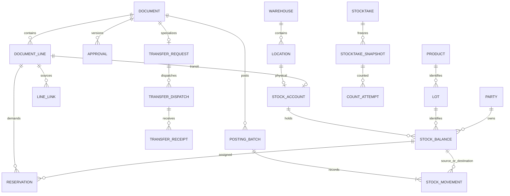

# WMSD — SQL Database, Business Flow and Document Proposal

> **Note:** The use of SQL (3NF relational model and reference DDL) in this document is strictly for **design purposes** (normalizing entities, clarifying relationships, defining integrity constraints, and specifying transaction flows); in **actual implementation**, the system will use **MongoDB**.

## 1. Warehouse terminology

| Term | Meaning and use in WMSD |
|---|---|
| WMS — Warehouse Management System | Manages physical warehouse operations, locations and quantities. It does not replace the entire sales/accounting system. |
| Warehouse / Location / Bin | A physical warehouse / a position within it / a storage slot or shelf. Receiving, usable storage and quarantine areas at one site are usually locations, not three separate warehouses. |
| SKU — Stock Keeping Unit | A product/specification identifier. One SKU can have several lots, tones and calibres. |
| Lot / Batch | A manufacturing or identified traceability batch. Proposed identity: product + manufacturer's lot code + tone + calibre. |
| Tone / Shade | The actual colour shade of a tile lot. Lots of the same design can have different tones. |
| Calibre | Actual manufacturing size group, distinct from nominal size such as 600 × 600 mm. Do not silently mix calibres for a construction project. |
| UoM — Unit of Measure | Piece, box or square metre. Tiles use pieces as the base stock unit; product conversion factors are versioned. |
| On-hand | Store-owned goods at physical warehouse locations, including good, pending, quarantined and staged stock. |
| Usable / Available | Usable stock meets quality and location conditions. Available stock is the eligible quantity still free for new demand after reservations and stocktake locks. |
| Reservation | Assigns specific on-hand stock to demand. It is not an issue; its link must follow goods when their location changes. |
| Allocation | Links demand to supply, including planned PO/transfer supply. It does not prove the goods are physically available for issue. |
| Receiving / Put-away | The inbound area / moving received goods to storage. Put-away does not increase total stock a second time. |
| Picking / Staging | Selecting the correct goods, lot and location / the dispatch preparation area. Picked stock remains on-hand until actual issue. |
| Quality / Quarantine | The condition of goods / the isolation area. One lot may contain 90 good pieces and 10 damaged pieces in different balances. |
| In-transit | Goods dispatched from the source warehouse whose destination receipt or resolution is incomplete. This is a transport condition, not a quality status. |
| Custody | Goods held for a customer or supplier that are not yet store-owned stock. Track physical presence separately from owned and available inventory. |
| Replenishment Request — RR | A request raised by Sales/Warehouse and reviewed by the Owner. It does not increase inventory. |
| Purchase Order — PO | An order prepared by the Accountant from approved demand, tracking ordered and supplier-confirmed quantities and multiple receipts. |
| Goods Receipt — GR | The inbound stock document. Use **“Goods Receipt”**, not “Good Receipt”. Posting records accepted store-managed quantities at the correct quality and location. |
| Goods Issue — GI / Post Goods Issue — PGI | The outbound document / the action posting actual issue. PGI deducts stock exactly once when goods are handed out. |
| Transfer Request — TR | In **WMSD**, a request between physical warehouses requiring Owner approval. In SAP WM, TR can mean *Transfer Requirement*, a different concept. |
| Transfer Order — TO | In **WMSD**, an internal warehouse task for put-away, picking, relocation, quarantine or unpicking. Its technical table is `warehouse_task`. It is not a second inter-warehouse approval. |
| Stock Transport Order — STO | The SAP example's order for stock transport between organizational units/warehouses. It differs from an internal WM TO. WMSD uses its approved TR and does not implement the complete SAP STO model. |
| Transfer Dispatch — TD | The source warehouse dispatch document. Posting decreases source stock and increases in-transit stock. |
| Multi-warehouse Transfer Receipt — MWTR | **A WMSD naming convention for an inter-warehouse transfer receipt.** Each receipt belongs to one destination warehouse and one source dispatch. It does not simultaneously increase several warehouses. The references do not establish this name as a universal WMS standard. |
| Handover / POD | Handover evidence / Proof of Delivery to the customer. Carrier handover does not itself prove customer delivery. |
| Stocktake / Snapshot / Cutoff | Physical counting / an immutable book-balance snapshot / the reconciliation reference time. |
| Recount / Adjustment / Disposition | Another count attempt / a stock variance correction / a decision on defective goods, such as continued isolation, supplier return or scrapping. |
| Posting / Reversal / Idempotency | Committing a stock-affecting event / a traceable reversing document / preventing repeated requests from posting twice. |
| FIFO | Prefer earlier receipts within compatible stock when picking. This is a physical selection rule, not an accounting cost valuation policy. |
| PK / FK / UNIQUE / CHECK / 3NF | Primary key / foreign key / uniqueness / data constraint / third normal form. SQL does not automatically mean Microsoft SQL Server. |

## 2. Proposal status, evidence and scope

Prepared **18 October 2026**, Vietnam time. This is a **design proposal for review**, not a customer-approved SRS. Equivalent Vietnamese version: [Vietnamese proposal](De_xuat_database_SQL_va_luong_chung_tu_VI.md). Accompanying DDL: [WMSD_SQL_schema.sql](WMSD_SQL_schema.sql). Editable mainflows: [VI and EN](../04_so_do/WMSD_Mainflows_SQL_VI_EN.drawio).

### 2.1 Sources reviewed and conflict resolution

| ID | Source | Use |
|---|---|---|
| S1 | [Seven-process proposal after review 1](../02_nghiep_vu/De_xuat_7_quy_trinh_sau_review1.md), 17 October 2026 | Proposed business baseline: BF-01–07, five roles, reduced sales scope and no direct MISA integration. |
| S2 | [Report 1 online](https://docs.google.com/document/d/1kb36v5HuFrM75NFCTXvnJcsg6QnPjYkb/edit), modified 17 October 2026, 16:26 Vietnam time | Tan Thuong single-store context, tiles, objectives and boundaries; read through Drive. |
| S3 | [Report 3 online](https://docs.google.com/document/d/1HvhlCmYjfXj7766ZVNUBAU4J063Lmr71/edit), modified 17 October 2026, 17:17 Vietnam time | Current 102-UC catalogue, actors, permissions, inventory and data rules; read through Drive. It currently specifies MongoDB. |
| S4 | [WMSD_Bangach.drawio](../04_so_do/WMSD_Bangach.drawio), **21 pages in the current file** | Reviewed BF01–06b, ERDs and the final two pages. BF03 contains a System lane; BF02/04/05/06a/06b contain WMSD lanes. The new diagrams remove them as requested. |
| S5 | [SAP WM I](../06_tham_khao/sap/Intro_S4HANA_Using_Global_Bike_Case_Study_WM_I_en_v4.1.pdf), [II](../06_tham_khao/sap/Intro_S4HANA_Using_Global_Bike_Case_Study_WM_II_en_v4.1.pdf), [III](../06_tham_khao/sap/Intro_S4HANA_Using_Global_Bike_Case_Study_WM_III_en_v4.1.pdf), [IV](../06_tham_khao/sap/Intro_S4HANA_Using_Global_Bike_Case_Study_WM_IV_en_v4.1.pdf) | Local **v4.1** set: I GR p.10, TO pp.18/21; II STO p.6, GI p.12, GR p.18, TO pp.26/29; III picking pp.14/19, shipping p.25; IV snapshot/count/recount/clearing pp.4/12/14/21/27. Do not reuse v4.2 page references from the older proposal. |
| S6 | [Process compilation](../06_tham_khao/quy_trinh/Tổng%20hợp%20quy%20trình.pdf), four pages | Handover documents and business context. Debt, payments and fleet management are not automatically added to the MVP. |
| S7 | [Reference links](../06_tham_khao/link_tham_khao.md) | Official MISA, Odoo and Microsoft guidance for concept comparison; WMSD-specific decisions are stated separately. |

Priority: the user's current requirements → S1 proposal → compatible S2/S3 requirements → supporting S4–S7 references. Replacing MongoDB with SQL requires changes to architecture, persistence, transactions, SRS interfaces, data rules, tests and deployment plans, not just renaming types. The original reports are not edited by this proposal.

### 2.2 Design decisions

1. Use a **3NF relational model**, with reference DDL targeting **PostgreSQL 16+** *(note: SQL is used here for design modeling and specifying data constraints, whereas the actual implementation will use **MongoDB**).* This is a concrete illustrative dialect, not a claim that version 16 is the newest release. A SQL Server implementation must adapt identity, timestamp, boolean, filtered indexes and locking syntax.
2. One store, multiple locations; enable inter-warehouse transfer only when at least two physical warehouses are confirmed. Do not add an unnecessary branch/company hierarchy.
3. WMSD handles externally referenced issue requests, not commercial SOs, selling prices, internal/tax invoices, payment collection or refund calculations in this MVP. The Accountant records external follow-up references.
4. No live MISA API. Manual entry/import requires unique source references and quantity validation. WMSD owns detailed physical warehouse events.
5. The stocktake MVP **freezes locations** from snapshot until resolution. It must not combine an old snapshot with unrestricted movements. S3's dynamic-count approach is a future alternative.
6. Keep five application roles: Owner, Sales, Warehouse, Accountant and Admin. Source/destination duties are warehouse-scoped responsibilities of Warehouse Staff, not additional application roles.

### 2.3 Required SRS changes

| Area | Current position → proposal |
|---|---|
| Database | MongoDB/ObjectId/Decimal128 → SQL PK/FK, NUMERIC, transactions and locking. |
| BF-01 | Sales/Warehouse raise demand; Accountant prepares PO after approval. |
| BF-03 | Separate same-warehouse and inter-warehouse movement before approval. Remove duplicate TR → approval → inter-warehouse TO; retain internal task TOs. |
| BF-04 | Owner plans; Warehouse counts/proposes; Owner approves and performs Clear Difference. |
| BF-05 | SO → Warehouse Issue Request; retain delivery, picking TO and PGI; remove billing. |
| BF-06 | Sales requests; Warehouse takes custody and inspects; Owner accepts after inspection; financial follow-up is separate. |
| BF-07 | Warehouse requests; Accountant records supplier agreement; Owner authorizes before dispatch or reuses an applicable BF-02 decision. |
| Diagrams | Actor lanes only; standardize Inventory Staff to Warehouse Staff. |

## 3. Document contract

### 3.1 Documents and stock-posting points

“Create” means creating a draft or case. “Post” means committing a confirmed business event. Printing/exporting a PDF does not post inventory. A record can have a document number and printable representation; every step does not require a separate PDF.

| Code | Document | Creator/confirmer | Required source | Stock effect at posting |
|---|---|---|---|---|
| RR | Replenishment request | Sales/Warehouse; Owner approves | Shortage, threshold or stocktake demand | None |
| PO | Purchase order | Accountant | Approved RR and authorized line quantities | None |
| ARR / INS | Arrival record / inspection | Warehouse | PO or appropriate return/transfer source | INS does not increase stock; ARR records presence/custody if ownership is unaccepted |
| GR-P | Purchase goods receipt | Warehouse | PO line, ARR and INS | Increases owned inventory at its actual quality/location; not automatically available |
| TO | Put-away/picking/relocation task | Warehouse | GR, delivery, TR or location-move need | Confirmation moves stock within one warehouse; total unchanged |
| TR | Transfer request | Warehouse; Owner approves | Demand and source/destination warehouses | None; approval can reserve source stock |
| TD | Transfer dispatch | Source Warehouse Staff | Approved TR | Source −q, in-transit +q |
| MWTR | Inter-warehouse transfer receipt | Independent destination Warehouse Staff | TD and its individual lines | In-transit −q, destination +q at actual quality |
| HO | Handover record | Warehouse; records recipient | TD, GI or custody release | Evidence only; no second deduction after TD/GI |
| WIR / OD | Issue request / delivery plan | Sales | External order line / WIR | None |
| GI-S | Customer goods issue | Warehouse | OD, actual picked and handed-over quantity | Staging −q at PGI |
| DC / DISP | Defect case / disposition decision | Warehouse proposes; Owner approves | Discovery event, source lines and evidence | Creating/reviewing the case does not reduce quantity |
| SCRAP | Destruction record and stock deduction | Warehouse | Approved DISP and destruction evidence | Quarantine −q actually destroyed |
| ST / COUNT | Stocktake session and count sheet | Owner plans; Warehouse counts | Scope and snapshot | None |
| ADJ | Adjustment proposal/document | Warehouse proposes; Owner approves/posts | Selected count attempt and snapshot | Approved delta only; no zero-quantity adjustment |
| CR / GR-CR | Customer return request / return receipt | Sales / Warehouse; Owner accepts | Original GI line or verified historical source | Increases owned stock only for accepted quantities |
| CUS-IN / CUS-OUT | Custody receipt/release | Warehouse | ARR or CR and actual owner | Custody ledger only; not store-owned stock |
| SR / GI-SR | Supplier return request / return issue | Warehouse; Accountant records agreement; Owner approves | Original GR/lot, agreement and authorization | GI-SR reduces owned stock; use CUS-OUT for supplier-owned custody |
| ACK / VAR | Supplier receipt acknowledgement / discrepancy | Accountant / Warehouse | Return issue or transfer line | No automatic stock change |
| REV | Reversal document | Authorized actor after resolution decision | Posted batch and reason | Controlled reversal with preserved history |

**TO and MWTR are not interchangeable.** The inter-warehouse chain is `approved TR → TD → MWTR → put-away TO`. Source picking TO is required only where staging is used; it does not add another Owner approval. MWTR is its own receipt type: **do not also create a GR-P for the quantity already received through MWTR**.

### 3.2 Cardinality and traceability

- One PO has multiple ARR and GR-P documents. One PO line can feed multiple receipt lines, lots and qualities. One delivery may be partly accepted and partly held in custody.
- One TR has multiple TDs. One TD has multiple MWTRs for partial receipts. MVP: each MWTR receives one TD; several TDs on one vehicle may share a handover/trip reference.
- One TD line has multiple MWTR lines; each MWTR line references exactly one TD line and cannot exceed its remaining in-transit quantity.
- One WIR has multiple ODs; one OD has multiple TOs and GI-S documents. Actual issued quantity comes from posted events, not requested quantity.
- One GI line can have multiple CR/GR-CR documents, but accepted returns plus open return claims cannot exceed eligible source quantity.
- **Line-level** links carry allocated quantities. Header-only PO/TR references cannot prevent over-receipt or over-issue.

### 3.3 States and edit permissions

| Object | Proposed lifecycle |
|---|---|
| RR/TR/CR/SR/ADJ request | DRAFT → SUBMITTED → APPROVED / REJECTED / REVISION_REQUIRED. Material edits increment the version and require approval of the changed scope. |
| PO/WIR/TR execution | OPEN → PARTIAL → COMPLETED; cancel only unexecuted remainder. Overall progress derives from lines and explicit remainder-cancellation decisions. |
| GR/TD/MWTR/GI/SCRAP | DRAFT → POSTED. Posted content is immutable; REVERSED requires a valid reversing batch. Never delete posted documents. |
| TO | OPEN → PARTIAL → CONFIRMED; cancel the unexecuted remainder. Each confirmation has its own operation key. |
| Stocktake | PLANNED → FROZEN → COUNTED → RECONCILING → APPROVED → POSTED/CLOSED. No difference can proceed directly to CLOSED. |
| Defect/discrepancy | OPEN → UNDER_REVIEW → RESOLVING → CLOSED when every quantity is resolved or linked to an accountable open follow-up case. |
| Return financial follow-up | NOT_RECORDED / PENDING_EXTERNAL / RECORDED_EXTERNAL, independent of warehouse completion. |

A human-readable number such as `TR-202610-000123` is separate from the bigint PK. Allocate numbers using a sequence or locked counter, not `MAX()+1`. Gaps caused by rollback are acceptable and do not indicate stock inconsistency.

## 4. Detailed BF-01–BF-07 flows

Each table specifies **actor → action → document created/updated → stock effect**. Automatic validation is a precondition/postcondition of an actor's operation, not a System lane.

### BF-01 — Replenishment, purchasing, receipt and put-away

| Step | Actor and action | Documents and links | Stock / progression rule |
|---|---|---|---|
| 1 | Sales/Warehouse reviews shortages, other warehouses and expected supply | RR and demand lines linked to WIR/alert | No increase; inbound plans reduce uncovered demand only when explicitly allocated |
| 2 | Owner approves or requests revision | Approval for the RR version and quantities | No PO from unapproved RR |
| 3 | Accountant creates PO and records supplier confirmation | PO lines; RR→PO line links; expected dates | No increase; changes beyond approved scope require review |
| 4 | Warehouse receives each delivery and inspects identity/quality | ARR; INS splits good/damaged/pending/rejected; VAR for discrepancies | Multiple arrivals per PO; custody tracking until ownership acceptance |
| 5 | Warehouse records store-accepted quantities | GR-P from INS/PO; CUS-IN for retained custody | GR-P adds GOOD/PENDING/DAMAGED at receiving/quarantine; immediately rejected goods do not create artificial receipt/issue |
| 6 | Warehouse creates and confirms put-away | TO-PUTAWAY linked to GR-P and actual locations | Receiving −q, storage +q; only eligible GOOD stock becomes available |
| 7 | Accountant reconciles; Owner approves undelivered-remainder closure if needed | PO–GR–supplier references; remainder decision | Shortage stays open; closing does not change stock |

Example: ordered 100 boxes, delivered 80; accept 75 good and responsibility for 3 damaged, reject 2 that immediately leave with the supplier. GR-P records 78 (=75 GOOD +3 DAMAGED); accepted fulfilment is 78 and outstanding quantity is 22 unless separately resolved. ARR records all 80. If the rejected 2 remain pending supplier collection, create CUS-IN for 2 without adding them to the 78 owned boxes. Replacement deliveries create new ARR/GR documents.

### BF-02 — Defects and quality disposition

| Step | Actor and action | Document | Stock / condition |
|---|---|---|---|
| 1 | Warehouse records a defect discovered during receiving, picking, counting, returns or routine checks | DC, source lines and evidence | Identify ownership as well as lot |
| 2 | Warehouse blocks allocation and isolates immediately | TO-QUARANTINE / quality movement | GOOD −q, DAMAGED/BLOCKED +q; total unchanged; release or replace affected reservations |
| 3 | Warehouse inspects and proposes outcomes by quantity | INS and DISP | Isolation does not transfer ownership |
| 4 | Owner approves release, regrade, supplier return or scrap | Approval and approval_line | Rejected proposals stay isolated; immediate blocking does not wait for approval |
| 5 | Warehouse executes the decision | Release/regrade movement, SCRAP or SR | Scrap deducts actual destruction; supplier return deducts only at BF-07 GI-SR |
| 6 | Warehouse reconciles and closes completed portions | DC linked to batches/SR | Combined outcomes cannot exceed the unresolved eligible quantity |

Release to GOOD needs reinspection evidence and approval. A discounted external selling price does not automatically make damaged goods GOOD. Do not change an entire lot's quality when only a subset is damaged.

### BF-03A — Movement within one warehouse

| Step | Actor and action | Document | Stock / condition |
|---|---|---|---|
| 1 | Warehouse chooses goods and source/destination locations | TO-RELOCATE | Same warehouse, sufficient quantity, neither location frozen |
| 2 | Warehouse physically moves and confirms actual quantity | TO confirmation/batch | Source −q, destination +q; preserve lot, quality and owner |
| 3 | Warehouse completes or continues the remainder | TO PARTIAL/CONFIRMED and history | Reservation follows goods; no RR/TR or Owner approval |

### BF-03B — Transfer between physical warehouses

| Step | Actor and action | Document | Stock / condition |
|---|---|---|---|
| 1 | Sales confirms the fulfilment option; Warehouse requests physical transfer | TR linked to demand | Direct customer dispatch from warehouse B uses BF-05 at B, without a fictitious receipt at A |
| 2 | Owner approves quantity/version | TR approval | Reserve source stock atomically; no second inter-warehouse TO approval |
| 3 | Source Warehouse picks and checks | Optional TO-PICK, draft TD | Picking moves stock to source staging only |
| 4 | Source Warehouse hands over and posts dispatch | TD and HO, dispatcher/time | Source −q, in-transit account for the **TD line** +q |
| 5 | Destination Warehouse independently inspects | INS, MWTR for actual quantities, VAR as needed | Receiver differs from dispatcher; reference the exact TD line |
| 6 | Destination Warehouse posts receipt and puts goods away | Posted MWTR and TO-PUTAWAY | In-transit −q received, destination receiving/quarantine +q; put-away does not receive twice |
| 7 | Warehouse proposes variance handling; Owner approves; Warehouse executes | VAR, approval, supplemental receipt/return-to-source/loss adjustment | Unverified remainder stays open; do not rewrite TD to match receipt |
| 8 | Destination Warehouse reconciles completion | Close TR/TD when all quantities are accounted for | No stock effect on closure |

**100–98–95–3–2 example:** A dispatches 100 boxes. B receives 98: 95 good and 3 damaged. After MWTR: A −100; B +95 GOOD and +3 DAMAGED; transit remains 2. If the Owner approves loss of 2, deduct 2 from transit through a separate resolution document. If found, a second MWTR receives them. Do not also post a GR for the 98, and do not classify the 3 physically received damaged boxes as missing.

Per TD line: `dispatched = received at destination + returned to source directly from transit + approved transit loss/scrap + remaining transit`. Goods already received and later sent back use a new TR/TD; do not retrospectively reduce the earlier shipment's received quantity. Excess or wrong-lot goods stay pending identification/custody and must not overdraw the TD or silently change lot.

### BF-04 — Stocktake and adjustment

| Step | Actor and action | Document | Stock / condition |
|---|---|---|---|
| 1 | Owner sets scope, schedule and counters | ST and stocktake_scope | MVP scope is locations; reconcile transit by documents rather than counting it as a shelf |
| 2 | Warehouse resolves in-progress work and activates the session | location_lock, snapshot and blind count sheet | Freeze scope then snapshot in one transaction; hide book quantities on count sheets |
| 3 | Warehouse records each count attempt | COUNT/count_attempt | Uncounted differs from zero; recounts append |
| 4 | Warehouse reconciles, explains and records unexpected stock | Variance record; flagged supplemental snapshot row | Unexpected balances use book=0 while original snapshot rows remain unchanged; unknown goods are not automatically GOOD |
| 5 | Warehouse proposes an adjustment if required | ADJ linked to selected count and delta | `delta = counted − book`; frozen scope prevents intervening movements |
| 6 | Owner approves and performs Clear Difference | Version-specific approval and ADJ batch | Post the delta once; physically present damage may require quality reclassification rather than quantity loss |
| 7 | Warehouse closes, or Owner closes through Clear Difference | ST CLOSED and lock release | No ADJ=0; unlock only after resolution or a traceable permitted cancellation |

Do not expire the freeze and continue using the old snapshot. To release a location urgently, cancel the unposted session with a reason, invalidate old proposals and unlock; the next stocktake needs a new snapshot. A partly posted session requires reconciliation of its remaining scope, not a blanket cancellation that silently reverses previous adjustments.

### BF-05 — Issue request, picking and handover

| Step | Actor and action | Document | Stock / condition |
|---|---|---|---|
| 1 | Sales enters demand from an external order | WIR, external reference/line/release key | Deduplicate source system + line + release; no financial SO |
| 2 | Sales chooses full/partial delivery, waiting or another warehouse | OD and allocation; RR/TR for shortages | No negative stock; retain confirmation for tone/calibre substitution |
| 3 | Warehouse reserves stock and assigns picking | Reservation and TO-PICK | Verified GOOD at eligible storage; do not reserve twice for the same demand through WIR and TR |
| 4 | Warehouse picks and confirms | TO confirmation; VAR/DC for shortages/damage | Bin −q, staging +q; move reservation; total stock unchanged |
| 5 | Warehouse performs final check and drafts issue | GI-S from OD/TO lines | Drafting/printing does not deduct inventory |
| 6 | Warehouse physically hands over and posts GI | Posted GI-S and HO | Staging −q; consume matching reservation; HO does not deduct again |
| 7 | Sales tracks the remainder; Accountant reconciles externally | WIR/OD status and external references | Complete after fulfilment or authorized remainder cancellation; no WMS invoice |

Failed handover before PGI leaves stock staged or generates TO-UNPICK. Keep the reservation for continuing demand, or release it when demand is cancelled. After PGI, physical returns require new receipt/inspection documents; cancelling WIR must not restore stock.

### BF-06 — Customer returns

| Step | Actor and action | Document | Stock / condition |
|---|---|---|---|
| 1 | Sales requests return; Accountant verifies historical sources if necessary | CR linked to original GI line or external historical line | Claim eligible source quantity to prevent overlapping returns |
| 2 | Warehouse takes physical custody pending decision | CUS-IN linked to CR, owner CUSTOMER | No increase to store-owned stock |
| 3 | Warehouse counts, verifies lot and classifies | INS separates GOOD/DAMAGED/PENDING and recommendation | Do not assign unverified goods to an eligible good lot |
| 4 | Owner accepts/rejects quantities after inspection | Approval and approval_line | Partial acceptance permitted, including damaged goods accepted for supplier claims |
| 5 | Warehouse receives accepted quantities | GR-CR from CR/INS/approval | Transfer customer custody → STORE ownership; GOOD to receiving, DAMAGED to quarantine |
| 6 | Warehouse puts away or returns rejected quantities | TO-PUTAWAY / CUS-OUT and HO | No second receipt; rejected custody release does not reduce STORE stock |
| 7 | Sales communicates outcome; Accountant records external handling | Warehouse completion and external references | No refund calculation/payment; financial status remains independent |

Example: hold 10 boxes; Owner accepts 7 good and 2 damaged, rejects 1 unverified-source box. STORE stock increases by 9: 7 eligible after put-away and 2 quarantined. Customer custody remains 1 until actual handback. Do not add 10 GOOD. Pre-go-live transactions use verified external source references, not fictitious historical GI postings.

### BF-07 — Supplier returns

| Step | Actor and action | Document | Stock / condition |
|---|---|---|---|
| 1 | Warehouse requests return with source and ownership | SR linked to GR/ARR/DC/GR-CR | Damaged stock is blocked; good stock proposed for return is reserved |
| 2 | Accountant records supplier agreement, quantities and collection date | Agreement on SR and evidence | Does not replace internal authorization |
| 3 | Owner authorizes before dispatch | SR approval or reusable DISP approval | Same version, source, decision scope and quantity; avoid duplicate BF-02 approval |
| 4 | Warehouse picks and hands over | Optional TO, GI-SR or CUS-OUT, HO | STORE: deduct once. Supplier custody: reduce custody only |
| 5 | Accountant records supplier receipt | ACK lines referencing dispatch | No second deduction; do not rewrite dispatch quantities to match ACK |
| 6 | Warehouse records discrepancies; Owner approves resolution | VAR and additional decision | Missing/damaged/rejected quantities remain open; goods increase on return only after physical receipt/inspection |
| 7 | Accountant reconciles externally; Owner closes | External references and closed SR | Closure does not deduct; compensation does not create physical quantities |

Supplier refusal does not release defective goods for sale. Replacement goods create a new receipt linked to SR. Ownership during supplier-return transport must be confirmed against the agreement. The MVP removes physically dispatched goods from warehouse-owned stock and tracks unacknowledged quantities in the return case; it does not implement financial valuation of supplier-return goods in transit.

## 5. Mainflows with actor lanes only

The accompanying file contains **16 pages**: eight flows × two languages, with BF-03 split into A/B. Lanes are Sales Staff, Warehouse Staff, Store Owner and Accountant; BF-03B distinguishes source/destination Warehouse Staff duties. Admin has no operational step, so no empty Admin lane is added. There are no System, WMSD, Database, API, MISA, Supplier, Customer or Carrier lanes.

Quick preview: [English inter-warehouse mainflow image](../04_so_do/WMSD_Mainflow_BF03B_EN.png). The draw.io file contains every flow; this image illustrates BF-03B only.

Activities use **“actor action — document”** labels. “Confirm receipt — GR-P” belongs to Warehouse Staff, with its stock effect specified as a postcondition; it does not need another “System update inventory” activity. Tables and §7 define automatic controls. External involvement is represented through actor work such as the Accountant recording supplier agreement or Warehouse Staff recording handover.

These are **summary swimlane mainflows**, not a claim of executable BPMN completeness. Rejection, revision, partial execution and variance branches are specified in §4; mainflows identify approval points and related-flow handoffs. Do not turn exceptions into extra actors or place database implementation detail on the business flow.

## 6. Relational design and data dictionary

### 6.1 SQL and normalization

- **1NF:** atomic values; no comma-separated product/lot/warehouse lists and no JSON line arrays as the transactional source of truth.
- **2NF:** complete composite keys on join tables, such as `(role_code, permission_code)` and `(user_id, warehouse_id)`.
- **3NF:** warehouse, product and supplier master data are referenced by FK. `document` is a supertype with 1:1 typed extensions, not an unconstrained `entity_type/entity_id` pair.
- Product-name, delivery-address and conversion snapshots intentionally preserve history. `stock_balance` is a controlled denormalized projection/cache updated atomically with the ledger and periodically reconciled.
- PKs use `BIGINT GENERATED ALWAYS AS IDENTITY`; quantities `NUMERIC(20,6)`, factors `NUMERIC(24,12)`, dates `DATE`, events `TIMESTAMP WITH TIME ZONE`. Exchange/store instants in UTC and display Asia/Saigon. Do not use FLOAT for stock quantities.
- Finite states and `snake_case` names. No cascade deletion of history. Deactivate master records with `active=false`; retain historical searchability.

### 6.2 Master data and authorization

| Table | Main keys/fields | Rule |
|---|---|---|
| `app_user` | user_id PK; username UNIQUE, display_name, credential_hash, active | Hash credentials; no plaintext |
| `app_role`, `user_role` | Role code; composite user-role PK | Five roles; multiple roles do not bypass self-approval restrictions |
| `permission`, `role_permission` | Permission code; role-permission PK | Operation-specific permissions; Admin has no implicit warehouse authority |
| `warehouse`, `user_warehouse` | warehouse_id, UNIQUE code; user-warehouse PK | Assigned warehouse scope |
| `location` | location_id, warehouse FK, code, kind, allocatable, active | UNIQUE(warehouse,code); only STORAGE may be allocatable |
| `party` | party_id, UNIQUE code, kind, contact | STORE/SUPPLIER/CUSTOMER/CARRIER; one STORE in MVP; not login accounts |
| `uom`, `product` | uom_code; product_id, UNIQUE sku, base_uom FK, whole_base_units | Tiles use PIECE; do not hard-code all products as tiles |
| `product_uom_version` | conversion_id, product, UoM, version, base_per_unit | UNIQUE(product,UoM,version); used versions are immutable |
| `product_warehouse_policy` | PK(product,warehouse), minimum_qty | Fixed replenishment threshold, not a general policy editor |
| `lot` | lot_id, product, manufacturer_lot, tone, calibre, identification_status | No stock total on lot; UNKNOWN cannot be allocated for sale |
| `quality_status` | quality_code | PENDING, GOOD, DAMAGED, BLOCKED; IN_TRANSIT is not quality |

### 6.3 Shared document model

| Table | Main fields/relationships | Purpose |
|---|---|---|
| `document` | document_id PK; document_no UNIQUE; kind, status, version, creator/timestamps | Stable document identity, lifecycle and version |
| `document_line` | line_id PK; document FK; UNIQUE(document,line_no); product, optional lot, conversion, entered/base quantities, snapshots | Planning lines can omit lot; posted lines require verified identity or explicitly blocked provisional lots |
| `document_link` | parent/child document IDs and relation_code PK | Header traceability with real FKs |
| `line_link` | source/target line IDs, relation_code, linked_qty | RR→PO, PO→GR, WIR→OD→GI, receipt→TO by quantity |
| `approval`, `approval_line` | UNIQUE(document,version,decision_kind); requester≠approver; line/quantity/outcome | Decisions and quantity ceilings, rather than one approved boolean |
| `evidence` | document FK, object_key, sha256, MIME, uploader/time | Private object references, not public URLs or base64 in transaction lines |
| `external_reference`, `document_external_reference` | UNIQUE(system,kind,number), document-reference join | MISA source, supplier documents and external resolution references |
| `external_reference_line` | reference and line_key UNIQUE per reference; product, eligible_qty | Line-level external source entitlement, verified by Accountant |

### 6.4 Business-specific tables

Header tables below use **`document_id` as both PK and FK to `document`**. Typed line tables use **`line_id` as PK/FK to `document_line`**. Supertype/subtype storage does not create two document numbers for one receipt.

| Group | Tables and important attributes |
|---|---|
| BF-01 | `replenishment_request`: warehouse, needed_on, trigger_reason. `purchase_order`: supplier, receiving warehouse, expected date, supplier_confirmation. `arrival`: warehouse, optional supplier, arrived_at, delivery_reference. |
| Shared inspection | `inspection_line`: inspected_source_line, quality, ownership_decision, inspector/time. Split quantities with different quality/ownership outcomes. |
| Purchase/customer-return receipt | `goods_receipt`: warehouse, PURCHASE/CUSTOMER_RETURN kind; line sources through line_link. |
| BF-03 | `transfer_request`: different source/destination warehouses. `transfer_dispatch`: request FK, dispatcher/time. `transfer_receipt`: dispatch FK, receiver/time. `transfer_receipt_line`: dispatch_line FK and quality. |
| Handover | `handover`: related document FK, recipient_name, optional carrier, time, confirmer; evidence through evidence table. |
| BF-05 | `issue_request`: customer, requested warehouse, needed date, address snapshot. `issue_request_line`: external line FK, release_key UNIQUE per external line, requested tone/calibre and substitution confirmation. `outbound_delivery`: WIR FK, one warehouse and planned date. `goods_issue`: warehouse, SALE/SUPPLIER_RETURN. |
| Warehouse tasks | `warehouse_task`: warehouse, kind, assignee. `warehouse_task_line`: source/destination locations and quality; both locations belong to the task warehouse. |
| BF-02 | `defect_case`: discovered_at, reason. `disposition_line`: defect_line, outcome, approval. SCRAP uses document/line and links to DISP. |
| BF-06 | `customer_return`: customer, warehouse, separate financial status. `customer_return_line`: original GI line **or** verified external historical line, reason; exclusive source choice. |
| BF-07 | `supplier_return`: supplier, warehouse, agreement, financial status. `supplier_return_line`: origin_line, owner_party, agreed_qty, authorization. `supplier_ack_line`: dispatch_line, outcome, acknowledgement time. |
| Shared discrepancies | `discrepancy_line`: source_line, SHORT/OVER/DAMAGED/WRONG_LOT/WRONG_PRODUCT, status, resolution document. |

`SUPPLIER_ACK`, `CUSTODY_RECEIPT`, `CUSTODY_RELEASE`, `HANDOVER`, `REVERSAL`, `SCRAP` and `OPENING` are document kinds. A separate empty header table is unnecessary when a kind has no special attributes. Each document has relational lines, not an embedded array. Services must additionally verify source document kinds and product/lot compatibility: an existing FK does not establish business eligibility.

### 6.5 Inventory, reservations and ledger

| Table | Keys/fields | Invariant |
|---|---|---|
| `stock_account` | account_id; **location_id XOR transit_dispatch_line_id**, each UNIQUE | Either a physical bin or transit dedicated to one TD line; do not assign transit to a fictitious destination bin |
| `stock_balance` | balance_id; UNIQUE(account,lot,quality,owner_party); qty≥0; version | Non-null dimensions prevent duplicate logical balances caused by NULL semantics |
| `posting_batch` | batch_id, document; UNIQUE idempotency_key; UNIQUE(document,operation,operation_key); payload_hash; actor/time; UNIQUE reversal_of | One batch per business execution; same key with different payload is rejected |
| `stock_movement` | batch, document line, optional from/to balances, q>0, before/after | At least one endpoint; two for movement, one for entering/leaving the tracked scope |
| `reservation` | demand_line, execution_line, balance, qty, ACTIVE/CONSUMED/RELEASED | Sum ACTIVE ≤ balance quantity; follow goods and avoid duplicate claims for one demand |
| `demand_supply_allocation` | PK(demand_line,supply_line), qty, status | Planned PO/TD supply assigned to demand; not available before eligible receipt |
| `audit_event`, `outbox_event` | actor/action/time; UNIQUE event_key, attempts, delivered_at | Written with the business transaction; notifications after commit do not roll back stock |

Owned stock is all balances whose owner party is STORE. Physical warehouse-owned stock is the owned balance at that warehouse's locations. Transit is owned balance with a transit_dispatch_line_id. Custody has another owner and is reported separately.

`available_stock` includes only GOOD, VERIFIED-lot stock with active product/warehouse/location at an allocatable location outside a stocktake freeze, less ACTIVE reservations on that balance. Reserved staging/transit goods stay assigned to their demand but are **not free supply for new demand**.

The ledger uses positive movements with from/to endpoints; `inventory_ledger` exposes signed quantity entries. This is a **quantity ledger**, not a monetary general ledger. Within a consistent ownership scope, `closing = opening + sum(delta)`. Location/quality changes have equal opposing entries; custody→STORE changes ownership without increasing physical presence.

### 6.6 Stocktake model

| Table | Content |
|---|---|
| `stocktake` | document_id, warehouse, cutoff, completion, mode=FROZEN |
| `stocktake_scope` | PK(stocktake_id,location_id), count scope |
| `location_lock` | location_id PK, stocktake FK; at most one active freeze per location |
| `stocktake_snapshot` | UNIQUE(stocktake,balance), book_qty, found_after_cutoff; original rows immutable |
| `count_attempt` | UNIQUE(snapshot,attempt_no), counted_qty≥0, counter/time; absent record means uncounted |
| `adjustment_line` | line_id, selected count_id, nonzero signed delta, approval_id once approved |

Adjustment lines carry a signed delta; document_line.qty_base is its absolute value. Quality reclassification links negative/positive deltas in the same case to preserve total quantity. Unexpected goods must belong to an already frozen location. Scope expansion needs additional locking and snapshot capture before counting, not arbitrary post-cutoff location additions.

### 6.7 Condensed ERD

This diagram shows the main structure; the DDL contains the complete columns, FKs, join tables and subtypes.



## 7. Required constraints and transactions

### 7.1 What the DDL does and does not enforce

The DDL provides PK/FK/UNIQUE constraints, exact numeric types, local CHECKs, exclusive source choices, quantity before/after checks and indexes. **It is not a complete operational backend:** posting services/procedures, authorization, immutability triggers and APIs are not supplied. Do not pretend a row-level CHECK enforces aggregate cross-row rules. PostgreSQL documents this distinction. [PostgreSQL constraints](https://www.postgresql.org/docs/16/ddl-constraints.html).

| ID | Required rule | Implementation enforcement |
|---|---|---|
| R-01 | No negative balance or excess reservation | Lock balance; sum ACTIVE reservations inside transaction; CHECK qty≥0 is the final guard |
| R-02 | Correct warehouse, bin, lot, product and owner | FKs plus subtype/location/source checks; prohibit dimension changes on balances with history |
| R-03 | No receipt/issue/return beyond eligible source | Lock source line; aggregate committed batches, reservations/open claims and valid cancellations/reversals |
| R-04 | MWTR matches TD, TR and destination | Validate receipt.dispatch, receipt-line source and warehouse authority; quantity ≤ remaining transit |
| R-05 | Correct approved version and quantities | Validate approval document/version/line/outcome; material changes invalidate prior authorization |
| R-06 | No self-approval; independent transfer receipt | Compare actual actor with creator/requester; receiver≠dispatcher; do not trust client-supplied requester |
| R-07 | No duplicate posting | Both posting_batch unique keys and payload hash; stable business operation key, not a fresh random key on each click |
| R-08 | Immutable posted history | Restrict DML; one posting service/procedure path; triggers protect ledger/snapshot/approval/posted sources; audit administrative changes |
| R-09 | No movements entering a frozen count | All posting locks the same location rows before checking location_lock; activation follows the same protocol |
| R-10 | Custody excluded from STORE inventory | Check balance owner; acceptance requires a documented ownership movement, not editing the party master |
| R-11 | Correct conversions and granularity | Snapshot factor; enforce integer quantities for whole_base_units; request actual pieces/boxes when m² conversion is fractional |
| R-12 | Ledger/balance and batch consistency | batch.document_id=movement.document_id; balance deltas equal movement and before/after; no standalone balance updates |

For tiles with 4 pieces/box and 0.36 m²/piece, 3 boxes +2 pieces =14 pieces =5.04 m². Preserve the entry as separate unit components/lines. Do not rely on “3.5 boxes” without the underlying piece quantity. Square metres may express demand/display; actual issue must respect product granularity. Future conversion versions must not recalculate history.

### 7.2 Posting protocol

```text
BEGIN
1. Authenticate; check role + operation + warehouse + current state.
2. Check idempotency key and payload hash; return prior committed result on retry.
3. Lock documents, source lines, locations and balances in a consistent order.
4. Recheck version, approval, stocktake freeze, eligible source and remaining quantity.
5. Insert posting_batch and movements; update balances/reservations atomically.
6. Update progress/state; append audit and outbox events.
COMMIT
7. Notify/render from committed snapshots; notification failure does not change stock.
```

Use a consistent global lock order: ascending document/source IDs → ascending location IDs → ascending balance IDs. If a destination balance does not exist, create it through a unique-key-safe insert/upsert and then lock it; `SELECT FOR UPDATE` cannot lock an absent row. Lock both physical endpoints. Stocktake activation locks the same location rows before creating its freeze/snapshot; otherwise movement can slip between a lock check and update. Retry deadlock/serialization failures using the same idempotency key. [PostgreSQL explicit locking](https://www.postgresql.org/docs/16/explicit-locking.html).

### 7.3 Transfer transaction example

Dispatch 400 pieces from A: `movement(A_GOOD → TRANSIT_TD_LINE,400)`. Receive 380 good and 12 damaged using two movements: `TRANSIT→B_RECEIVING_GOOD,380` and `TRANSIT→B_QUARANTINE_DAMAGED,12`. Eight pieces remain in transit. All lines of one MWTR commit in one batch/transaction; a failed line must not leave a half-posted receipt. A second MWTR can handle the later remainder.

### 7.4 Reversals, corrections and remainder closure

Reverse an entire batch only if no dependent downstream operation exists and all affected endpoints remain eligible with sufficient stock. UNIQUE reversal_of prevents two full reversals. Create a new reversing batch/movements; never overwrite the original. Partial corrections or cases with downstream activity require explicit adjustment/return documents rather than unrestricted full reversal. Cancelling an unexecuted PO/WIR/TR remainder must record the quantity/decision and release corresponding reservations/allocations without reducing plans below posted quantities.

## 8. Authorization and reporting

| Action | Sales | Warehouse | Accountant | Owner | Admin |
|---|---:|---:|---:|---:|---:|
| Create RR | Yes | Yes | No | View/approve | No |
| PO, supplier agreement, external financial references | Related view | Receiving view | Yes | View/review when required | No |
| GR, TO, TD, MWTR, GI | No | Assigned warehouse | Reconcile | View | No |
| WIR, OD, proposed CR | Yes | Warehouse execution | Verify sources | Approve CR | No |
| Immediate isolation and disposition proposal | No | Yes | Reconcile | Approve disposition | No |
| Count and propose ADJ | No | Yes | Reconcile | Plan, approve/post ADJ | No |
| Technical permission administration | No | No | No | As explicitly specified | Yes |

This is the core operation matrix, not a grant of additional master-data privileges. Source/destination scope is checked by actual user and warehouse assignment. Multiple roles do not permit self-approval. Reports and evidence downloads inherit the same access scope as operational screens. Sales does not receive costs or unrestricted quarantine visibility; Accountants trace only their authorized document chains.

Required reports: owned stock by warehouse/bin/lot/quality; available/reserved; custody by owner; transit by TD and age; outstanding PO/WIR demand; transfer/count/supplier-return discrepancies; external source→WIR/PO→GR/GI→return/adjustment traceability. Reconcile `SUM(inventory_ledger.delta)` against stock_balance regularly, including OPENING postings. Do not initialize balances by bypassing the ledger.

## 9. Design acceptance scenarios

| ID | Scenario | Required result |
|---|---|---|
| T01 | PO receives 78/100 including 3 damaged; 2 rejected | ARR80, owned78, usable≤75 after put-away, outstanding22 |
| T02 | Retry GR with same key, or fresh key for same operation_key | One batch; same key/different payload conflicts |
| T03 | Concurrent reservations of 60 and 50 against100 | Total cannot exceed100; later transaction revalidates |
| T04 | Relocation or picking TO | Owned total unchanged; reservation follows location |
| T05 | TD100; MWTR95GOOD+3DAMAGED | Transit2; destination98; only95 eligible after put-away |
| T06 | Another MWTR3 when transit2 remains | Reject; excess recorded separately, no negative transit |
| T07 | Dispatcher confirms destination receipt | Deny even with WAREHOUSE role at both warehouses |
| T08 | Return10; accept7good+2damaged, reject1 | Owned+9, custody1 until handback; not usable+10 |
| T09 | Return supplier-owned custody goods | Custody decreases; STORE quantity unchanged |
| T10 | Two SR/disposition cases target the same damaged quantity | Combined execution cannot exceed unresolved eligible stock |
| T11 | Snapshot20, count18, Owner approves−2 | Post−2 once; never overwrite current stock with a stale count |
| T12 | Missing count versus zero count | Distinct states; blank does not imply total shortage |
| T13 | Posting races stocktake activation | Serialized boundary; snapshot includes preceding committed movements |
| T14 | Packaging changes from4 to5pieces/box | Old documents retain4; new documents use the new version |
| T15 | Email fails after PGI | GI/stock remain committed; outbox retries without another PGI |
| T16 | Edit posted lot/tone/document | Block; use an appropriate correction and audit |
| T17 | Stocktake finds no difference | Close/unlock; no ADJ0 |
| T18 | Historical sale has no WMS GI | CR references verified external history; no fictitious GI |

These are **acceptance criteria**, not a claim that a complete backend has passed them. DDL and diagrams are checked separately; implement posting services and execute concurrency/integration tests before operational use.

**Artifact verification on 18 October 2026:** DDL successfully created 63 tables and two views on PostgreSQL 18.6 through PGlite 0.5.10. Twenty-one schema/query/illustrative-transaction checks passed, including FKs, negative/duplicate balances, self-approval, duplicate posting keys and the TD100/MWTR98 example. PostgreSQL 16 was not separately exercised; authorization services and multi-connection concurrency were not tested. All 16 draw.io pages were exported to PNG for visual review; the validator reported zero errors/warnings and all lane names represent actors. Both language versions share ten main sections, cover all 63 table names and have no missing internal file links.

## 10. Implementation order and decisions to confirm

Suggested order: master/roles/scope → documents/lines/approvals → ledger/posting/idempotency → BF-01 and TO → BF-05 → BF-03 → BF-02/06/07 → BF-04 → reporting/reconciliation. Include tone/calibre differences, partial receipts, custody and transit in early sample data.

Confirm before SRS sign-off: final DBMS, actual warehouse count, independent transfer receivers, acceptance of damaged goods and ownership responsibility, unit granularity, feasible count-freeze duration, substitution policy, historical-source verification, printable forms and numbering. This proposal selects a working baseline without presenting those outstanding business choices as validated survey findings.

### Online references and limits

- [MISA eShop warehouse transfer](https://helpeshop.misa.vn/kb/huong-dan-cach-chuyen-kho-tren-phan-mem-misa-eshop) distinguishes same-branch warehouse transfers from inter-branch transfer issues; WMSD uses separate dispatch/receipt checkpoints for its own requirements.
- [Odoo 18 three-step receipt](https://www.odoo.com/documentation/18.0/applications/inventory_and_mrp/inventory/shipping_receiving/daily_operations/receipts_three_steps.html) illustrates input, quality and stock separation; WMSD does not copy every Odoo configuration step.
- [Microsoft transfer order receiving](https://learn.microsoft.com/en-us/dynamics365/supply-chain/warehousing/configure-transfer-order-receiving-process) illustrates separation of transfer receipt and background processing; Dynamics financial configuration is not WMSD scope.

Table names, the MWTR code, the document supertype, TD-line transit accounts and the transaction protocol are **design proposals in this document**, not verbatim SAP/MISA/Odoo/Microsoft data models. Tax/invoice references are not used to provide legal guidance in this warehouse proposal.
