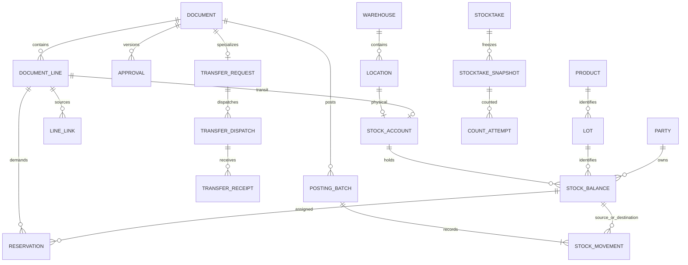

# WMSD — Đề xuất database SQL, luồng nghiệp vụ và chứng từ

## 1. Thuật ngữ quản lý kho

| Thuật ngữ | Nghĩa và cách dùng trong WMSD |
|---|---|
| WMS — Warehouse Management System | Hệ thống quản lý thao tác vật lý, vị trí và số lượng hàng trong kho. Không thay thế toàn bộ phần mềm bán hàng/kế toán. |
| Warehouse / Location / Bin | Kho vật lý / vị trí trong kho / ô hoặc kệ chứa. Khu nhận, kệ bán được và khu cách ly trong một địa điểm thường là các location, không phải ba warehouse. |
| SKU — Stock Keeping Unit | Mã mặt hàng/quy cách; cùng SKU vẫn có thể có nhiều lô, tone và calibre. |
| Lot / Batch | Lô sản xuất hoặc lô được nhận dạng để truy xuất. Khóa nhận dạng đề xuất: sản phẩm + mã lô nhà sản xuất + tone + calibre. |
| Tone / Shade | Sắc độ/mã màu thực tế của lô gạch. Hai lô cùng mẫu có thể khác tone. |
| Calibre | Nhóm kích thước thực tế sau sản xuất; khác với kích thước danh nghĩa, ví dụ 600 × 600 mm. Không tự trộn calibre khi đáp ứng công trình. |
| UoM — Unit of Measure | Đơn vị tính: viên, thùng, m². Gạch dùng viên làm đơn vị tồn chuẩn; hệ số quy đổi có phiên bản theo sản phẩm. |
| On-hand | Hàng thuộc cửa hàng đang ở các vị trí vật lý của kho; bao gồm hàng đạt, chờ kiểm, cách ly và staging. |
| Usable / Available | Usable: đủ điều kiện chất lượng và vị trí. Available: phần đủ điều kiện còn rảnh để cấp cho nhu cầu mới sau khi trừ giữ hàng và khóa kiểm kê. |
| Reservation | Giữ một lượng tồn cụ thể cho nhu cầu. Chưa phải xuất kho; khi chuyển vị trí phải chuyển liên kết giữ hàng theo. |
| Allocation | Liên kết nhu cầu với nguồn đáp ứng. Có thể là nguồn dự kiến từ PO/điều chuyển; không đồng nghĩa đã có hàng để xuất. |
| Receiving / Put-away | Khu tiếp nhận / thao tác đưa hàng từ khu tiếp nhận vào vị trí lưu trữ. Put-away không nhập tăng tổng tồn lần nữa. |
| Picking / Staging | Soạn đúng hàng, lô, vị trí / khu tập kết chờ bàn giao. Hàng đã picking vẫn ở trong tồn kho đến khi thực xuất. |
| Quality / Quarantine | Chất lượng hàng / khu cách ly. Một lô có thể đồng thời có 90 viên đạt và 10 viên hỏng ở các số dư khác nhau. |
| In-transit | Hàng đã xuất khỏi kho nguồn, chưa hoàn tất nhận/giải quyết tại kho đích. Đây là trạng thái vận chuyển, không phải chất lượng. |
| Custody | Hàng giữ hộ khách/NCC, chưa thuộc tồn của cửa hàng. Theo dõi vật lý nhưng loại khỏi tồn sở hữu và khả dụng. |
| Replenishment Request — RR | Đề nghị bổ sung hàng do Sales/Warehouse lập, Owner duyệt. Chưa làm tăng tồn. |
| Purchase Order — PO | Đơn đặt mua do Accountant lập từ nhu cầu đã duyệt; theo dõi số đặt, NCC xác nhận và nhiều đợt nhận. |
| Goods Receipt — GR | **Phiếu nhập kho**; tên tiếng Anh chuẩn dùng trong tài liệu là “Goods Receipt”, không dùng “Good Receipt”. Post GR ghi tăng lượng được cửa hàng nhận quản lý, đúng chất lượng và vị trí. |
| Goods Issue — GI / Post Goods Issue — PGI | Phiếu xuất / hành động ghi nhận xuất thực tế. PGI làm giảm lượng tồn đúng một lần khi bàn giao ra ngoài. |
| Transfer Request — TR | Trong **WMSD**: đề nghị chuyển giữa hai kho vật lý, cần Owner duyệt. Trong SAP WM, TR có thể là *Transfer Requirement*, nghĩa khác; không dịch hai khái niệm thành một. |
| Transfer Order — TO | Trong **WMSD**: phiếu giao việc nội kho, gồm put-away, picking, relocation, quarantine, unpick. Bảng kỹ thuật gọi `warehouse_task`. Không phải một lần duyệt liên kho thứ hai. |
| Stock Transport Order — STO | Lệnh điều chuyển giữa các đơn vị/kho trong ví dụ SAP; khác TO thao tác nội kho. WMSD dùng TR đã duyệt để điều phối, không triển khai toàn bộ STO của SAP. |
| Transfer Dispatch — TD | Phiếu xuất điều chuyển nguồn. Post TD: giảm kho nguồn, tăng in-transit. |
| Multi-warehouse Transfer Receipt — MWTR | **Tên quy ước của đề xuất WMSD cho phiếu nhập điều chuyển liên kho**. Mỗi phiếu nhận thuộc một kho đích và một đợt xuất nguồn; không phải phiếu cộng tồn đồng thời ở nhiều kho. Nguồn tham khảo không chứng minh đây là thuật ngữ chuẩn chung của mọi WMS. |
| Handover / POD | Biên bản bàn giao / bằng chứng khách đã nhận (*Proof of Delivery*). Bàn giao cho nhà vận chuyển chưa chứng minh khách đã nhận. |
| Stocktake / Snapshot / Cutoff | Kiểm kê / ảnh chụp số dư bất biến / thời điểm chốt sổ phục vụ đối chiếu. |
| Recount / Adjustment / Disposition | Đếm lại / điều chỉnh chênh lệch tồn / quyết định xử lý hàng lỗi, ví dụ cách ly tiếp, trả NCC, hủy. |
| Posting / Reversal / Idempotency | Ghi nhận có tác động tồn / chứng từ đảo có dấu vết / cùng yêu cầu lặp lại không được ghi nhận hai lần. |
| FIFO | Ưu tiên hàng nhận trước trong tập hàng tương thích để soạn. Đây là quy tắc xuất vật lý, không lựa chọn phương pháp tính giá vốn kế toán. |
| PK / FK / UNIQUE / CHECK / 3NF | Khóa chính / khóa ngoại / duy nhất / ràng buộc dữ liệu / chuẩn hóa dạng chuẩn ba. SQL là ngôn ngữ và họ hệ quản trị quan hệ; “SQL” không mặc nhiên có nghĩa Microsoft SQL Server. |

## 2. Trạng thái đề xuất, căn cứ và phạm vi

Ngày lập: **18/10/2026**, giờ Việt Nam. Đây là **phương án thiết kế để nhóm review**, chưa phải SRS đã được cửa hàng phê duyệt. Bản tiếng Anh tương ứng: [English proposal](De_xuat_database_SQL_va_luong_chung_tu_EN.md). DDL đi kèm: [WMSD_SQL_schema.sql](WMSD_SQL_schema.sql). Mainflow chỉnh sửa được: [VI và EN](../04_so_do/WMSD_Mainflows_SQL_VI_EN.drawio).

### 2.1 Nguồn đã đọc và cách xử lý mâu thuẫn

| Mã | Nguồn | Cách áp dụng |
|---|---|---|
| S1 | [Đề xuất 7 quy trình sau review 1](../02_nghiep_vu/De_xuat_7_quy_trinh_sau_review1.md), 17/10/2026 | Baseline nghiệp vụ đề xuất: BF-01–07, năm role, thu hẹp bán hàng, không tích hợp MISA trực tiếp. |
| S2 | [Report 1 trực tuyến](https://docs.google.com/document/d/1kb36v5HuFrM75NFCTXvnJcsg6QnPjYkb/edit), modified 17/10/2026 16:26 giờ Việt Nam | Bối cảnh một cửa hàng Tân Thương, hàng gạch, mục tiêu và giới hạn; đọc qua Drive. |
| S3 | [Report 3 trực tuyến](https://docs.google.com/document/d/1HvhlCmYjfXj7766ZVNUBAU4J063Lmr71/edit), modified 17/10/2026 17:17 giờ Việt Nam | Catalogue 102 UC, actor, quyền, nguyên tắc tồn và dữ liệu; đọc qua Drive. Báo cáo hiện yêu cầu MongoDB. |
| S4 | [WMSD_Bangach.drawio](../04_so_do/WMSD_Bangach.drawio), **21 trang trong file hiện tại** | Kiểm tra BF01–06b, ERD và hai trang cuối. Trang BF03 có lane System; BF02/04/05/06a/06b có lane WMSD. Sơ đồ mới bỏ các lane này theo yêu cầu. |
| S5 | [SAP WM I](../06_tham_khao/sap/Intro_S4HANA_Using_Global_Bike_Case_Study_WM_I_en_v4.1.pdf), [II](../06_tham_khao/sap/Intro_S4HANA_Using_Global_Bike_Case_Study_WM_II_en_v4.1.pdf), [III](../06_tham_khao/sap/Intro_S4HANA_Using_Global_Bike_Case_Study_WM_III_en_v4.1.pdf), [IV](../06_tham_khao/sap/Intro_S4HANA_Using_Global_Bike_Case_Study_WM_IV_en_v4.1.pdf) | Bộ **v4.1** trong repo: I GR tr.10, TO tr.18/21; II STO tr.6, GI tr.12, GR tr.18, TO tr.26/29; III picking tr.14/19, ship tr.25; IV snapshot/đếm/đếm lại/clear tr.4/12/14/21/27. Không tái dùng số trang v4.2 từ đề xuất cũ. |
| S6 | [Tổng hợp quy trình](../06_tham_khao/quy_trinh/Tổng%20hợp%20quy%20trình.pdf), 4 trang | Tham khảo chứng từ giao nhận và bối cảnh; phần công nợ/thanh toán/xe không tự trở thành phạm vi MVP. |
| S7 | [Các link tham khảo](../06_tham_khao/link_tham_khao.md) | Dùng hướng dẫn chính thức MISA, Odoo, Microsoft để đối chiếu khái niệm; các quyết định riêng của WMSD được mô tả dưới đây. |

Thứ tự áp dụng: yêu cầu mới của người dùng → phương án S1 → yêu cầu còn tương thích trong S2/S3 → tham khảo S4–S7. Không coi việc đổi MongoDB sang SQL là “sửa cách viết kiểu dữ liệu” đơn thuần: cần cập nhật kiến trúc, persistence, transaction, SRS phần interfaces, DR, kiểm thử và kế hoạch triển khai. Không sửa các report gốc trong bộ đề xuất này.

### 2.2 Quyết định thiết kế

1. Dùng **mô hình quan hệ 3NF**, DDL tham chiếu chạy trên **PostgreSQL 16+**; đây là lựa chọn minh họa cụ thể, không khẳng định PostgreSQL 16 là bản mới nhất. Nếu chọn SQL Server, chuyển identity, timestamp, boolean, filtered index và cơ chế khóa theo dialect tương ứng.
2. Một cửa hàng, nhiều location, chỉ bật liên kho khi có ít nhất hai kho vật lý đã xác nhận. Không thêm branch/company hierarchy chưa cần thiết.
3. WMSD quản lý yêu cầu xuất có mã nguồn, không tạo SO thương mại, giá bán, hóa đơn nội bộ/thuế, thu tiền hoặc tính hoàn tiền trong MVP này. Accountant lưu tham chiếu xử lý bên ngoài.
4. Không live API MISA. Import/nhập tay có mã nguồn duy nhất và kiểm tra lượng; WMS là nguồn chi tiết thao tác kho.
5. Kiểm kê MVP **khóa theo location** từ snapshot đến khi hoàn tất xử lý; không vừa dùng snapshot cũ vừa cho xuất tự do. Phương án đếm động của S3 là thay đổi tương lai.
6. Giữ năm application roles: Owner, Sales, Warehouse, Accountant, Admin. Nguồn/đích là hai trách nhiệm theo kho của Warehouse Staff, không phải hai role mới.

### 2.3 Các thay đổi phải phản ánh trong SRS

| Nội dung | Hiện tại → đề xuất |
|---|---|
| Database | MongoDB/ObjectId/Decimal128 → SQL PK/FK, NUMERIC, transaction và locking. |
| BF-01 | Sales/Warehouse tạo nhu cầu; Accountant lập PO sau duyệt. |
| BF-03 | Phân loại cùng kho/liên kho trước duyệt; bỏ TR → duyệt → TO liên kho lặp lại; giữ TO thao tác nội kho. |
| BF-04 | Owner tạo phiên; Warehouse đếm/đề nghị; Owner duyệt và Clear Difference. |
| BF-05 | SO → Warehouse Issue Request; vẫn giữ delivery, picking TO và PGI; bỏ bước billing. |
| BF-06 | Sales tạo đề nghị; kho giữ hộ và kiểm; Owner quyết định nhận sau kiểm; tài chính theo dõi riêng. |
| BF-07 | Warehouse đề nghị; Accountant ghi thỏa thuận NCC; Owner duyệt trước xuất hoặc dùng quyết định BF-02 phù hợp. |
| Sơ đồ | Chỉ actor lanes; cập nhật tên Inventory Staff thành Warehouse Staff. |

## 3. Hợp đồng chứng từ

### 3.1 Bộ chứng từ và thời điểm tác động tồn

“Tạo” chỉ tạo bản nháp hoặc hồ sơ. “Post” là commit nghiệp vụ đã xác nhận. In/xuất PDF không tự post. Biên bản có thể là dữ liệu có mã và bản in; không bắt mỗi bước phải có một PDF độc lập.

| Mã | Chứng từ | Người lập/xác nhận | Nguồn bắt buộc | Tác động tồn khi post |
|---|---|---|---|---|
| RR | Đề nghị bổ sung | Sales/Warehouse; Owner duyệt | Nhu cầu thiếu/ngưỡng/kiểm kê | Không |
| PO | Đơn đặt mua | Accountant | RR đã duyệt và dòng lượng được duyệt | Không |
| ARR / INS | Biên bản tiếp nhận / kiểm nhận | Warehouse | PO hoặc nguồn trả/điều chuyển phù hợp | INS không tự tăng tồn; ARR chỉ ghi hiện diện/giữ hộ nếu chưa nhận sở hữu |
| GR-P | Goods Receipt mua hàng | Warehouse | Dòng PO, ARR, INS | Tăng tồn sở hữu đúng lượng được nhận, không tự tăng khả dụng |
| TO | Put-away / Picking / Relocation task | Warehouse | GR, delivery, TR hoặc yêu cầu chuyển vị trí | Confirm chuyển vị trí cùng kho; tổng tồn không đổi |
| TR | Transfer Request | Warehouse; Owner duyệt | Nhu cầu, kho nguồn, kho đích | Không; có thể giữ hàng nguồn sau duyệt |
| TD | Transfer Dispatch | Warehouse kho đi | TR đã duyệt | Nguồn −q, in-transit +q |
| MWTR | Phiếu nhập điều chuyển | Warehouse kho nhận độc lập | TD và từng dòng TD | In-transit −q, đích +q theo chất lượng |
| HO | Biên bản bàn giao | Warehouse; ghi người nhận | TD, GI hoặc phiếu trả giữ hộ | Bằng chứng; không ghi giảm lần nữa nếu TD/GI đã post |
| WIR / OD | Yêu cầu xuất / kế hoạch đợt giao | Sales | Dòng đơn nguồn bên ngoài / WIR | Không |
| GI-S | Phiếu xuất giao khách | Warehouse | OD, lượng đã soạn và bàn giao | Staging −q khi PGI |
| DC / DISP | Hồ sơ lỗi / quyết định xử lý | Warehouse đề nghị; Owner duyệt | Sự kiện phát hiện, dòng hàng, bằng chứng | Hồ sơ/duyệt chưa giảm tồn |
| SCRAP | Biên bản hủy và phiếu ghi giảm | Warehouse | DISP đã duyệt, bằng chứng hủy | Tồn cách ly −q đã hủy thực tế |
| ST / COUNT | Phiên và phiếu đếm | Owner tạo phiên; Warehouse đếm | Phạm vi + snapshot | Không |
| ADJ | Đề nghị và phiếu điều chỉnh | Warehouse đề nghị; Owner duyệt/post | Kết quả đếm được chọn, snapshot | Chỉ delta đã duyệt; không tạo ADJ = 0 |
| CR / GR-CR | Đề nghị khách trả / phiếu nhập trả | Sales / Warehouse, Owner duyệt nhận | Dòng GI gốc hoặc nguồn lịch sử được xác minh | Chỉ tăng tồn sở hữu ở lượng được chấp nhận |
| CUS-IN / CUS-OUT | Phiếu giữ hộ / bàn giao trả giữ hộ | Warehouse | ARR hoặc CR và chủ hàng | Chỉ thay đổi sổ giữ hộ, không tăng/giảm tồn của cửa hàng |
| SR / GI-SR | Đề nghị trả NCC / phiếu xuất trả | Warehouse; Accountant ghi thỏa thuận; Owner duyệt | GR/lô nguồn + thỏa thuận + phê duyệt | GI-SR giảm tồn cửa hàng; CUS-OUT dùng cho hàng NCC gửi giữ hộ |
| ACK / VAR | NCC xác nhận nhận / biên bản sai lệch | Accountant / Warehouse | Dòng xuất trả hoặc điều chuyển | Không tự giảm/tăng tồn |
| REV | Chứng từ đảo | Người có quyền sau quyết định xử lý | Batch đã post, lý do | Đảo có kiểm soát; không xóa lịch sử |

**TO và MWTR không thay thế nhau.** Trong BF-03, chuỗi liên kho là `TR đã duyệt → TD → MWTR → TO put-away`. TO picking tại nguồn chỉ cần khi kho dùng staging; nó không tạo thêm vòng Owner duyệt. MWTR là một loại receipt riêng: **không tạo thêm GR-P cho cùng lượng đã nhập qua MWTR**.

### 3.2 Cardinality và truy vết

- Một PO có nhiều ARR và GR-P; một dòng PO có thể tách vào nhiều receipt line/lô/chất lượng. Một lần giao có thể nhận một phần và giữ hộ một phần.
- Một TR có nhiều TD; một TD có nhiều MWTR khi nhận từng phần. MVP: một MWTR chỉ nhận một TD; nhiều TD trên cùng xe có thể được nhóm bằng HO/tham chiếu chuyến.
- Một dòng TD có nhiều dòng MWTR; mỗi dòng MWTR chỉ tham chiếu một dòng TD. Không vượt lượng còn đang chuyển của dòng đó.
- Một WIR có nhiều OD; một OD có nhiều TO và GI-S. Dòng đã xuất lấy từ ledger, không lấy lượng yêu cầu làm lượng thực xuất.
- Một dòng GI có nhiều CR/GR-CR nhưng tổng lượng đã nhận trả + lượng đang giữ chỗ cho đề nghị trả không vượt lượng nguồn còn đủ điều kiện.
- Liên kết **dòng** lưu số lượng phân bổ; chỉ lưu mã PO/TR ở header là chưa đủ để chống vượt nguồn.

### 3.3 Trạng thái và quyền sửa

| Đối tượng | Trạng thái đề xuất và cách xử lý |
|---|---|
| Đề nghị RR/TR/CR/SR/ADJ | DRAFT → SUBMITTED → APPROVED / REJECTED / REVISION_REQUIRED. Sửa nội dung đã duyệt tăng version và duyệt lại phần thay đổi. |
| PO / WIR / TR thực hiện | OPEN → PARTIAL → COMPLETED; CANCELLED chỉ phần chưa thực hiện. Tổng trạng thái suy ra từ các dòng và quyết định hủy phần còn lại. |
| GR / TD / MWTR / GI / SCRAP | DRAFT → POSTED. POSTED bất biến; nhãn REVERSED chỉ khi có batch đảo hợp lệ. Không xóa chứng từ đã post. |
| TO | OPEN → PARTIAL → CONFIRMED; hủy phần chưa thực hiện. Mỗi lần confirm có operation key riêng. |
| Stocktake | PLANNED → FROZEN → COUNTED → RECONCILING → APPROVED → POSTED/CLOSED. Không chênh lệch đi thẳng CLOSED. |
| Defect/discrepancy | OPEN → UNDER_REVIEW → RESOLVING → CLOSED khi mọi lượng có kết quả hoặc chuyển hồ sơ còn mở có trách nhiệm rõ. |
| Tài chính trả hàng | NOT_RECORDED / PENDING_EXTERNAL / RECORDED_EXTERNAL; độc lập trạng thái hoàn tất phần kho. |

Mã `TR-202610-000123` dùng để người dùng đọc; PK dùng bigint độc lập. Sinh số bằng sequence/counter có khóa, không `MAX()+1`. Cho phép số chứng từ bị khuyết khi rollback; không dùng số liên tục làm tiêu chí đúng tồn.

## 4. Luồng chi tiết BF-01–BF-07

Các bảng ghi đủ **actor → hành động → chứng từ tạo/cập nhật → tác động tồn**. Nội dung kiểm tra tự động là điều kiện/hậu điều kiện của thao tác actor, không tạo lane System.

### BF-01 — Bổ sung, đặt mua, nhập và xếp hàng

| Bước | Actor và hành động | Chứng từ, dữ liệu liên kết | Tồn / điều kiện chuyển bước |
|---|---|---|---|
| 1 | Sales/Warehouse xem thiếu hàng, nguồn ở kho khác và lịch về | Tạo RR + dòng nhu cầu; liên kết WIR/cảnh báo | Chưa tăng tồn; PO đang về chỉ giảm nhu cầu chưa đáp ứng khi được phân bổ rõ |
| 2 | Owner duyệt hoặc yêu cầu sửa | Approval theo version RR và từng lượng | Chưa duyệt không tạo PO từ RR |
| 3 | Accountant lập PO và ghi NCC xác nhận | PO + dòng; `line_link` RR→PO, ngày hẹn | Chưa tăng tồn; sửa vượt duyệt phải duyệt lại |
| 4 | Warehouse nhận từng chuyến, đếm và kiểm lô/tone/calibre | ARR; INS tách đạt/lỗi/chờ/từ chối; VAR khi lệch | Một PO nhiều ARR; chưa nhận sở hữu thì theo dõi giữ hộ |
| 5 | Warehouse ghi lượng cửa hàng chấp nhận | GR-P từ INS/PO; CUS-IN cho phần giữ hộ nếu có | GR-P tăng GOOD/PENDING/DAMAGED tại receiving/cách ly; hàng trả ngay không giả nhập rồi xuất |
| 6 | Warehouse tạo và xác nhận put-away | TO-PUTAWAY + nguồn GR-P + vị trí thực tế | Receiving −q, storage +q; GOOD ở vị trí hợp lệ mới khả dụng |
| 7 | Accountant đối chiếu; Owner duyệt bỏ phần PO không giao nếu cần | PO–GR–chứng từ NCC; quyết định hủy phần dư | Nhận thiếu giữ PO mở; đóng không tăng/giảm thêm |

Ví dụ 100 thùng đặt, xe giao 80: 75 đạt nhận sở hữu, 3 vỡ cửa hàng chấp nhận trách nhiệm, 2 từ chối và NCC chở về ngay. GR-P ghi 78 (=75 GOOD +3 DAMAGED); lũy kế nhận sở hữu 78, còn 22 chưa đáp ứng nếu chưa có quyết định khác. ARR ghi đủ 80. Nếu 2 thùng còn ở cửa hàng chờ NCC lấy, tạo CUS-IN 2; không cộng vào 78 tồn sở hữu. Hàng thay thế về là ARR/GR mới.

### BF-02 — Hàng lỗi và xử lý chất lượng

| Bước | Actor và hành động | Chứng từ | Tồn / điều kiện |
|---|---|---|---|
| 1 | Warehouse ghi phát hiện từ nhập, soạn, kiểm kê, trả hoặc kiểm thường ngày | DC + dòng nguồn + ảnh | Ghi cả chủ sở hữu, không chỉ lot |
| 2 | Warehouse chặn xuất và cách ly ngay | TO-QUARANTINE / movement đổi chất lượng | GOOD −q, DAMAGED/BLOCKED +q; tổng không đổi; giải phóng/đổi nguồn reservation bị ảnh hưởng |
| 3 | Warehouse kiểm và đề nghị xử lý theo từng lượng | INS + DISP | Không đổi quyền sở hữu bằng thao tác cách ly |
| 4 | Owner duyệt release, regrade, trả NCC hoặc hủy | Approval + approval_line | Chưa duyệt giữ cách ly; không cần duyệt để chặn hàng nguy cơ |
| 5 | Warehouse thực hiện quyết định | Release/regrade movement, SCRAP hoặc chuyển SR | Hủy −q thực tế; trả NCC chỉ giảm khi GI-SR ở BF-07; không giảm tại cả hai flow |
| 6 | Warehouse đối chiếu kết quả và đóng phần đã xử lý | DC + liên kết batch/SR | Tổng lượng các kết quả không vượt lượng sự cố còn mở |

Release trở lại GOOD cần bằng chứng kiểm lại và duyệt; bán giảm giá bên ngoài không làm hàng DAMAGED tự thành GOOD. Không sửa trạng thái toàn bộ lot khi chỉ một phần lô bị vỡ.

### BF-03A — Chuyển vị trí trong cùng kho

| Bước | Actor và hành động | Chứng từ | Tồn / điều kiện |
|---|---|---|---|
| 1 | Warehouse chọn hàng, vị trí nguồn–đích | TO-RELOCATE | Cùng warehouse; đủ lượng; vị trí không khóa kiểm kê |
| 2 | Warehouse chuyển thực tế và confirm lượng | Confirmation/batch của TO | Nguồn −q, đích +q, giữ lot/chất lượng/chủ hàng |
| 3 | Warehouse xác nhận hoàn tất/tiếp tục phần còn lại | TO PARTIAL/CONFIRMED + nhật ký | Reservation đi theo hàng; không RR/TR, không Owner duyệt |

### BF-03B — Chuyển giữa hai kho vật lý

| Bước | Actor và hành động | Chứng từ | Tồn / điều kiện |
|---|---|---|---|
| 1 | Sales xác nhận nguồn đáp ứng; Warehouse lập yêu cầu chuyển | TR và liên kết nhu cầu | Nếu xuất thẳng từ kho B cho khách thì BF-05 tại B; không lập nhập giả kho A |
| 2 | Owner duyệt đúng lượng/version | Approval TR | Giữ tồn nguồn nguyên tử; không tạo TO liên kho để duyệt lại |
| 3 | Warehouse nguồn soạn và kiểm đếm | TO-PICK tùy chọn, TD nháp | Picking chỉ chuyển vào staging nguồn |
| 4 | Warehouse nguồn bàn giao và post xuất | TD + HO, người/giờ giao | Nguồn −q; tài khoản in-transit của **dòng TD** +q |
| 5 | Warehouse đích kiểm độc lập | INS + MWTR theo lượng thực nhận, VAR nếu lệch | Người nhận khác người xuất; tham chiếu đúng TD line |
| 6 | Warehouse đích post MWTR và xếp hàng | MWTR POSTED, TO-PUTAWAY | In-transit −q nhận, receiving/quarantine đích +q; put-away không tăng lần hai |
| 7 | Warehouse trình sai lệch; Owner duyệt; kho thực hiện | VAR + Approval + receipt bổ sung/phiếu trả nguồn/ADJ mất | Phần chưa xác minh vẫn mở; không sửa TD cho bằng số nhận |
| 8 | Warehouse đích đối chiếu hoàn tất | TR/TD đóng khi mọi lượng có kết quả | Không tác động tồn ở bước đóng |

**Bài toán 100–98–95–3–2:** A xuất 100 thùng; B nhận 98 =95 đạt +3 vỡ. Sau MWTR: A −100; B +95 GOOD, +3 DAMAGED; in-transit còn 2. Nếu Owner duyệt mất 2, ghi giảm 2 từ transit bằng chứng từ xử lý riêng. Nếu tìm lại được 2, MWTR thứ hai nhận 2. Không tạo thêm GR cho 98 đã nhận, không coi 3 vỡ là mất.

Phương trình từng dòng TD: `đã xuất = đã nhận tại đích + đã hoàn trả nguồn từ transit + mất/hủy đã duyệt từ transit + còn transit`. Hàng đã nhận rồi gửi ngược lại dùng TR/TD mới; không hồi tố giảm “đã nhận” của chuyến cũ. Hàng giao thừa/sai lô chưa đối chiếu được nằm chờ xác minh hoặc giữ hộ, không nhận vượt dòng TD hay tự đổi lot.

### BF-04 — Kiểm kê và điều chỉnh

| Bước | Actor và hành động | Chứng từ | Tồn / điều kiện |
|---|---|---|---|
| 1 | Owner lập phạm vi, lịch và người đếm | ST + stocktake_scope | MVP theo location; tách transit ra đối chiếu chứng từ, không đếm như kệ |
| 2 | Warehouse xử lý việc dở dang và kích hoạt phiên | location_lock + snapshot + phiếu đếm mù | Trong cùng transaction: khóa phạm vi rồi snapshot; không hiện tồn sổ trên phiếu đếm |
| 3 | Warehouse ghi từng lần đếm | COUNT/count_attempt | Chưa nhập khác 0; đếm lại append, không ghi đè |
| 4 | Warehouse đối chiếu, giải trình; ghi hàng ngoài danh sách | Biên bản chênh lệch; dòng snapshot bổ sung flagged | Hàng ngoài danh sách có book=0, giữ snapshot gốc; chưa rõ nguồn không tự thành GOOD |
| 5 | Warehouse lập đề nghị điều chỉnh nếu có | ADJ, dòng count được chọn và delta | `delta = counted − book`; đang khóa nên không có movement chen giữa |
| 6 | Owner duyệt và thực hiện Clear Difference | Approval đúng version, batch ADJ | Post delta một lần; hàng hỏng còn hiện hữu có thể là đổi chất lượng, không phải mất số lượng |
| 7 | Warehouse hoàn tất phiên hoặc Owner hoàn tất qua Clear | ST CLOSED, giải phóng location_lock | Không lệch: không tạo ADJ=0. Chỉ mở khóa sau xử lý xong hoặc hủy phiên có dấu vết |

Không tự hết hạn khóa rồi tiếp tục dùng snapshot cũ. Nếu phải hủy để phục vụ xuất gấp: ghi lý do, hủy phiên chưa post, bỏ hiệu lực đề nghị cũ, mở khóa; lần kiểm sau tạo snapshot mới. Phiên đã post một phần phải đối chiếu phần còn lại trước khi mở khóa, không “hủy toàn bộ” để đảo ngầm.

### BF-05 — Yêu cầu xuất, soạn và bàn giao

| Bước | Actor và hành động | Chứng từ | Tồn / điều kiện |
|---|---|---|---|
| 1 | Sales nhập yêu cầu từ đơn nguồn | WIR + external reference/line/release key | Chống trùng mã hệ thống nguồn + dòng + đợt; không tạo SO tài chính |
| 2 | Sales chọn giao đủ/từng phần/chờ/đổi kho | OD và allocation; RR/TR nếu thiếu | Thiếu không cho tồn âm; thay tone/calibre cần xác nhận được lưu |
| 3 | Warehouse giữ và giao việc soạn | Reservation + TO-PICK | Chỉ GOOD xác minh tại storage hợp lệ; không giữ lại lần hai ở TR và WIR |
| 4 | Warehouse soạn và confirm | TO confirmation; VAR/DC nếu thiếu/hỏng | Bin −q, staging +q; chuyển reservation cùng q; tổng kho không đổi |
| 5 | Warehouse kiểm cuối và lập phiếu xuất nháp | GI-S từ dòng OD/TO | Nháp/in phiếu chưa giảm tồn |
| 6 | Warehouse bàn giao thực tế và PGI | GI-S POSTED + HO | Staging −q; consume reservation tương ứng; không trừ lại ở HO |
| 7 | Sales theo dõi lượng còn lại; Accountant đối chiếu ngoài WMS | WIR/OD trạng thái, external refs | Đủ hoặc hủy phần còn lại mới đóng; không phát hành invoice trong WMS |

Bàn giao thất bại trước PGI: hàng còn staging hoặc tạo TO-UNPICK về vị trí; nếu nhu cầu còn thì giữ reservation, nếu hủy thì release. Sau PGI, hàng thực quay lại phải nhận/kiểm bằng chứng từ mới; không hủy WIR để cộng tồn.

### BF-06 — Khách trả hàng

| Bước | Actor và hành động | Chứng từ | Tồn / điều kiện |
|---|---|---|---|
| 1 | Sales tạo đề nghị, Accountant xác minh nguồn lịch sử nếu cần | CR + dòng GI hoặc external historical line | Giữ chỗ lượng nguồn để chặn nhiều đề nghị nhận trùng |
| 2 | Warehouse nhận vật lý chờ xét | CUS-IN gắn CR, chủ hàng là CUSTOMER | Chưa tăng tồn của cửa hàng |
| 3 | Warehouse đếm, kiểm lô và phân loại | INS chia GOOD/DAMAGED/PENDING và đề xuất | Không tự gán lô đạt khi chưa rõ nguồn |
| 4 | Owner duyệt lượng nhận/từ chối theo kết quả kiểm | Approval + approval_line | Có thể chấp nhận từng phần, kể cả nhận hàng lỗi để khiếu nại NCC |
| 5 | Warehouse ghi nhận phần được nhận | GR-CR từ CR/INS/approval | Chuyển custody khách → sở hữu STORE đúng lượng; GOOD nhận về receiving, DAMAGED về cách ly |
| 6 | Warehouse put-away hoặc bàn giao lại phần từ chối | TO-PUTAWAY / CUS-OUT + HO | Không +q lần hai; phần từ chối không giảm tồn STORE |
| 7 | Sales thông báo; Accountant ghi kết quả xử lý ngoài | CR đóng phần kho; external refs | Không tính/chi hoàn tiền; trạng thái tài chính độc lập |

Ví dụ nhận giữ hộ 10 thùng: Owner nhận 7 đạt +2 lỗi, từ chối 1 sai nguồn. Tồn STORE tăng 9, gồm 7 có thể khả dụng sau put-away và 2 cách ly; custody khách còn 1 đến khi thực bàn giao trả. Không +10 GOOD. Nguồn trước ngày triển khai được xác minh bằng external reference, không tạo GI giả để hợp thức hóa.

### BF-07 — Trả NCC

| Bước | Actor và hành động | Chứng từ | Tồn / điều kiện |
|---|---|---|---|
| 1 | Warehouse lập đề nghị đúng nguồn/chủ hàng | SR + dòng GR/ARR/DC/GR-CR | Hàng lỗi chặn bán; hàng đạt giữ riêng lượng xin trả |
| 2 | Accountant ghi NCC đồng ý, lượng, lịch nhận | Supplier agreement ở SR + evidence | Không thay cho phê duyệt nội bộ |
| 3 | Owner duyệt trước xuất | Approval SR hoặc DISP được tái sử dụng | Cùng version/nguồn/loại quyết định/lượng; không duyệt trùng BF-02 |
| 4 | Warehouse soạn và bàn giao | TO nếu cần, GI-SR hoặc CUS-OUT, HO | STORE: −q một lần. NCC giữ hộ: chỉ giảm custody, không giảm STORE |
| 5 | Accountant ghi NCC xác nhận thực nhận | ACK + dòng tham chiếu xuất | Không trừ thêm tồn; không sửa lượng xuất theo ACK |
| 6 | Warehouse lập sai lệch; Owner duyệt xử lý | VAR + quyết định bổ sung | Thiếu/hỏng/từ chối giữ hồ sơ mở; hàng quay lại chỉ tăng khi nhận thực và kiểm |
| 7 | Accountant đối chiếu ngoài; Owner đóng hồ sơ | External refs, SR CLOSED | Đóng không ghi giảm; tiền bồi thường không sinh số lượng hàng |

NCC từ chối nhận không tự làm hàng lỗi khả dụng. Thay thế từ NCC là receipt mới liên kết SR. Quyền sở hữu trong vận chuyển trả NCC cần xác nhận theo thỏa thuận; MVP ghi rời tồn vật lý STORE khi thực xuất và giữ hồ sơ lượng NCC chưa xác nhận, không triển khai định giá tài sản vận chuyển trả NCC.

## 5. Mainflow chỉ có lane của actor

File đi kèm có **16 trang**: 8 flow × 2 ngôn ngữ (BF-03 tách A/B). Các lane dùng: Sales Staff, Warehouse Staff, Store Owner, Accountant; BF-03B tách Warehouse Staff nguồn/đích theo trách nhiệm. Admin không có bước nghiệp vụ nên không thêm lane trống. Không có System, WMSD, Database, API, MISA, Supplier, Customer hay Carrier lane.

Xem nhanh [ảnh mainflow liên kho tiếng Việt](../04_so_do/WMSD_Mainflow_BF03B_VI.png). File draw.io chứa đầy đủ các flow; ảnh này chỉ minh họa BF-03B.

Mỗi activity có dạng **“actor làm gì — chứng từ nào”**. “Xác nhận nhập — GR-P” ở lane Warehouse có hậu điều kiện tăng đúng tồn; không tách “System update inventory” thành activity khác. Điều kiện tự động ghi trong bảng bước và quy tắc §7. Bên ngoài tham gia thông qua hoạt động của actor như Accountant ghi thỏa thuận NCC hoặc Warehouse ghi bàn giao.

Đây là **swimlane mainflow tóm tắt**, không tuyên bố mô hình BPMN thực thi đầy đủ. Các nhánh từ chối, quay lại sửa, nhận một phần và xử lý sai lệch được đặc tả ở §4; mainflow đánh dấu điểm duyệt/nhánh đi sang flow liên quan. Không buộc mỗi ngoại lệ thành một lane hoặc nhét toàn bộ chi tiết database lên sơ đồ nghiệp vụ.

## 6. Thiết kế quan hệ và từ điển dữ liệu

### 6.1 Chuẩn SQL và chuẩn hóa

- **1NF:** một ô chứa một giá trị; không lưu danh sách product/lot/warehouse bằng chuỗi CSV, không nhét dòng chứng từ vào JSON làm nguồn giao dịch chính.
- **2NF:** bảng nối có PK đầy đủ; ví dụ quyền theo `(role_code, permission_code)`, phân công theo `(user_id, warehouse_id)`.
- **3NF:** tên kho, sản phẩm, NCC ở master; phiếu tham chiếu FK. `document` là supertype, bảng nghiệp vụ là subtype 1:1, không phải cặp `entity_type/entity_id` không có FK.
- Snapshot tên hàng, địa chỉ giao, hệ số quy đổi trên chứng từ là dữ liệu lịch sử có chủ đích. `stock_balance` là projection/cache được cập nhật cùng ledger, là phi chuẩn hóa có kiểm soát và phải đối soát.
- PK `BIGINT GENERATED ALWAYS AS IDENTITY`; lượng `NUMERIC(20,6)`, hệ số `NUMERIC(24,12)`, ngày `DATE`, sự kiện `TIMESTAMP WITH TIME ZONE`; lưu/trao đổi UTC, hiển thị Asia/Saigon. Không dùng FLOAT cho số lượng.
- Trạng thái hữu hạn, tên bảng/cột `snake_case`. Không cascade delete lịch sử. Master ngừng sử dụng bằng `active=false`; lịch sử vẫn tra cứu được.

### 6.2 Master data và phân quyền

| Bảng | Khóa và trường chính | Quy tắc |
|---|---|---|
| `app_user` | PK user_id; username UNIQUE, display_name, credential_hash, active | Hash mật khẩu/credential, không lưu plaintext |
| `app_role`, `user_role` | Role code; PK ghép user-role | Năm role; một user nhiều role vẫn chịu cấm tự duyệt |
| `permission`, `role_permission` | Permission code; role-permission PK | Quyền theo thao tác; Admin không tự có nghiệp vụ |
| `warehouse`, `user_warehouse` | warehouse_id; code UNIQUE; user-warehouse PK | Phạm vi kho được giao |
| `location` | location_id, warehouse_id FK, code, kind, allocatable, active | UNIQUE(warehouse,code); chỉ STORAGE có thể allocatable |
| `party` | party_id, code UNIQUE, kind, contact | STORE/SUPPLIER/CUSTOMER/CARRIER; một STORE trong MVP; không là tài khoản đăng nhập |
| `uom`, `product` | uom_code; product_id, sku UNIQUE, base_uom FK, whole_base_units | Gạch base=PIECE; không hard-code mọi hàng là gạch |
| `product_uom_version` | conversion_id, product_id, uom_code, version, base_per_unit | UNIQUE(product,uom,version); version đã dùng bất biến |
| `product_warehouse_policy` | PK(product,warehouse), minimum_qty | Ngưỡng bổ sung cố định, không trình biên tập policy tổng quát |
| `lot` | lot_id, product_id, manufacturer_lot, tone, calibre, identification_status | Một lot không chứa tổng tồn; UNKNOWN không được phân bổ bán |
| `quality_status` | quality_code | PENDING, GOOD, DAMAGED, BLOCKED; không thêm IN_TRANSIT vào quality |

### 6.3 Chứng từ dùng chung

| Bảng | Trường/quan hệ chính | Mục đích |
|---|---|---|
| `document` | document_id PK; document_no UNIQUE; kind, status, version, creator, timestamps | Danh tính chứng từ, trạng thái và phiên bản |
| `document_line` | line_id PK; document_id FK; UNIQUE(document,line_no); product, lot?, conversion, entered_qty, qty_base, snapshots | Dòng kế hoạch có thể chưa xác định lot; dòng post phải có lot đã xác minh hoặc lot tạm bị chặn |
| `document_link` | parent_document_id, child_document_id, relation_code PK | Truy vết header qua FK thật |
| `line_link` | source_line_id, target_line_id, relation_code, linked_qty | RR→PO; PO→GR; WIR→OD→GI; receipt→TO, từng lượng |
| `approval`, `approval_line` | document/version/decision_kind UNIQUE; requester ≠ approver; dòng/lượng/outcome | Lưu quyết định và giới hạn theo lượng; không một boolean approved cho toàn hồ sơ |
| `evidence` | document_id FK, object_key, sha256, MIME, uploader/time | Lưu tham chiếu tệp riêng tư; không URL công khai hoặc base64 trong bảng dòng |
| `external_reference`, `document_external_reference` | UNIQUE(system,kind,number), bảng nối document-reference | Nguồn MISA, chứng từ NCC và kết quả xử lý bên ngoài |
| `external_reference_line` | reference_id, line_key UNIQUE theo reference; product, eligible_qty | Nguồn từng dòng và hạn mức lịch sử; Accountant xác minh |

### 6.4 Các bảng nghiệp vụ

Các bảng header dưới đây có **PK đồng thời là FK `document_id → document`**; bảng line có **PK/FK `line_id → document_line`**. Không tạo hai mã cho cùng một GR chỉ vì có supertype/subtype.

| Nhóm | Bảng và trường riêng quan trọng |
|---|---|
| BF-01 | `replenishment_request`: warehouse, needed_on, trigger_reason. `purchase_order`: supplier, receiving warehouse, expected date, supplier_confirmation. `arrival`: warehouse, supplier?, arrived_at, delivery_reference. |
| Kiểm nhận dùng chung | `inspection_line`: inspected_source_line, quality, ownership_decision, inspector/time. Tách dòng khi khác chất lượng/quyền sở hữu. |
| Nhập mua/trả khách | `goods_receipt`: warehouse, receipt_kind PURCHASE/CUSTOMER_RETURN; nguồn từng dòng qua line_link. |
| BF-03 | `transfer_request`: source/destination warehouses khác nhau. `transfer_dispatch`: request FK, dispatcher/time. `transfer_receipt`: dispatch FK, receiver/time. `transfer_receipt_line`: dispatch_line FK, quality. |
| Bàn giao | `handover`: related_document FK, recipient_name, carrier?, time, confirmer; bằng chứng qua evidence. |
| BF-05 | `issue_request`: customer, requested warehouse, needed date, address snapshot. `issue_request_line`: external_line FK, release_key UNIQUE theo external line, tone/calibre yêu cầu, xác nhận thay thế. `outbound_delivery`: WIR FK, một warehouse, lịch giao. `goods_issue`: warehouse, SALE/SUPPLIER_RETURN. |
| Công việc kho | `warehouse_task`: warehouse, kind, assigned_to. `warehouse_task_line`: from/to location, quality; hai location cùng warehouse của task. |
| BF-02 | `defect_case`: discovered_at, reason. `disposition_line`: defect_line, outcome, approval. Chứng từ SCRAP nằm trong document/line, liên kết DISP. |
| BF-06 | `customer_return`: customer, warehouse, trạng thái tài chính riêng. `customer_return_line`: GI nguồn **hoặc** external historical line, reason; XOR hai nguồn. |
| BF-07 | `supplier_return`: supplier, warehouse, thỏa thuận và trạng thái tài chính. `supplier_return_line`: origin_line, owner_party, agreed_qty, approval. `supplier_ack_line`: dispatch_line, outcome, acknowledged_at. |
| Sai lệch dùng chung | `discrepancy_line`: source_line, SHORT/OVER/DAMAGED/WRONG_LOT/WRONG_PRODUCT, status, resolution_document. |

`SUPPLIER_ACK`, `CUSTODY_RECEIPT`, `CUSTODY_RELEASE`, `HANDOVER`, `REVERSAL`, `SCRAP`, `OPENING` là document kinds. Không cần một bảng header trống riêng cho từng kind khi không có thuộc tính riêng. Một phiếu có nhiều dòng, không có mảng embedded. Mỗi FK nguồn phải được service kiểm tra thêm đúng loại chứng từ và cùng sản phẩm/lô theo quy tắc, vì FK tồn tại chưa chứng minh nguồn hợp lệ về nghiệp vụ.

### 6.5 Tồn, giữ hàng và ledger

| Bảng | Khóa/trường | Bất biến |
|---|---|---|
| `stock_account` | account_id; **location_id XOR transit_dispatch_line_id**, mỗi cột UNIQUE | Một tài khoản là bin vật lý hoặc transit riêng một dòng TD; transit không gán giả vào kho đích |
| `stock_balance` | balance_id; UNIQUE(account,lot,quality,owner_party); qty_base ≥0; version | Không NULL trong dimension để tránh hai số dư “giống nhau” do NULL |
| `posting_batch` | batch_id; document FK; UNIQUE(idempotency_key); UNIQUE(document,operation,operation_key); payload_hash; actor/time; reversal_of UNIQUE | Một lần confirm/post có một batch; retry cùng key khác payload bị từ chối |
| `stock_movement` | batch, document_line, from_balance?, to_balance?, q>0; before/after | Ít nhất một đầu; hai đầu khi di chuyển; một đầu khi nhập/xuất khỏi phạm vi theo dõi |
| `reservation` | demand_line, execution_line, balance, qty, ACTIVE/CONSUMED/RELEASED | Tổng ACTIVE trên balance ≤ balance.qty; chuyển theo hàng, không tạo hai lượt giữ cho cùng nhu cầu |
| `demand_supply_allocation` | PK(demand_line,supply_line), qty, trạng thái | PO/TD dự kiến dành cho nhu cầu; không đưa vào available trước khi đủ điều kiện |
| `audit_event`, `outbox_event` | actor/action/time; event_key UNIQUE, attempts, delivered_at | Audit và sự kiện tạo trong transaction; email sau commit, thất bại không rollback kho |

Tồn sở hữu = tổng số dư có `party_kind=STORE`. Tồn vật lý một kho = số dư sở hữu ở location thuộc kho đó. Transit = số dư sở hữu có transit_dispatch_line_id. Custody = số dư chủ hàng khác STORE, báo cáo riêng.

`available_stock` chỉ tính GOOD, lot VERIFIED, sản phẩm/kho/vị trí active, vị trí allocatable và không khóa kiểm kê; trừ ACTIVE reservations đúng balance. Hàng đang staging hoặc transit đã dành cho một đơn vẫn giữ reservation nhưng **không phải nguồn rảnh cho đơn mới**.

Ledger dùng movement không dấu gồm đầu đi/đầu đến; view `inventory_ledger` tạo bút toán số lượng âm/dương. Đây là sổ **số lượng**, không phải sổ kế toán tiền. Với cùng phạm vi sở hữu: `cuối = đầu + tổng delta`. Chuyển bin/đổi chất lượng có hai vế bằng nhau; đổi chủ custody→STORE tăng sở hữu nhưng không tăng hàng vật lý hiện diện.

### 6.6 Kiểm kê

| Bảng | Nội dung |
|---|---|
| `stocktake` | document_id, warehouse, cutoff, completion, mode=FROZEN |
| `stocktake_scope` | PK(stocktake_id,location_id); phạm vi đếm |
| `location_lock` | location_id PK; stocktake_id FK; mỗi location chỉ một phiên khóa |
| `stocktake_snapshot` | UNIQUE(stocktake,balance), book_qty, found_after_cutoff; dòng gốc bất biến |
| `count_attempt` | UNIQUE(snapshot,attempt_no); counted_qty ≥0, counter/time; không có record nghĩa là chưa đếm |
| `adjustment_line` | line_id, count_id được chọn, delta_qty≠0, approval_id khi được duyệt |

Delta âm/dương dùng trong adjustment_line; `document_line.qty_base` là trị tuyệt đối. Nếu đổi chất lượng, các delta âm/dương liên kết cùng hồ sơ để tổng lượng được bảo toàn. Dòng phát hiện mới phải nằm trong location đã khóa; mở rộng scope cần khóa và snapshot bổ sung trước khi đếm, không tùy tiện thêm vị trí sau cutoff.

### 6.7 ERD rút gọn

Sơ đồ này thể hiện cấu trúc chính; toàn bộ cột, FK, bảng nối và subtype nằm trong DDL.



## 7. Ràng buộc và transaction bắt buộc

### 7.1 DDL bảo đảm gì, chưa bảo đảm gì?

DDL cung cấp PK/FK, UNIQUE, kiểu số chính xác, CHECK cục bộ, XOR nguồn, kiểm tra quantity before/after và index. **DDL này không phải toàn bộ backend đã vận hành được**: chưa cung cấp stored procedure/service post, authorization, trigger bất biến hay API. Quy tắc tổng nhiều dòng không được giả vờ đã giải quyết bằng `CHECK`. PostgreSQL cũng phân biệt CHECK trên một dòng với ràng buộc liên dòng. [PostgreSQL constraints](https://www.postgresql.org/docs/16/ddl-constraints.html).

| ID | Ràng buộc | Cách cưỡng chế khi triển khai |
|---|---|---|
| R-01 | Không tồn âm, không giữ vượt lượng | Lock balance; tính ACTIVE reservation trong transaction; CHECK qty≥0 là lớp cuối |
| R-02 | Đúng kho/vị trí/lô/sản phẩm/chủ hàng | FK + kiểm subtype, location của task, product của lot và nguồn; cấm đổi dimension balance đã có lịch sử |
| R-03 | Không nhận/xuất/trả vượt nguồn | Lock dòng nguồn; cộng toàn bộ batch đã post, reservation/đề nghị mở và hủy/đảo hợp lệ |
| R-04 | MWTR đúng TD, cùng TR và đích | Kiểm receipt.dispatch, receipt_line.dispatch_line và quyền warehouse; tổng q không vượt transit còn lại |
| R-05 | Đúng version và lượng duyệt | Kiểm approval.document/version, từng line/outcome; thay đổi nội dung làm mất hiệu lực duyệt cũ |
| R-06 | Cấm tự duyệt và tách người nhận liên kho | So user thực tế với creator/requester; receiver≠dispatcher. Không tin requested_by do client gửi |
| R-07 | Không post trùng | Hai UNIQUE ở posting_batch + kiểm hash payload; operation_key là mã lần thực hiện nghiệp vụ, không key ngẫu nhiên mỗi lần bấm |
| R-08 | Không sửa/xóa lịch sử đã post | Hạn chế DML, service/stored procedure duy nhất, trigger chặn sửa/xóa ledger/snapshot/approval/posted source; audit quyền admin |
| R-09 | Không chen giao dịch vào kiểm kê | Mọi posting lock cùng các location rows rồi kiểm location_lock; activation cũng dùng protocol đó trước snapshot |
| R-10 | Không cộng custody vào STORE | Kiểm owner_party của balance; acceptance có chứng từ chuyển chủ, không chỉ sửa master party |
| R-11 | Giữ đúng đơn vị/làm tròn | Snapshot conversion; với whole_base_units, kiểm qty nguyên; dữ liệu m² yêu cầu nhập viên/thùng thực khi quy đổi không nguyên |
| R-12 | Cân đối ledger/balance, đúng batch | batch.document_id = movement.document_id; delta balance khớp movement và before/after; không UPDATE balance riêng |

Với gạch 4 viên/thùng và 0,36 m²/viên: 3 thùng +2 viên =14 viên =5,04 m². Lưu thành hai dòng nhập hoặc tách các thành phần đơn vị rõ; không lưu “3,5 thùng” rồi suy ra khả năng xuất nửa thùng mà thiếu thông tin viên. M² dùng hiển thị/đặt nhu cầu; xuất thực phải đạt độ hạt sản phẩm. Version quy đổi sau này không tính lại lịch sử.

### 7.2 Trình tự post một lần

```text
BEGIN
1. Xác thực user; kiểm role + operation + warehouse + trạng thái.
2. Kiểm idempotency key và payload hash; nếu đã commit, trả kết quả cũ.
3. Lock document, các dòng nguồn, location và balance theo thứ tự thống nhất.
4. Kiểm version, quyết định duyệt, stocktake lock, nguồn và lượng còn lại.
5. Tạo posting_batch; tạo movement; cập nhật balance và reservation nguyên tử.
6. Cập nhật phần đã thực hiện/trạng thái; append audit và outbox.
COMMIT
7. Sau commit mới gửi thông báo/in từ snapshot; lỗi thông báo không đổi tồn.
```

Thứ tự khóa toàn ứng dụng: document/source IDs tăng dần → location IDs tăng dần → balance IDs tăng dần. Với số dư đích chưa tồn tại, tạo bằng unique-key-safe insert/upsert rồi lock; không chỉ `SELECT FOR UPDATE` trên một hàng chưa tồn tại. Lock location của cả nguồn và đích trước kiểm đếm. Stocktake activation lock cùng location rows trước khi tạo lock/snapshot; nếu không có protocol chung, một giao dịch có thể lọt giữa kiểm khóa và update. Retry deadlock/serialization với cùng idempotency key. [PostgreSQL explicit locking](https://www.postgresql.org/docs/16/explicit-locking.html).

### 7.3 Ví dụ transaction liên kho

TD xuất 400 viên từ A: `movement(A_GOOD → TRANSIT_TD_LINE,400)`. MWTR nhận 380 đạt +12 vỡ: hai movement `TRANSIT→B_RECEIVING_GOOD,380` và `TRANSIT→B_QUARANTINE_DAMAGED,12`. Còn 8 viên transit. Mọi dòng trên MWTR cùng một batch/transaction; nếu một dòng lỗi thì không nhận một nửa batch. Có thể tạo MWTR thứ hai cho phần nhận sau.

### 7.4 Đảo, sửa sai và đóng phần còn lại

Chỉ đảo toàn batch khi không có nghiệp vụ sau phụ thuộc và đủ tồn/điều kiện tại các đầu cần đảo. `reversal_of UNIQUE` chặn đảo toàn phần hai lần; đảo tạo batch/movement mới, không sửa batch gốc. Sửa một phần hoặc đã có downstream dùng chứng từ điều chỉnh/hoàn trả riêng, không dùng full reversal tùy tiện. Hủy phần PO/WIR/TR chưa thực hiện phải lưu lượng và quyết định, giải phóng reservation/allocation tương ứng; không giảm tổng kế hoạch xuống dưới lượng đã post.

## 8. Phân quyền và truy xuất báo cáo

| Hành động | Sales | Warehouse | Accountant | Owner | Admin |
|---|---:|---:|---:|---:|---:|
| Lập RR | Có | Có | Không | Xem/duyệt | Không |
| PO, thỏa thuận NCC, tham chiếu tài chính ngoài | Xem phần liên quan | Xem phần nhận | Có | Xem/duyệt phần cần | Không |
| GR, TO, TD, MWTR, GI | Không | Theo kho được giao | Đối chiếu | Xem | Không |
| WIR, OD, CR đề nghị | Có | Xem/kiểm/nhận phần kho | Xác minh nguồn | Duyệt CR | Không |
| Cách ly ngay; đề nghị xử lý | Không | Có | Đối chiếu | Duyệt xử lý | Không |
| Đếm/đề nghị ADJ | Không | Có | Đối chiếu | Tạo phiên, duyệt/post ADJ | Không |
| Phân quyền kỹ thuật | Không | Không | Không | Theo quyền đã chốt | Có |

Đây là ma trận thao tác cốt lõi, không mở rộng quyền master data của SRS. Kho nguồn/đích phải kiểm theo user ID và warehouse assignment. User có nhiều role không được tự duyệt đề nghị của mình. Các báo cáo và tệp chứng cứ áp cùng phạm vi truy cập như màn hình; Sales không thấy giá vốn hay toàn bộ dữ liệu cách ly. Accountants chỉ xem chuỗi chứng từ được giao trách nhiệm.

Báo cáo cần có: tồn sở hữu theo kho/bin/lot/quality; available và reservation; custody theo chủ hàng; transit theo TD và tuổi chờ; PO/WIR còn thiếu; chênh lệch chuyển/đếm/trả NCC; truy vết nguồn ngoài→WIR/PO→GR/GI→return/adjustment. Đối soát định kỳ `SUM(inventory_ledger.delta)` với `stock_balance.qty`, tính cả OPENING lúc khởi tạo; không nạp số dư đầu kỳ bằng UPDATE bỏ qua ledger.

## 9. Kịch bản nghiệm thu thiết kế

| ID | Tình huống | Kết quả bắt buộc |
|---|---|---|
| T01 | PO nhận 78/100, trong đó 3 hỏng; 2 từ chối | ARR=80; owned=78; usable tối đa75 sau put-away; PO còn22 |
| T02 | Retry GR cùng key hoặc key mới cùng operation_key | Chỉ một batch; payload khác cùng key báo conflict |
| T03 | Hai người đồng thời giữ 60 và 50 trên balance100 | Không vượt100; transaction thứ hai phải kiểm lại |
| T04 | TO chuyển bin hoặc picking | Tổng sở hữu không đổi; reservation theo vị trí mới |
| T05 | TD100, MWTR95GOOD+3DAMAGED | Transit2; B98; chỉ95 đủ điều kiện sau put-away |
| T06 | MWTR thêm3 khi transit còn2 | Từ chối; sai lệch thừa ghi riêng, không âm transit |
| T07 | Người xuất tự xác nhận nhận liên kho | Từ chối dù có role WAREHOUSE ở cả hai kho |
| T08 | Khách trả10: nhận7 đạt+2 lỗi, từ chối1 | Owned+9, custody1 đến khi trả; không usable+10 |
| T09 | Trả NCC hàng giữ hộ chưa nhập sở hữu | Custody giảm; owned không đổi |
| T10 | Hai SR/disposition cùng xử lý một lượng lỗi | Tổng thực xuất/hủy không vượt lượng còn đủ điều kiện |
| T11 | Snapshot20, đếm18, Owner duyệt −2 | Post−2 một lần; không overwrite balance bằng18 ở thời điểm khác |
| T12 | Chưa đếm và đếm0 | Hai trạng thái khác nhau; không tự tạo thiếu toàn bộ từ ô trống |
| T13 | Posting đua với stocktake activation | Giao dịch được tuần tự hóa; snapshot không bỏ sót movement đã commit trước khóa |
| T14 | Đổi quy cách 4 lên5 viên/thùng | Phiếu cũ giữ4; phiếu mới dùng version mới |
| T15 | Email lỗi sau PGI | GI và tồn giữ nguyên; outbox retry, không PGI lần nữa |
| T16 | Sửa lot/tone hoặc chứng từ đã post | Bị chặn; cần chứng từ đính chính phù hợp và audit |
| T17 | Không lệch kiểm kê | Đóng và mở khóa; không tạo ADJ0 |
| T18 | Lịch sử chưa có GI trong WMS | CR tham chiếu nguồn ngoài được xác minh; không GI giả |

Đây là **acceptance criteria**, không phải tuyên bố toàn bộ backend đã vượt qua kiểm thử. DDL và sơ đồ được kiểm tra độc lập; cần triển khai posting service và chạy concurrency/integration tests trước sử dụng thực tế.

**Kiểm tra artifact ngày 18/10/2026:** DDL tạo thành công 63 bảng và 2 view trên PostgreSQL 18.6 qua PGlite 0.5.10; 21 kiểm tra schema/truy vấn/giao dịch minh họa đã qua, gồm ràng buộc FK, số dư âm/trùng, tự duyệt, khóa post trùng và đối soát ví dụ TD100/MWTR98. Chưa chạy riêng trên PostgreSQL 16, chưa kiểm thử dịch vụ phân quyền hoặc cạnh tranh nhiều kết nối. Cả 16 trang draw.io đã được export PNG để xem bố cục; validator báo 0 lỗi/0 cảnh báo; tên lane đều là actor. Hai bản có cùng 10 mục chính, bao phủ đủ 63 tên bảng và không có liên kết file nội bộ bị thiếu.

## 10. Thứ tự triển khai và quyết định cần chốt

Triển khai theo thứ tự: master/role/scope → document/line/approval → ledger/posting/idempotency → BF-01 và TO → BF-05 → BF-03 → BF-02/06/07 → BF-04 → báo cáo và đối soát. Dùng dữ liệu mẫu khác biệt tone/calibre, nhận từng phần, custody và transit ngay từ đầu.

Các quyết định cần nhóm/cửa hàng xác nhận trước chốt SRS: hệ quản trị cuối cùng; số kho thực tế; người nhận độc lập ở liên kho; chính sách chấp nhận hàng lỗi và mốc nhận quyền quản lý; độ hạt đơn vị; thời lượng khóa kiểm kê; quy tắc thay lô; tiêu chí xác minh nguồn lịch sử; mẫu in/mã chứng từ. Đề xuất đã chọn baseline để thiết kế tiếp, không coi các điểm này là đã khảo sát xong.

### Tham khảo trực tuyến và giới hạn áp dụng

- [MISA eShop — chuyển kho](https://helpeshop.misa.vn/kb/huong-dan-cach-chuyen-kho-tren-phan-mem-misa-eshop): phân biệt chuyển kho cùng chi nhánh với xuất điều chuyển chi nhánh; WMSD dùng hai checkpoint xuất/nhận theo yêu cầu riêng.
- [Odoo 18 — three-step receipt](https://www.odoo.com/documentation/18.0/applications/inventory_and_mrp/inventory/shipping_receiving/daily_operations/receipts_three_steps.html): tham khảo tách input, quality và stock; không yêu cầu WMSD sao chép mọi bước cấu hình Odoo.
- [Microsoft — transfer order receiving](https://learn.microsoft.com/en-us/dynamics365/supply-chain/warehousing/configure-transfer-order-receiving-process): minh họa nhận điều chuyển và xử lý hậu trường có thể tách; không lấy cấu hình tài chính Dynamics làm phạm vi WMSD.

Toàn bộ tên bảng, mã MWTR, supertype chứng từ, tài khoản transit theo dòng TD và transaction protocol là **thiết kế đề xuất của tài liệu này**, không phải trích nguyên một mô hình dữ liệu của SAP/MISA/Odoo/Microsoft. Các nguồn thuế/hóa đơn không được dùng để đưa ra hướng dẫn pháp lý trong đề xuất kho này.
