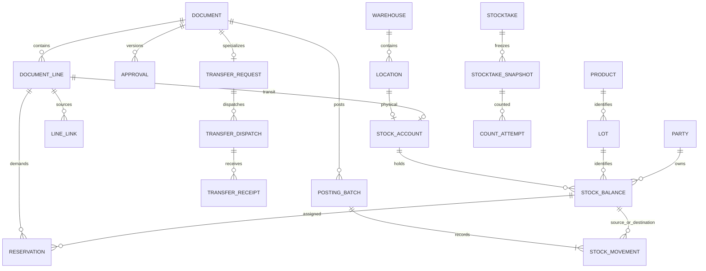

# WMSD — Database Design Proposal

> **Technology distinction:** the relational model and SQL DDL here are **design/analysis proposals** for clarifying entities, relationships, integrity rules and transactions. The actual implementation **will use MongoDB (NoSQL)**, per Report 3 and the detailed system design. Do not apply the PostgreSQL DDL as the live database schema.

Prepared **18 October 2026**, Vietnam time. This is a proposal for review. Authoritative process flows are maintained in the [Vietnamese seven-process proposal](../02_nghiep_vu/De_xuat_7_quy_trinh_sau_review1.md). Warehouse glossary, document types, BF-01–07 and swimlane rules are kept there to avoid duplication.

## 1. Status, evidence and scope

### 1.1 Sources and precedence

| ID | Source | Use |
|---|---|---|
| S1 | [Seven-process proposal after review 1](../02_nghiep_vu/De_xuat_7_quy_trinh_sau_review1.md), 17 October 2026 | Proposed business baseline: BF-01–07, five roles, reduced sales scope and no direct MISA integration. |
| S2 | [Report 1 online](https://docs.google.com/document/d/1kb36v5HuFrM75NFCTXvnJcsg6QnPjYkb/edit), modified 17 October 2026, 16:26 Vietnam time | Tan Thuong single-store context, tiles, objectives and boundaries; read through Drive. |
| S3 | [Report 3 online](https://docs.google.com/document/d/1HvhlCmYjfXj7766ZVNUBAU4J063Lmr71/edit), modified 17 October 2026, 17:17 Vietnam time | Current 102-UC catalogue, actors, permissions, inventory and data rules; read through Drive. It currently specifies MongoDB. |
| S4 | [WMSD_Bangach.drawio](../04_so_do/WMSD_Bangach.drawio), **21 pages in the current file** | Reviewed BF01–06b, ERDs and the final two pages. BF03 contains a System lane; BF02/04/05/06a/06b contain WMSD lanes. The new diagrams remove them as requested. |
| S5 | [SAP WM I](../06_tham_khao/sap/Intro_S4HANA_Using_Global_Bike_Case_Study_WM_I_en_v4.1.pdf), [II](../06_tham_khao/sap/Intro_S4HANA_Using_Global_Bike_Case_Study_WM_II_en_v4.1.pdf), [III](../06_tham_khao/sap/Intro_S4HANA_Using_Global_Bike_Case_Study_WM_III_en_v4.1.pdf), [IV](../06_tham_khao/sap/Intro_S4HANA_Using_Global_Bike_Case_Study_WM_IV_en_v4.1.pdf) | Local **v4.1** set: I GR p.10, TO pp.18/21; II STO p.6, GI p.12, GR p.18, TO pp.26/29; III picking pp.14/19, shipping p.25; IV snapshot/count/recount/clearing pp.4/12/14/21/27. Do not reuse v4.2 page references from the older proposal. |
| S6 | [Process compilation](../06_tham_khao/quy_trinh/Tổng%20hợp%20quy%20trình.pdf), four pages | Handover documents and business context. Debt, payments and fleet management are not automatically added to the MVP. |
| S7 | [Reference links](../06_tham_khao/link_tham_khao.md) | Official MISA, Odoo and Microsoft guidance for concept comparison; WMSD-specific decisions are stated separately. |

Priority: the current request for a SQL model → S1 business proposal → compatible S2/S3 requirements → supporting S4–S7 references. SQL is an analysis model here; the MongoDB runtime requirement in Report 3 remains in effect.

### 1.2 Scope and architecture impact

- One store and its configured warehouses/locations; enable inter-warehouse transfer after confirming at least two physical warehouses.
- Business scope, actors, documents and seven BF flows use the process proposal as the source of truth. This design does not add accounting, tax invoices, payments or a live MISA integration.
- SQL DDL illustrates a normalized relational model for reviewing data relationships and invariants. It does not change the persistence decision: MongoDB/NoSQL is the runtime database.
- SQL FK/UNIQUE/CHECK constraints express relationships and business rules. In MongoDB, enforce equivalents with collection validation, unique/partial indexes, ID references and transaction/service logic. MongoDB does not provide SQL foreign keys across collections.

### 1.3 Technology mapping

| Layer | Proposal here | Actual implementation |
|---|---|---|
| Database | Normalized relational SQL model for design review | MongoDB/NoSQL, per Report 3 |
| Identifier | Illustrative PK/FK | ObjectId and reference IDs |
| Cross-collection rules | Illustrative FK, UNIQUE and CHECK | Schema validation, unique indexes and server/service checks |
| Stock/ledger/document update | Multi-table transaction | Multi-document MongoDB transaction on a supported deployment; atomic, idempotent and concurrency-aware |
| SQL attachment | Reference DDL for analysis | Not a schema for the live MongoDB database |

### 1.4 Use cases to align with the design

| Group | Delta to record in the SRS |
|---|---|
| BF-01 | Sales/Warehouse raise demand; Accountant prepares PO after approval |
| BF-03 | Separate same-warehouse relocation from transfer; remove duplicate TR → approval → inter-warehouse TO approval |
| BF-04 | Owner plans; Warehouse counts/proposes; Owner approves and clears differences |
| BF-05 | External Warehouse Issue Request; retain delivery/picking/PGI; do not add invoice scope |
| BF-06 | Custody and inspection precede Owner acceptance; financial follow-up stays external |
| BF-07 | Warehouse requests; Accountant records supplier agreement; Owner authorizes issue or reuses an eligible BF-02 decision |
| Persistence | MongoDB is runtime; SQL is the analysis model and reference DDL |

## 2. Mapping the design to MongoDB runtime

This table describes how relational design concepts could map to MongoDB. Align the implementation with the detailed system design before coding.

| Relational analysis model | Proposed MongoDB collection/embedding |
|---|---|
| app_user, app_role, permission, user_warehouse | users, roles, permissions; references/embedded assigned role IDs |
| warehouse, location, party, product, uom, lot | warehouses, locations, parties, products, lots; snapshot important attributes on transaction lines |
| document + typed header + document_line | business_documents with documentType, or bounded-context collections sharing documentId; embed headers/lines when lifecycle and size are bounded |
| approval + approval_line | approvals with authorized version, actor, decision and quantities |
| external_reference + line | external_references with sufficient source data for reconciliation/deduplication |
| stock_balance | stock_balances with unique compound index on account/location + lot + quality + owner |
| stock_movement + posting_batch | Append-only stock_movements and posting_batches linked by ObjectId and unique idempotency key |
| reservation + demand_supply_allocation | reservations and demand_supply_allocations with status, quantity and source IDs |
| stocktake + snapshot + count_attempt | stocktakes/stocktake_snapshots and append-only count attempts with cutoff/version |
| evidence, audit_event, outbox_event | evidence_refs, append-only audit_events, and outbox_events with unique event key |

Do not make every SQL table a MongoDB collection. Embed data only when it shares a lifecycle, is read/updated as one unit and cannot grow without bound. Posted documents, ledgers, audit trails and recount attempts need durable append-only history. A multi-document transaction must commit posting batch, movements, balance, reservations, document status, audit and outbox together.

Create unique indexes for document numbers, idempotency keys, operation keys and balance dimensions. Confirm collation, partial indexes for active records, reporting/trace indexes and shard strategy against real workload; do not shard simply because MongoDB supports it.

## 3. Relational reference model (SQL)

### 3.1 SQL normalization and type conventions

In this model, PK means primary key, FK means foreign key, UNIQUE enforces distinct values, CHECK validates conditions, and 3NF means third normal form. SQL describes the relational reference model here and does not imply Microsoft SQL Server specifically.
- **1NF:** atomic values; no comma-separated product/lot/warehouse lists and no JSON line arrays as the transactional source of truth.
- **2NF:** complete composite keys on join tables, such as `(role_code, permission_code)` and `(user_id, warehouse_id)`.
- **3NF:** warehouse, product and supplier master data are referenced by FK. `document` is a supertype with 1:1 typed extensions, not an unconstrained `entity_type/entity_id` pair.
- Product-name, delivery-address and conversion snapshots intentionally preserve history. `stock_balance` is a controlled denormalized projection/cache updated atomically with the ledger and periodically reconciled.
- In the SQL reference model, PKs use `BIGINT GENERATED ALWAYS AS IDENTITY`; quantities `NUMERIC(20,6)`, factors `NUMERIC(24,12)`, dates `DATE`, and events `TIMESTAMP WITH TIME ZONE`. These are not runtime storage types; MongoDB uses ObjectId, UTC Date and Decimal128 under the current field contract. Do not use floating point for quantities.
- Finite states and `snake_case` names. No cascade deletion of history. Deactivate master records with `active=false`; retain historical searchability.

### 3.2 Master data and authorization

| Table | Main keys/fields | Rule |
|---|---|---|
| `app_user` | user_id PK; username UNIQUE, display_name, credential_hash, active | Hash credentials; no plaintext |
| `app_role`, `user_role` | Role code; composite user-role PK | Five roles; multiple roles do not bypass self-approval restrictions |
| `permission`, `role_permission` | Permission code; role-permission PK | Operation-specific permissions; Admin has no implicit warehouse authority |
| `warehouse`, `user_warehouse` | warehouse_id, UNIQUE code; user-warehouse PK | Assigned warehouse scope |
| `location` | location_id, warehouse FK, code, kind, allocatable, active | UNIQUE(warehouse,code); only STORAGE may be allocatable |
| `party` | party_id, UNIQUE code, kind, contact | STORE/SUPPLIER/CUSTOMER/CARRIER; one STORE in MVP; not login accounts |
| `uom`, `product` | uom_code; product_id, UNIQUE sku, base_uom FK, whole_base_units | Tiles use PIECE; do not hard-code all products as tiles |
| `product_uom_version` | conversion_id, product, UoM, version, base_per_unit | UNIQUE(product,UoM,version); used versions are immutable |
| `product_warehouse_policy` | PK(product,warehouse), minimum_qty | Fixed replenishment threshold, not a general policy editor |
| `lot` | lot_id, product, manufacturer_lot, tone, calibre, identification_status | No stock total on lot; UNKNOWN cannot be allocated for sale |
| `quality_status` | quality_code | PENDING, GOOD, DAMAGED, BLOCKED; IN_TRANSIT is not quality |

### 3.3 Document model

| Table | Main fields/relationships | Purpose |
|---|---|---|
| `document` | document_id PK; document_no UNIQUE; kind, status, version, creator/timestamps | Stable document identity, lifecycle and version |
| `document_line` | line_id PK; document FK; UNIQUE(document,line_no); product, optional lot, conversion, entered/base quantities, snapshots | Planning lines can omit lot; posted lines require verified identity or explicitly blocked provisional lots |
| `document_link` | parent/child document IDs and relation_code PK | Header traceability with real FKs |
| `line_link` | source/target line IDs, relation_code, linked_qty | RR→PO, PO→GR, WIR→OD→GI, receipt→TO by quantity |
| `approval`, `approval_line` | UNIQUE(document,version,decision_kind); requester≠approver; line/quantity/outcome | Decisions and quantity ceilings, rather than one approved boolean |
| `evidence` | document FK, object_key, sha256, MIME, uploader/time | Private object references, not public URLs or base64 in transaction lines |
| `external_reference`, `document_external_reference` | UNIQUE(system,kind,number), document-reference join | MISA source, supplier documents and external resolution references |
| `external_reference_line` | reference and line_key UNIQUE per reference; product, eligible_qty | Line-level external source entitlement, verified by Accountant |

### 3.4 Business-specific tables

Header tables below use **`document_id` as both PK and FK to `document`**. Typed line tables use **`line_id` as PK/FK to `document_line`**. Supertype/subtype storage does not create two document numbers for one receipt.

| Group | Tables and important attributes |
|---|---|
| BF-01 | `replenishment_request`: warehouse, needed_on, trigger_reason. `purchase_order`: supplier, receiving warehouse, expected date, supplier_confirmation. `arrival`: warehouse, optional supplier, arrived_at, delivery_reference. |
| Shared inspection | `inspection_line`: inspected_source_line, quality, ownership_decision, inspector/time. Split quantities with different quality/ownership outcomes. |
| Purchase/customer-return receipt | `goods_receipt`: warehouse, PURCHASE/CUSTOMER_RETURN kind; line sources through line_link. |
| BF-03 | `transfer_request`: different source/destination warehouses. `transfer_dispatch`: request FK, dispatcher/time. `transfer_receipt`: dispatch FK, receiver/time. `transfer_receipt_line`: dispatch_line FK and quality. |
| Handover | `handover`: related document FK, recipient_name, optional carrier, time, confirmer; evidence through evidence table. |
| BF-05 | `issue_request`: customer, requested warehouse, needed date, address snapshot. `issue_request_line`: external line FK, release_key UNIQUE per external line, requested tone/calibre and substitution confirmation. `outbound_delivery`: WIR FK, one warehouse and planned date. `goods_issue`: warehouse, SALE/SUPPLIER_RETURN. |
| Warehouse tasks | `warehouse_task`: warehouse, kind, assignee. `warehouse_task_line`: source/destination locations and quality; both locations belong to the task warehouse. |
| BF-02 | `defect_case`: discovered_at, reason. `disposition_line`: defect_line, outcome, approval. SCRAP uses document/line and links to DISP. |
| BF-06 | `customer_return`: customer, warehouse, separate financial status. `customer_return_line`: original GI line **or** verified external historical line, reason; exclusive source choice. |
| BF-07 | `supplier_return`: supplier, warehouse, agreement, financial status. `supplier_return_line`: origin_line, owner_party, agreed_qty, authorization. `supplier_ack_line`: dispatch_line, outcome, acknowledgement time. |
| Shared discrepancies | `discrepancy_line`: source_line, SHORT/OVER/DAMAGED/WRONG_LOT/WRONG_PRODUCT, status, resolution document. |

`SUPPLIER_ACK`, `CUSTODY_RECEIPT`, `CUSTODY_RELEASE`, `HANDOVER`, `REVERSAL`, `SCRAP` and `OPENING` are document kinds. A separate empty header table is unnecessary when a kind has no special attributes. Each document has relational lines, not an embedded array. Services must additionally verify source document kinds and product/lot compatibility: an existing FK does not establish business eligibility.

### 3.5 Inventory, reservations and ledger

| Table | Keys/fields | Invariant |
|---|---|---|
| `stock_account` | account_id; **location_id XOR transit_dispatch_line_id**, each UNIQUE | Either a physical bin or transit dedicated to one TD line; do not assign transit to a fictitious destination bin |
| `stock_balance` | balance_id; UNIQUE(account,lot,quality,owner_party); qty≥0; version | Non-null dimensions prevent duplicate logical balances caused by NULL semantics |
| `posting_batch` | batch_id, document; UNIQUE idempotency_key; UNIQUE(document,operation,operation_key); payload_hash; actor/time; UNIQUE reversal_of | One batch per business execution; same key with different payload is rejected |
| `stock_movement` | batch, document line, optional from/to balances, q>0, before/after | At least one endpoint; two for movement, one for entering/leaving the tracked scope |
| `reservation` | demand_line, execution_line, balance, qty, ACTIVE/CONSUMED/RELEASED | Sum ACTIVE ≤ balance quantity; follow goods and avoid duplicate claims for one demand |
| `demand_supply_allocation` | PK(demand_line,supply_line), qty, status | Planned PO/TD supply assigned to demand; not available before eligible receipt |
| `audit_event`, `outbox_event` | actor/action/time; UNIQUE event_key, attempts, delivered_at | Written with the business transaction; notifications after commit do not roll back stock |

Owned stock is all balances whose owner party is STORE. Physical warehouse-owned stock is the owned balance at that warehouse's locations. Transit is owned balance with a transit_dispatch_line_id. Custody has another owner and is reported separately.

`available_stock` includes only GOOD, VERIFIED-lot stock with active product/warehouse/location at an allocatable location outside a stocktake freeze, less ACTIVE reservations on that balance. Reserved staging/transit goods stay assigned to their demand but are **not free supply for new demand**.

The ledger uses positive movements with from/to endpoints; `inventory_ledger` exposes signed quantity entries. This is a **quantity ledger**, not a monetary general ledger. Within a consistent ownership scope, `closing = opening + sum(delta)`. Location/quality changes have equal opposing entries; custody→STORE changes ownership without increasing physical presence.

### 3.6 Stocktake model

| Table | Content |
|---|---|
| `stocktake` | document_id, warehouse, cutoff, completion, mode=FROZEN |
| `stocktake_scope` | PK(stocktake_id,location_id), count scope |
| `location_lock` | location_id PK, stocktake FK; at most one active freeze per location |
| `stocktake_snapshot` | UNIQUE(stocktake,balance), book_qty, found_after_cutoff; original rows immutable |
| `count_attempt` | UNIQUE(snapshot,attempt_no), counted_qty≥0, counter/time; absent record means uncounted |
| `adjustment_line` | line_id, selected count_id, nonzero signed delta, approval_id once approved |

Adjustment lines carry a signed delta; document_line.qty_base is its absolute value. Quality reclassification links negative/positive deltas in the same case to preserve total quantity. Unexpected goods must belong to an already frozen location. Scope expansion needs additional locking and snapshot capture before counting, not arbitrary post-cutoff location additions.

### 3.7 Condensed ERD

This diagram shows the main structure; the DDL contains the complete columns, FKs, join tables and subtypes.



## 4. Constraints and transactions

### 4.1 DDL scope and limits

The SQL DDL illustrates PK/FK/UNIQUE constraints, exact numeric types, local CHECKs, exclusive source choices, before/after checks and indexes. **It is not the production database schema:** MongoDB has no SQL foreign keys; validators and unique indexes protect only part of the model. Services/transactions must enforce cross-document rules, authorization, append-only history and cumulative quantity limits. A row-level CHECK does not enforce a multi-row aggregate. [PostgreSQL constraints](https://www.postgresql.org/docs/16/ddl-constraints.html).

| ID | Required rule | Implementation enforcement |
|---|---|---|
| R-01 | No negative balance or excess reservation | Lock balance; sum ACTIVE reservations inside transaction; CHECK qty≥0 is the final guard |
| R-02 | Correct warehouse, bin, lot, product and owner | FKs plus subtype/location/source checks; prohibit dimension changes on balances with history |
| R-03 | No receipt/issue/return beyond eligible source | Lock source line; aggregate committed batches, reservations/open claims and valid cancellations/reversals |
| R-04 | MWTR matches TD, TR and destination | Validate receipt.dispatch, receipt-line source and warehouse authority; quantity ≤ remaining transit |
| R-05 | Correct approved version and quantities | Validate approval document/version/line/outcome; material changes invalidate prior authorization |
| R-06 | No self-approval; independent transfer receipt | Compare actual actor with creator/requester; receiver≠dispatcher; do not trust client-supplied requester |
| R-07 | No duplicate posting | Both posting_batch unique keys and payload hash; stable business operation key, not a fresh random key on each click |
| R-08 | Immutable posted history | Restrict DML; one posting service/procedure path; triggers protect ledger/snapshot/approval/posted sources; audit administrative changes |
| R-09 | No movements entering a frozen count | All posting locks the same location rows before checking location_lock; activation follows the same protocol |
| R-10 | Custody excluded from STORE inventory | Check balance owner; acceptance requires a documented ownership movement, not editing the party master |
| R-11 | Correct conversions and granularity | Snapshot factor; enforce integer quantities for whole_base_units; request actual pieces/boxes when m² conversion is fractional |
| R-12 | Ledger/balance and batch consistency | batch.document_id=movement.document_id; balance deltas equal movement and before/after; no standalone balance updates |

For tiles with 4 pieces/box and 0.36 m²/piece, 3 boxes +2 pieces =14 pieces =5.04 m². Preserve the entry as separate unit components/lines. Do not rely on “3.5 boxes” without the underlying piece quantity. Square metres may express demand/display; actual issue must respect product granularity. Future conversion versions must not recalculate history.

### 4.2 Transactions and idempotent posting

```text
BEGIN
1. Authenticate; check role + operation + warehouse + current state.
2. Check idempotency key and payload hash; return prior committed result on retry.
3. Lock documents, source lines, locations and balances in a consistent order.
4. Recheck version, approval, stocktake freeze, eligible source and remaining quantity.
5. Insert posting_batch and movements; update balances/reservations atomically.
6. Update progress/state; append audit and outbox events.
COMMIT
7. Notify/render from committed snapshots; notification failure does not change stock.
```

MongoDB does not use SQL row locks or `SELECT FOR UPDATE`. Update each balance atomically with a filter on ObjectId, version and sufficient quantity; use a conditional increment. Create balances through a unique compound index and handle duplicate-key/retry. Transactions recheck document version, stocktake freeze and source ceilings; retry write conflicts using the same idempotency key. To prevent a stocktake/posting race, activation and posting must update/check the scoped version in a transaction. Commit posting batch, ledger, balance, reservation, document status, audit and outbox together. Exercise transaction limits and load with representative data.

### 4.3 Inter-warehouse transaction example

Dispatch 400 pieces from A: `movement(A_GOOD → TRANSIT_TD_LINE,400)`. Receive 380 good and 12 damaged using two movements: `TRANSIT→B_RECEIVING_GOOD,380` and `TRANSIT→B_QUARANTINE_DAMAGED,12`. Eight pieces remain in transit. All lines of one MWTR commit in one batch/transaction; a failed line must not leave a half-posted receipt. A second MWTR can handle the later remainder.

### 4.4 Reversals, corrections and remainder closure

Reverse an entire batch only if no dependent downstream operation exists and all affected endpoints remain eligible with sufficient stock. UNIQUE reversal_of prevents two full reversals. Create a new reversing batch/movements; never overwrite the original. Partial corrections or cases with downstream activity require explicit adjustment/return documents rather than unrestricted full reversal. Cancelling an unexecuted PO/WIR/TR remainder must record the quantity/decision and release corresponding reservations/allocations without reducing plans below posted quantities.

## 5. Authorization and reporting

| Action | Sales | Warehouse | Accountant | Owner | Admin |
|---|---:|---:|---:|---:|---:|
| Create RR | Yes | Yes | No | View/approve | No |
| PO, supplier agreement, external financial references | Related view | Receiving view | Yes | View/review when required | No |
| GR, TO, TD, MWTR, GI | No | Assigned warehouse | Reconcile | View | No |
| WIR, OD, proposed CR | Yes | Warehouse execution | Verify sources | Approve CR | No |
| Immediate isolation and disposition proposal | No | Yes | Reconcile | Approve disposition | No |
| Count and propose ADJ | No | Yes | Reconcile | Plan, approve/post ADJ | No |
| Technical permission administration | No | No | No | As explicitly specified | Yes |

This is the core operation matrix, not a grant of additional master-data privileges. Source/destination scope is checked by actual user and warehouse assignment. Multiple roles do not permit self-approval. Reports and evidence downloads inherit the same access scope as operational screens. Sales does not receive costs or unrestricted quarantine visibility; Accountants trace only their authorized document chains.

Required reports: owned stock by warehouse/bin/lot/quality; available/reserved; custody by owner; transit by TD and age; outstanding PO/WIR demand; transfer/count/supplier-return discrepancies; external source→WIR/PO→GR/GI→return/adjustment traceability. Reconcile `SUM(inventory_ledger.delta)` against stock_balance regularly, including OPENING postings. Do not initialize balances by bypassing the ledger.

## 6. Design acceptance scenarios

| ID | Scenario | Required result |
|---|---|---|
| T01 | PO receives 78/100 including 3 damaged; 2 rejected | ARR80, owned78, usable≤75 after put-away, outstanding22 |
| T02 | Retry GR with same key, or fresh key for same operation_key | One batch; same key/different payload conflicts |
| T03 | Concurrent reservations of 60 and 50 against100 | Total cannot exceed100; later transaction revalidates |
| T04 | Relocation or picking TO | Owned total unchanged; reservation follows location |
| T05 | TD100; MWTR95GOOD+3DAMAGED | Transit2; destination98; only95 eligible after put-away |
| T06 | Another MWTR3 when transit2 remains | Reject; excess recorded separately, no negative transit |
| T07 | Dispatcher confirms destination receipt | Deny even with WAREHOUSE role at both warehouses |
| T08 | Return10; accept7good+2damaged, reject1 | Owned+9, custody1 until handback; not usable+10 |
| T09 | Return supplier-owned custody goods | Custody decreases; STORE quantity unchanged |
| T10 | Two SR/disposition cases target the same damaged quantity | Combined execution cannot exceed unresolved eligible stock |
| T11 | Snapshot20, count18, Owner approves−2 | Post−2 once; never overwrite current stock with a stale count |
| T12 | Missing count versus zero count | Distinct states; blank does not imply total shortage |
| T13 | Posting races stocktake activation | Serialized boundary; snapshot includes preceding committed movements |
| T14 | Packaging changes from4 to5pieces/box | Old documents retain4; new documents use the new version |
| T15 | Email fails after PGI | GI/stock remain committed; outbox retries without another PGI |
| T16 | Edit posted lot/tone/document | Block; use an appropriate correction and audit |
| T17 | Stocktake finds no difference | Close/unlock; no ADJ0 |
| T18 | Historical sale has no WMS GI | CR references verified external history; no fictitious GI |

These are **acceptance criteria**, not a claim that a complete backend has passed them. DDL and diagrams are checked separately; implement posting services and execute concurrency/integration tests before operational use.

**Artifact verification on 18 October 2026:** DDL successfully created 63 tables and two views on PostgreSQL 18.6 through PGlite 0.5.10. Twenty-one schema/query/illustrative-transaction checks passed, including FKs, negative/duplicate balances, self-approval, duplicate posting keys and the TD100/MWTR98 example. PostgreSQL 16 was not separately exercised; authorization services and multi-connection concurrency were not tested. All 16 draw.io pages were exported to PNG for visual review; the validator reported zero errors/warnings and all lane names represent actors. Both language versions share ten main sections, cover all 63 table names and have no missing internal file links.

## 7. Implementation order and decisions to confirm

Suggested order: MongoDB validators/indexes/master data → roles/scope → document shapes/approvals → append-only ledger and posting/idempotency service → BF-01/TO → BF-05 → BF-03 → BF-02/06/07 → BF-04 → reporting/reconciliation. Include tone/calibre differences, partial receipts, custody and transit in early sample data.

Confirm before SRS sign-off: final DBMS, actual warehouse count, independent transfer receivers, acceptance of damaged goods and ownership responsibility, unit granularity, feasible count-freeze duration, substitution policy, historical-source verification, printable forms and numbering. This proposal selects a working baseline without presenting those outstanding business choices as validated survey findings.

### Online references and limits

- [MISA eShop warehouse transfer](https://helpeshop.misa.vn/kb/huong-dan-cach-chuyen-kho-tren-phan-mem-misa-eshop) distinguishes same-branch warehouse transfers from inter-branch transfer issues; WMSD uses separate dispatch/receipt checkpoints for its own requirements.
- [Odoo 18 three-step receipt](https://www.odoo.com/documentation/18.0/applications/inventory_and_mrp/inventory/shipping_receiving/daily_operations/receipts_three_steps.html) illustrates input, quality and stock separation; WMSD does not copy every Odoo configuration step.
- [Microsoft transfer order receiving](https://learn.microsoft.com/en-us/dynamics365/supply-chain/warehousing/configure-transfer-order-receiving-process) illustrates separation of transfer receipt and background processing; Dynamics financial configuration is not WMSD scope.

Table names, the MWTR code, the document supertype, TD-line transit accounts and the transaction protocol are **design proposals in this document**, not verbatim SAP/MISA/Odoo/Microsoft data models. Tax/invoice references are not used to provide legal guidance in this warehouse proposal.
