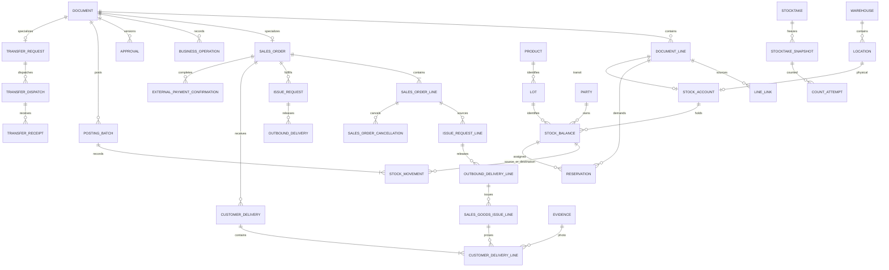

# WMSD — Database Design Proposal

SQL Server/T-SQL is a relational reference model for design analysis. MongoDB remains runtime; this DDL is not a MongoDB migration and does not implement business services.

Updated 22 October 2026 against the survey, D1–D8 and current BF-06 in [Process Proposal 2 — EN](../02_nghiep_vu/de_xuat_quy_trinh_2_EN.md). Reference SQL: [WMSD_SQL_schema.sql](WMSD_SQL_schema.sql). History: [change_logs.md](../../change_logs.md).

| Version | Date | Revision |
|---|---|---|
| 1.0.0 | 21 October 2026, before the sales-flow revision | D1–D8 baseline: WIR directly references external order lines. |
| 2.0.0 | 21 October 2026 | SO → WIR → PGI → photo POD → PAY-CFM; replace the WIR source contract and add status/confirmation transactions. |
| 3.0.0 | 22 October 2026 | Separate BF-03 relocation and BF-04 transfer; renumber BF-05–08, without changing SQL tables/columns. |

## 1. Status, evidence and scope

### 1.1 Sources and precedence

| ID | Source | Use |
|---|---|---|
| S1 | [Process Proposal 2 — EN](../02_nghiep_vu/de_xuat_quy_trinh_2_EN.md), sales revision on 21 October and BF-03/BF-04 split on 22 October 2026 | Current business source: eight BFs, five roles, 111 UCs (98 active/13 retired), BR-01–33; no live MISA integration. |
| S2 | [Report 1 text](../01_bao_cao/WMSD_Report1_Fix.docx.txt), synchronized 21 October 2026 | Single-store context, survey reporting three or more warehouses, current purpose and scope; As-is is not an implemented To-be. |
| S3 | [Report 3 text](../01_bao_cao/WMSD_Report3_Fix.docx.txt), earlier 21 October baseline | Historical 108 UCs (95 active/13 retired), before UC-109–111. Requires follow-up to S1; MongoDB remains runtime. |
| S4 | [WMSD_Bangach.drawio](../04_so_do/WMSD_Bangach.drawio), **21 pages in the current file** | Reviewed BF01–06b, ERDs and the final two pages. BF03 contains a System lane; BF02/04/05/06a/06b contain WMSD lanes. The new diagrams remove them as requested. |
| S5 | [SAP WM I](../06_tham_khao/sap/Intro_S4HANA_Using_Global_Bike_Case_Study_WM_I_en_v4.1.pdf), [II](../06_tham_khao/sap/Intro_S4HANA_Using_Global_Bike_Case_Study_WM_II_en_v4.1.pdf), [III](../06_tham_khao/sap/Intro_S4HANA_Using_Global_Bike_Case_Study_WM_III_en_v4.1.pdf), [IV](../06_tham_khao/sap/Intro_S4HANA_Using_Global_Bike_Case_Study_WM_IV_en_v4.1.pdf) | Local **v4.1** set: I GR p.10, TO pp.18/21; II STO p.6, GI p.12, GR p.18, TO pp.26/29; III picking pp.14/19, shipping p.25; IV snapshot/count/recount/clearing pp.4/12/14/21/27. Do not reuse v4.2 page references from the older proposal. |
| S6 | [Process compilation](../06_tham_khao/quy_trinh/Tổng%20hợp%20quy%20trình.pdf), four pages | Handover documents and business context. Debt, payments and fleet management are not automatically added to the MVP. |
| S7 | [Reference links](../06_tham_khao/link_tham_khao.md) | Official MISA, Odoo and Microsoft guidance for concept comparison; WMSD-specific decisions are stated separately. |

Priority: current instruction → S1 and BF-06 revision in the [change log](../../change_logs.md) → D1–D8 → pre-revision Report 1/3 → survey → historical S4–S7. Current catalogue: 111 UCs, 98 active/13 retired; old sources cannot reinstate retired functions. SQL is the reference model; MongoDB remains runtime.

### 1.2 Scope and architecture impact

- One store; the survey reports three or more warehouses with coded areas/racks. D4 retains transfers with independent dispatch/receipt. Exact warehouse list, addresses and staffing remain unverified; do not seed invented records.
- The current eight-process proposal is authoritative. Add copied SO, photo POD and external receipt confirmation; money collection, receivables, tax invoicing and live MISA integration remain outside scope.
- SQL DDL illustrates a normalized relational model for reviewing data relationships and invariants. It does not change the persistence decision: MongoDB/NoSQL is the runtime database.
- SQL FK/UNIQUE/CHECK constraints express relationships and business rules. In MongoDB, enforce equivalents with collection validation, unique/partial indexes, ID references and transaction/service logic. MongoDB does not provide SQL foreign keys across collections.

### 1.3 Technology mapping

| Layer | Proposal here | Actual implementation |
|---|---|---|
| Database | Normalized relational SQL model for design review | MongoDB/NoSQL, per Report 3 |
| Identifier | Illustrative PK/FK | ObjectId and reference IDs |
| Cross-collection rules | Illustrative FK, UNIQUE and CHECK | Schema validation, unique indexes and server/service checks |
| Stock/ledger/document update | Multi-table transaction | Multi-document MongoDB transaction on a supported deployment; atomic, idempotent and concurrency-aware |
| SQL attachment | Reference DDL for analysis | Not a schema for the live MongoDB database |

### 1.4 Use cases to align with the design

| Group | Delta to record in the SRS |
|---|---|
| BF-01 | Sales/Warehouse raise demand; Accountant prepares PO after approval |
| BF-03 | Same-warehouse relocation: Warehouse TO-RELOCATE, no Owner approval; preserve total and reservations; UC-34–37. |
| BF-04 | Inter-warehouse transfer: Owner-approved TR → source TD → independent destination MWTR → put-away; UC-38–44/104. |
| BF-05 | Owner plans; Warehouse counts/proposes; Owner approves and clears differences |
| BF-06 | Sales copies external SO → linked WIR → picking/PGI → Warehouse photo POD → DELIVERED → Sales PAY-CFM → COMPLETED. UC-45–48/109–111; BR-31–33. |
| BF-07 | Custody and inspection precede Owner acceptance; financial follow-up stays external |
| BF-08 | Warehouse requests; Accountant records supplier agreement; Owner authorizes issue or reuses an eligible BF-02 decision |
| Persistence | MongoDB is runtime; SQL is the analysis model and reference DDL |

## 2. Mapping the design to MongoDB runtime

This table describes how relational design concepts could map to MongoDB. Align the implementation with the detailed system design before coding.

| Relational analysis model | Proposed MongoDB collection/embedding |
|---|---|
| app_user, app_role, permission, user_warehouse | users, roles, permissions; references/embedded assigned role IDs |
| warehouse, location, party, product, uom, lot | warehouses, locations, parties, products, lots; snapshot important attributes on transaction lines |
| document + typed header + document_line | business_documents with documentType, or bounded-context collections sharing documentId; embed headers/lines when lifecycle and size are bounded |
| sales_order + line + cancellations | sales_orders with lines/source references; append-only cancellation_events; unique source and order version |
| customer_delivery + line / external_payment_confirmation / business_operation | customer_deliveries, external_payment_confirmations and business_operations; SO/GI/photo references, unique operation keys; no stock ledger writes |
| approval + approval_line | approvals with authorized version, actor, decision and quantities |
| external_reference + line | external_references with sufficient source data for reconciliation/deduplication |
| stock_balance | stock_balances with unique compound index on account/location + lot + quality + owner |
| stock_movement + posting_batch | Append-only stock_movements and posting_batches linked by ObjectId and unique idempotency key |
| reservation + demand_supply_allocation | reservations and demand_supply_allocations with status, quantity and source IDs |
| stocktake + snapshot + count_attempt | stocktakes/stocktake_snapshots and append-only count attempts with cutoff/version |
| customer_return_assessment | Append-only return_assessments by returnLineId, assessmentNo and documentVersion; latest-assessment index and version-matched approval reference |
| evidence, audit_event, outbox_event | evidence_refs, append-only audit_events, and outbox_events with unique event key |

Do not make every SQL table a MongoDB collection. Embed data only when it shares a lifecycle, is read/updated as one unit and cannot grow without bound. Posted documents, ledgers, audit trails and recount attempts need durable append-only history. A multi-document transaction must commit posting batch, movements, balance, reservations, document status, audit and outbox together.

Create unique indexes for document numbers, idempotency keys, operation keys and balance dimensions. Confirm collation, partial indexes for active records, reporting/trace indexes and shard strategy against real workload; do not shard simply because MongoDB supports it.

## 3. Relational reference model (SQL)

### 3.1 SQL normalization and type conventions

In this model, PK means primary key, FK means foreign key, UNIQUE enforces distinct values, CHECK validates conditions, and 3NF means third normal form. The current DDL uses Microsoft SQL Server/T-SQL in schema `wmsd`; this remains a relational reference model and does not change the MongoDB runtime.
- **1NF:** atomic values; no comma-separated product/lot/warehouse lists and no JSON line arrays as the transactional source of truth.
- **2NF:** complete composite keys on join tables, such as `(role_code, permission_code)` and `(user_id, warehouse_id)`.
- **3NF:** warehouse, product and supplier master data are referenced by FK. `document` is a supertype with 1:1 typed extensions, not an unconstrained `entity_type/entity_id` pair.
- Product-name, delivery-address and conversion snapshots intentionally preserve history. `stock_balance` is a controlled denormalized projection/cache updated atomically with the ledger and periodically reconciled.
- In the SQL reference model, PKs use `BIGINT IDENTITY(1,1)`; quantities `NUMERIC(20,6)`, factors `NUMERIC(24,12)`, dates `DATE`, and events `DATETIMEOFFSET`. These are not runtime storage types; MongoDB uses ObjectId, UTC Date and Decimal128 under the current field contract. Do not use floating point for quantities.
- T-SQL uses `bit` flags, `SYSDATETIMEOFFSET()`, filtered unique indexes for nullable keys and `GO` batches for schema/views. Use a client that understands `GO`; do not submit the whole file as one SQL statement.
- Finite states and `snake_case` names. No cascade deletion of history. Deactivate master records with `active=false`; retain historical searchability.

### 3.2 Master data and authorization

| Table | Main keys/fields | Rule |
|---|---|---|
| `app_user` | user_id PK; username UNIQUE, display_name, credential_hash, active | Hash credentials; no plaintext |
| `app_role`, `user_role` | Role code; composite user-role PK | Five roles; multiple roles do not bypass self-approval restrictions |
| `permission`, `role_permission` | Permission code; role-permission PK | Operation-specific permissions; Admin has no implicit warehouse authority |
| `warehouse`, `user_warehouse` | warehouse_id, UNIQUE code; user-warehouse PK | Assigned warehouse scope |
| `location` | location_id, warehouse FK, code, kind, allocatable, active | UNIQUE(warehouse,code); only STORAGE may be allocatable |
| `party` | party_id, UNIQUE code, kind, contact | STORE/SUPPLIER/CUSTOMER/CARRIER; one STORE in MVP; not login accounts |
| `uom`, `product` | uom_code; product_id, UNIQUE sku, base_uom FK, whole_base_units | Tiles use PIECE; do not hard-code all products as tiles |
| `product_uom_version` | conversion_id, product, UoM, version, base_per_unit | UNIQUE(product,UoM,version); used versions are immutable |
| `product_warehouse_policy` | PK(product,warehouse), minimum_qty | Fixed replenishment threshold, not a general policy editor |
| `lot` | lot_id, product, manufacturer_lot, tone, calibre, identification_status | No stock total on lot; UNKNOWN cannot be allocated for sale |
| `quality_status` | quality_code | PENDING, GOOD, DAMAGED, BLOCKED; IN_TRANSIT is not quality |

### 3.3 Document model

| Table | Main fields/relationships | Purpose |
|---|---|---|
| `document` | document_id PK; document_no UNIQUE; kind, status, version, creator/timestamps | Stable document identity, lifecycle and version |
| `document_line` | line_id PK; document FK; UNIQUE(document,line_no); product, optional lot, conversion, entered/base quantities, snapshots | Planning lines can omit lot; posted lines require verified identity or explicitly blocked provisional lots |
| `document_link` | parent/child document IDs and relation_code PK | Header traceability with real FKs |
| `line_link` | source/target line IDs, relation_code, linked_qty | RR→PO, PO→GR, SO→WIR→OD→GI→POD quantities; BF-06 also has typed FKs for parent consistency |
| `approval`, `approval_line` | UNIQUE(document,version,decision_kind); requester≠approver; line/quantity/outcome | Decisions and quantity ceilings, rather than one approved boolean |
| `evidence` | document, object_key, sha256, MIME, uploader/time; UNIQUE(evidence_id,document_id) | Private files. POD/PAY-CFM composite FKs bind evidence to its own document; service checks content and successful upload. |
| `external_reference`, `document_external_reference` | UNIQUE(system,kind,number), source_version when supplied, nonblank UNIQUE correlation_id, verifier/time and document-reference join | Never invent provider version; document.version tracks internal revisions; stable correlation supports trace |
| `external_reference_line` | reference/line_key unique per source; product, eligible_qty; UNIQUE(external_line_id,reference_id) | Sales verifies current source orders; Accountant supports historical/reconciliation evidence. SO lines use their SO source. |


**External source versions:** `external_reference.source_version` is nullable when the provider has no revision ID; `correlation_id` is required, UNIQUE and nonblank for stable WMS trace. `document.version` still governs internal workflow/approval versions. A fresh correlation on every retry must not replace a stable operation key.

### 3.4 Business-specific tables

Header tables below use **`document_id` as both PK and FK to `document`**. Typed line tables use **`line_id` as PK/FK to `document_line`**. Supertype/subtype storage does not create two document numbers for one receipt.

| Group | Tables and important attributes |
|---|---|
| BF-01 | `replenishment_request`: warehouse, needed_on, trigger_reason. `purchase_order`: supplier, receiving warehouse, expected date, supplier_confirmation. `arrival`: warehouse, optional supplier, arrived_at, delivery_reference. |
| Shared inspection | `inspection_line`: inspected_source_line, quality, ownership_decision, inspector/time. Split quantities with different quality/ownership outcomes. |
| Purchase/customer-return receipt | `goods_receipt`: warehouse, PURCHASE/CUSTOMER_RETURN kind; line sources through line_link. |
| BF-03 | warehouse_task kind RELOCATE; warehouse_task_line source/destination within the same warehouse, preserving lot/owner/quality; document/audit retain confirmation. |
| BF-04 | `transfer_request`: different source/destination warehouses. `transfer_dispatch`: request FK, dispatcher/time. `transfer_receipt`: dispatch FK, receiver/time. `transfer_receipt_line`: dispatch_line FK and quality. |
| Handover | `handover`: related document FK, recipient_name, optional carrier, time, confirmer; evidence through evidence table. |
| BF-06 | sales_order/line/cancellation; issue_request/line linked to SO; outbound_delivery/line; sales_goods_issue_line; customer_delivery/line; external_payment_confirmation and business_operation. See section 3.4.2. |
| Warehouse tasks | `warehouse_task`: warehouse, kind, assignee. `warehouse_task_line`: source/destination locations and quality; both locations belong to the task warehouse. |
| BF-02 | `defect_case`: discovered_at, reason. `disposition_line`: defect_line, outcome, approval. SCRAP uses document/line and links to DISP. |
| BF-07 | `customer_return`: customer, warehouse, separate financial status. `customer_return_line`: original GI line **or** verified external historical line, reason; exclusive source choice. |
| BF-08 | `supplier_return`: supplier, warehouse, agreement, financial status. `supplier_return_line`: origin_line, owner_party, agreed_qty, authorization. `supplier_ack_line`: dispatch_line, outcome, acknowledgement time. |
| Shared discrepancies | `discrepancy_line`: source_line, SHORT/OVER/DAMAGED/WRONG_LOT/WRONG_PRODUCT, status, resolution document. |

`SUPPLIER_ACK`, `CUSTODY_RECEIPT`, `CUSTODY_RELEASE`, `HANDOVER`, `REVERSAL`, `SCRAP` and `OPENING` are document kinds. A separate empty header table is unnecessary when a kind has no special attributes. Each document has relational lines, not an embedded array. Services must additionally verify source document kinds and product/lot compatibility: an existing FK does not establish business eligibility.


### 3.4.1 Return eligibility assessment and packaging observations

| Table/field | Current contract |
|---|---|
| `customer_return_assessment` | FK `return_line_id`; UNIQUE(return_line_id,assessment_no); `document_version`, `assessed_by/at`, nonblank reason and `approval_id` linking the post-inspection decision. Append-only; changed conditions/quantity require a new version. |
| Packaging / use / cause | `packaging_condition`=SEALED/OPENED/TORN/UNKNOWN; `installation_status`=UNUSED/INSTALLED/UNKNOWN; `damage_cause`=NONE/CUSTOMER/SUPPLIER/OTHER/UNKNOWN. Split lines with differing conditions. |
| Deadline | `deadline_status`=WITHIN/EXCEEDED/NOT_APPLICABLE/UNKNOWN; verified states require nonblank `deadline_reference`, including NOT_APPLICABLE. No default number of days. |
| Eligibility | Proven installed/customer-damaged/overdue goods are INELIGIBLE; unknown conditions without proven exclusion are PENDING; evidence-complete conditions are CASE_REVIEW, not acceptance. Owner may still reject CASE_REVIEW. |
| `inspection_line.packaging_condition` | Shared packaging observation on receipts/returns; defaults UNKNOWN and is updated from actual inspection. TORN does not automatically mean DAMAGED. Actual pieces are recorded on quantity lines/conversion snapshots, not inferred from empty cartons. |

Services select the latest assessment for the line and current version, then verify inspection, source, Owner APPROVE and matching approval_line/quantity before GR-CR. CHECK/FK alone do not establish these relationships. Changed conditions invalidate old approval. Physically held PENDING/INELIGIBLE goods remain custody until actual handback. Unverified lots use identification_status=UNKNOWN with openly identified unknown references; never invent calibre or treat nominal dimensions as verified calibre.

### 3.4.2 Sales order, delivery evidence and external receipt

The revised BF-06 uses the following typed records. Quantities are held on document_line in base units, except cancellation facts which store cancelled_qty_base. Existing receipt, transfer, defect, return and stocktake models are retained.

| Table | Fields and relationships | Contract |
|---|---|---|
| sales_order | document PK/FK; UNIQUE external_reference_id; customer, need date, address snapshot | SALES_ORDER is a manual copy of one verified source order. Keep source evidence; update/reopen the same SO instead of making another copy. |
| sales_order_line | line PK; SO and source reference; UNIQUE external_line_id; required tone/calibre | Composite FKs bind each line to its own SO document and the source reference belonging to that SO. Validate source product, unit conversion and quantity in the service. |
| sales_order_cancellation | SO/line, positive cancelled_qty_base, user/time, nonblank reason, UNIQUE operation_id | Append-only facts for unissued remainder. Validate cumulative cancellation; reduce affected unissued WIR/OD commitments and release reservations in the same transaction. |
| issue_request / issue_request_line | Required SO FK; line contains WIR/SO/SO-line IDs; UNIQUE(SO-line,release_key) | Header and line must refer to the same SO. Composite FKs reject a line from a different order; customer is obtained from SO. |
| outbound_delivery_line | line, OD, WIR and WIR-line IDs | Composite FKs bind each line to the OD's own WIR. One OD belongs to one warehouse. |
| sales_goods_issue_line | line, goods_issue_id, outbound_delivery_line_id | SALE-only subtype of actual GI-S lines. Match product/lot/warehouse and check valid posted PGI in the service. Supplier-return issue sources remain unchanged. |
| customer_delivery / customer_delivery_line | POD document, SO, warehouse, recipient, actual delivery time, confirmer/time, operation; line → sales GI line + required photo_evidence_id | Each line has one posted source GI-S line. A composite photo FK binds the image evidence to this POD document. Service verifies stored image, access and confirmed quantity cap; header alone is not proof of delivery. |
| external_payment_confirmation | PAY-CFM document, SO, delivered_order_version, full_payment_received=1, confirmer/time, operation; receipt reference/evidence/note | UNIQUE(SO,delivered_order_version) prevents duplicate receipt confirmation for one delivered version. CHECK requires a nonblank reference/note or evidence. Sales confirms full receipt outside WMSD after current SO is DELIVERED; no monetary calculation or transfer. |
| business_operation | document, operation/key, UNIQUE idempotency_key, payload_hash, document_version, user/time, optional reason | Records non-stock operations, separately from posting_batch. Stable keys return the previous result; same key with changed payload is rejected. |

Per-line ceilings: total non-cancelled WIR commitments (including already issued quantities) ≤ SO ordered quantity minus authorized cancellations; total OD commitments ≤ authorized WIR quantity after cancellation; valid PGI ≤ OD quantity; total confirmed, non-voided POD quantity ≤ valid posted PGI per GI-S line. Parent and child quantities are never added as independent demand. Aggregate checks run in a transaction and cannot be replaced by row-level CHECKs.

| Record | Lifecycle and effect |
|---|---|
| SO | DRAFT → OPEN → IN_PROGRESS/PARTIALLY_DELIVERED → DELIVERED → COMPLETED. DELIVERED needs photo-confirmed receipt of every remaining line and a total remaining quantity greater than zero. All cancelled with zero delivery sets CANCELLED. COMPLETED additionally requires Sales full external receipt confirmation. |
| POD / PAY-CFM | DRAFT → CONFIRMED, or VOIDED through an audited correction with reason. Confirmations do not affect inventory. WIR warehouse completion remains independent from SO delivery/payment completion. |

Retain original confirmation facts when voiding a mistake; record a new business_operation, increment the SO version and recalculate progress and invalidate stale completion authority. PAY-CFM must be confirmed against the current delivered order version. Ordinary customer returns retain historical POD/PAY-CFM evidence and use BF-07 separately. Photo upload failure leaves the POD unconfirmed; notification failure after confirmation retries only the notification.

### 3.5 Inventory, reservations and ledger

| Table | Keys/fields | Invariant |
|---|---|---|
| `stock_account` | account_id; **location_id XOR transit_dispatch_line_id**, each UNIQUE | Either a physical bin or transit dedicated to one TD line; do not assign transit to a fictitious destination bin |
| `stock_balance` | balance_id; UNIQUE(account,lot,quality,owner_party); qty≥0; version | Non-null dimensions prevent duplicate logical balances caused by NULL semantics |
| `posting_batch` | batch_id, document; UNIQUE idempotency_key; UNIQUE(document,operation,operation_key); payload_hash; actor/time; UNIQUE reversal_of | One batch per inventory posting; same key/different payload is rejected. POD/PAY-CFM use business_operation instead |
| `stock_movement` | batch, document line, optional from/to balances, q>0, before/after | At least one endpoint; two for movement, one for entering/leaving the tracked scope |
| `reservation` | demand_line, execution_line, balance, qty, ACTIVE/CONSUMED/RELEASED | Sum ACTIVE ≤ balance quantity; follow goods and avoid duplicate claims for one demand |
| `demand_supply_allocation` | PK(demand_line,supply_line), qty, status | Planned PO/TD supply assigned to demand; not available before eligible receipt |
| `audit_event`, `outbox_event` | actor/action/time; UNIQUE event_key, attempts, delivered_at | Written with the business transaction; notifications after commit do not roll back stock |

Owned stock is all balances whose owner party is STORE. Physical warehouse-owned stock is the owned balance at that warehouse's locations. Transit is owned balance with a transit_dispatch_line_id. Custody has another owner and is reported separately.

`available_stock` includes only GOOD, VERIFIED-lot stock with active product/warehouse/location at an allocatable location outside a stocktake freeze, less ACTIVE reservations on that balance. Reserved staging/transit goods stay assigned to their demand but are **not free supply for new demand**.

The ledger uses positive movements with from/to endpoints; `inventory_ledger` exposes signed quantity entries. This is a **quantity ledger**, not a monetary general ledger. Within a consistent ownership scope, `closing = opening + sum(delta)`. Location/quality changes have equal opposing entries; custody→STORE changes ownership without increasing physical presence.

### 3.6 Stocktake model

| Table | Content |
|---|---|
| `stocktake` | document_id, warehouse, cutoff, completion, mode=FROZEN |
| `stocktake_scope` | PK(stocktake_id,location_id), count scope |
| `location_lock` | location_id PK, stocktake FK; at most one active freeze per location |
| `stocktake_snapshot` | UNIQUE(stocktake,balance), book_qty, found_after_cutoff; original rows immutable |
| `count_attempt` | UNIQUE(snapshot,attempt_no), counted_qty≥0, counter/time; absent record means uncounted |
| `adjustment_line` | line_id, selected count_id, nonzero signed delta, approval_id once approved |

Adjustment lines carry a signed delta; document_line.qty_base is its absolute value. Quality reclassification links negative/positive deltas in the same case to preserve total quantity. Unexpected goods must belong to an already frozen location. Scope expansion needs additional locking and snapshot capture before counting, not arbitrary post-cutoff location additions.

### 3.7 Condensed ERD

This diagram shows the main structure; the DDL contains the complete columns, FKs, join tables and subtypes.



## 4. Constraints and transactions

### 4.1 DDL scope and limits

The SQL DDL illustrates PK/FK/UNIQUE constraints, exact numeric types, local CHECKs, exclusive source choices, before/after checks and indexes. **It is not the production database schema:** MongoDB has no SQL foreign keys; validators and unique indexes protect only part of the model. Services/transactions must enforce cross-document rules, authorization, append-only history and cumulative quantity limits. A row-level CHECK does not enforce multi-row aggregates; service/transaction logic must enforce them.

| ID | Required rule | Implementation enforcement |
|---|---|---|
| R-01 | No negative balance or excess reservation | Lock balance; sum ACTIVE reservations inside transaction; CHECK qty≥0 is the final guard |
| R-02 | Correct warehouse, bin, lot, product and owner | FKs plus subtype/location/source checks; prohibit dimension changes on balances with history |
| R-03 | No receipt/issue/return beyond eligible source | Lock source line; aggregate committed batches, reservations/open claims and valid cancellations/reversals |
| R-04 | MWTR matches TD, TR and destination | Validate receipt.dispatch, receipt-line source and warehouse authority; quantity ≤ remaining transit |
| R-05 | Correct approved version and quantities | Validate approval document/version/line/outcome; material changes invalidate prior authorization |
| R-06 | No self-approval; independent transfer receipt | Compare actual actor with creator/requester; receiver≠dispatcher; do not trust client-supplied requester |
| R-07 | No duplicate posting | Both posting_batch unique keys and payload hash; stable business operation key, not a fresh random key on each click |
| R-08 | Immutable posted history | Restrict DML; one posting service/procedure path; triggers protect ledger/snapshot/approval/posted sources; audit administrative changes |
| R-09 | No movements entering a frozen count | All posting locks the same location rows before checking location_lock; activation follows the same protocol |
| R-10 | Custody excluded from STORE inventory | Check balance owner; acceptance requires a documented ownership movement, not editing the party master |
| R-11 | Correct conversions and granularity | Snapshot factor; enforce integer quantities for whole_base_units; request actual pieces/boxes when m² conversion is fractional |
| R-12 | Ledger/balance and batch consistency | batch.document_id=movement.document_id; balance deltas equal movement and before/after; no standalone balance updates |
| R-13 | D6 line/quantity/version matches | Local eligibility CHECK plus service validation of latest assessment, inspection, source and approval_line; no PENDING/INELIGIBLE posting |
| R-14 | Actual packaging/units | Record packaging_condition and actual quantity; torn packaging alone does not change quality; conversion versions preserve history |
| R-15 | UC and role boundary | Exactly 5 roles; 13 retired UCs have no active permissions; UC-107/108 do not post stock; D2 departmental entry |
| R-16 | SO and WIR source | Unique SO/source line; composite parent FKs; Sales source verification/evidence; reuse SO for correction/reopening |
| R-17 | SO→WIR→OD→GI ceilings | Check totals at each layer, including issued portions; audited cancellation releases matching reservations; no parent/child double-counting |
| R-18 | Photo POD within valid PGI | Assigned Warehouse; eligible posted GI; same-document stored photo; concurrent per-GI cumulative POD check |
| R-19 | Correct DELIVERED/COMPLETED gates | Full remaining qty >0 for DELIVERED; Sales full external receipt on current version for COMPLETED; all cancelled before delivery gives CANCELLED |
| R-20 | Non-stock, idempotent confirmation | business_operation key/hash; confirmation, SO progress, audit/outbox in one transaction; no POD/PAY-CFM movement |
| R-21 | Traceable correction | VOIDED with reason; recalculate SO and invalidate stale completion authority. Normal BF-07 preserves original delivery/payment history |

For tiles with 4 pieces/box and 0.36 m²/piece, 3 boxes +2 pieces =14 pieces =5.04 m². Preserve the entry as separate unit components/lines. Do not rely on “3.5 boxes” without the underlying piece quantity. Square metres may express demand/display; actual issue must respect product granularity. Future conversion versions must not recalculate history.

### 4.2 Transactions for inventory posting

```text
BEGIN
1. Authenticate; check role + operation + warehouse + current state.
2. Check idempotency key and payload hash; return prior committed result on retry.
3. Lock documents, source lines, locations and balances in a consistent order.
4. Recheck version, approval, stocktake freeze, eligible source and remaining quantity.
5. Insert posting_batch and movements; update balances/reservations atomically.
6. Update progress/state; append audit and outbox events.
COMMIT
7. Notify/render from committed snapshots; notification failure does not change stock.
```

MongoDB does not use SQL row locks or `SELECT FOR UPDATE`. Update each balance atomically with a filter on ObjectId, version and sufficient quantity; use a conditional increment. Create balances through a unique compound index and handle duplicate-key/retry. Transactions recheck document version, stocktake freeze and source ceilings; retry write conflicts using the same idempotency key. To prevent a stocktake/posting race, activation and posting must update/check the scoped version in a transaction. Commit posting batch, ledger, balance, reservation, document status, audit and outbox together. Exercise transaction limits and load with representative data.

### 4.2.1 Confirmation transactions without inventory posting

1. Authenticate Sales for SO/WIR/cancellation/PAY-CFM, or assigned Warehouse for POD. Check document kind, state and version.
2. Look up business_operation by stable key and verify payload_hash. Return the stored result on retry; reject changed payload under the same key.
3. Serialize the relevant SO, WIR/OD and source GI lines. Recheck cumulative quantities, valid PGI, required stored photo and current SO version; pending uploads cannot confirm delivery.
4. Commit confirmation/cancellation, business_operation, derived SO progress, audit and outbox together. POD/PAY-CFM create no posting_batch, movement, balance or reservation change. Cancellation may release reservations but never changes owned quantity.
5. For PAY-CFM, recheck full delivery and Sales confirmation of full external receipt in the same transaction; set SO to COMPLETED. Never rely only on a client-supplied status or an old version.

In MongoDB, conditional updates to shared SO/source-line versions must make conflicting confirmations contend on the same documents. Snapshot reads alone do not prevent two distinct PODs jointly exceeding the source. Retrying write conflicts keeps the same operation key. The DDL declares these contracts but does not implement their services.

### 4.3 Inter-warehouse transaction example

Dispatch 400 pieces from A: `movement(A_GOOD → TRANSIT_TD_LINE,400)`. Receive 380 good and 12 damaged using two movements: `TRANSIT→B_RECEIVING_GOOD,380` and `TRANSIT→B_QUARANTINE_DAMAGED,12`. Eight pieces remain in transit. All lines of one MWTR commit in one batch/transaction; a failed line must not leave a half-posted receipt. A second MWTR can handle the later remainder.

### 4.4 Reversals, corrections and remainder closure

Reverse an entire batch only if no dependent downstream operation exists and all affected endpoints remain eligible with sufficient stock. UNIQUE reversal_of prevents two full reversals. Create a new reversing batch/movements; never overwrite the original. Partial corrections or cases with downstream activity require explicit adjustment/return documents rather than unrestricted full reversal. Cancelling an unexecuted PO/WIR/TR remainder must record the quantity/decision and release corresponding reservations/allocations without reducing plans below posted quantities.

## 5. Authorization and reporting

| Action | Sales | Warehouse | Accountant | Owner | Admin |
|---|---:|---:|---:|---:|---:|
| Create RR | Yes | Yes | No | View/approve | No |
| PO, supplier agreement, external financial references | Related view | Receiving view | Yes | View/review when required | No |
| GR, TO, TD, MWTR, GI | No | Assigned warehouse | Reconcile | View | No |
| WIR, OD, proposed CR | Yes | Warehouse execution | Verify sources | Approve CR | No |
| Copy/update SO; cancel unissued remainder | Yes | Related view | Reconcile | View | No |
| POD: photo-confirmed customer delivery (UC-110) | View | Assigned warehouse | View/reconcile | View | No |
| PAY-CFM: confirm full external receipt (UC-111) | Yes | View | View/reconcile | View | No |
| Immediate isolation and disposition proposal | No | Yes | Reconcile | Approve disposition | No |
| Count and propose ADJ | No | Yes | Reconcile | Plan, approve/post ADJ | No |
| Technical permission administration | No | No | No | No | Yes |

This is the core operation matrix, not a grant of additional master-data privileges. Source/destination scope is checked by actual user and warehouse assignment. Multiple roles do not permit self-approval. Reports and evidence downloads inherit the same access scope as operational screens. Sales does not receive costs or unrestricted quarantine visibility; Accountants trace only their authorized document chains.

Reports cover stock/availability/custody/transit, outstanding PO/SO/WIR demand, dispatched versus customer-received quantities, DELIVERED orders awaiting Sales receipt confirmation, COMPLETED orders, cancellations and discrepancies. Trace external source → SO → WIR → OD → GI-S → POD → PAY-CFM and linked returns/corrections. Reconcile SUM(inventory_ledger.delta) to stock_balance, including OPENING; POD/PAY-CFM never enter the stock ledger.

## 6. Design acceptance scenarios

| ID | Scenario | Required result |
|---|---|---|
| T01 | PO receives 78/100 including 3 damaged; 2 rejected | ARR80, owned78, usable≤75 after put-away, outstanding22 |
| T02 | Retry GR with same key, or fresh key for same operation_key | One batch; same key/different payload conflicts |
| T03 | Concurrent reservations of 60 and 50 against100 | Total cannot exceed100; later transaction revalidates |
| T04 | Relocation or picking TO | Owned total unchanged; reservation follows location |
| T05 | TD100; MWTR95GOOD+3DAMAGED | Transit2; destination98; only95 eligible after put-away |
| T06 | Another MWTR3 when transit2 remains | Reject; excess recorded separately, no negative transit |
| T07 | Dispatcher confirms destination receipt | Deny even with WAREHOUSE role at both warehouses |
| T08 | Return10; accept7good+2damaged, reject1 | Owned+9, custody1 until handback; not usable+10 |
| T09 | Return supplier-owned custody goods | Custody decreases; STORE quantity unchanged |
| T10 | Two SR/disposition cases target the same damaged quantity | Combined execution cannot exceed unresolved eligible stock |
| T11 | Snapshot20, count18, Owner approves−2 | Post−2 once; never overwrite current stock with a stale count |
| T12 | Missing count versus zero count | Distinct states; blank does not imply total shortage |
| T13 | Posting races stocktake activation | Serialized boundary; snapshot includes preceding committed movements |
| T14 | Packaging changes from4 to5pieces/box | Old documents retain4; new documents use the new version |
| T15 | Email fails after PGI | GI/stock remain committed; outbox retries without another PGI |
| T16 | Edit posted lot/tone/document | Block; use an appropriate correction and audit |
| T17 | Stocktake finds no difference | Close/unlock; no ADJ0 |
| T18 | Historical sale has no WMS GI | CR references verified external history; no fictitious GI |
| T19 | Installed/customer-damaged/verified overdue return | INELIGIBLE; no GR-CR, custody until handback if held |
| T20 | Unverified deadline or conditions | PENDING; no invented 7/15/30 days; obtain evidence |
| T21 | Evidence-complete sealed or unused loose tiles | CASE_REVIEW; Owner decides after inspection, no automatic acceptance |
| T22 | Assessment/quantity changes after approval | New version and approval; old approval cannot post |
| T23 | Missing or mismatched supplier ACK | BF-08 remains open; Owner UC-106 resolves; no deduction on closure |
| T24 | Torn carton with intact inspected tiles | Quality from inspection, not automatic DAMAGED; quantity from actual pieces/version |
| T25 | Connection loss between commit and response | Look up batch/operation key; no repeat posting or lost audit |
| T26 | Monthly stocktake | Owner manually creates session; D5 scope freeze; no automatic session job |
| T27 | Copy the same external sales order or source line twice | Reject duplicate SO/source; source verification/evidence required; create no stock posting. |
| T28 | WIR header uses SO A but a line uses SO B; OD line uses another WIR | Composite FKs reject mismatched parents; service also checks product and units. |
| T29 | Several WIRs/ODs claim one SO line, including already issued commitments | Enforce separate SO→WIR and WIR→OD ceilings; completed WIR does not reopen demand. |
| T30 | Cancel an unissued remainder already reserved or bound to tasks | Resolve tasks, reduce commitments, release only matching reservations and append reason/user/time. |
| T31 | POD uses unposted, reversed, wrong-order or wrong-warehouse GI | Reject; customer delivery needs an eligible posted sales issue line. |
| T32 | POD has no photo, wrong-document evidence, non-image or failed upload | Missing/wrong-document FK is rejected; service rejects non-image/incomplete upload; no DELIVERED. |
| T33 | PGI 10; two distinct PODs confirm 6 and 5 concurrently | At most 10 confirmed; source-line serialization rejects excess. Valid 6+4 reaches full delivery. |
| T34 | Retry POD/PAY-CFM with the same key; then change its payload | Return prior result once; changed payload conflicts; no repeat delivered quantity or stock movement. |
| T35 | PGI/carrier handover complete but customer has not received goods | SO remains IN_PROGRESS; photo-confirmed partial receipt sets PARTIALLY_DELIVERED. |
| T36 | Unpaid, partially paid or prepaid externally before full delivery | Do not complete SO; after delivery, incomplete external receipt leaves DELIVERED. |
| T37 | Warehouse/Accountant tries PAY-CFM; Sales confirms full receipt on current DELIVERED SO | Deny wrong role; allow Sales with reference/evidence/note and atomically set COMPLETED, with zero stock change. |
| T38 | All order quantities cancelled with no customer delivery | SO=CANCELLED, not DELIVERED/COMPLETED. Delivered portion plus authorized unissued cancellation may reach DELIVERED. |
| T39 | Mistaken POD/PAY-CFM is voided or old delivered version is reused | Keep original evidence, reason/audit and recomputed SO progress; stale completion cannot authorize a new confirmation. |
| T40 | Confirmation transaction fails, or customer later returns normally | Failed transaction commits no partial operation/state; normal BF-07 returns retain original delivery/payment history and require their own stock documents. |

These are **acceptance criteria**, not a claim that a complete backend has passed them. DDL and diagrams are checked separately; implement posting services and execute concurrency/integration tests before operational use.

**Verification history:** the 18 October PostgreSQL/PGlite checks concern the pre-conversion DDL and do not validate current T-SQL. The 20 October change log records ScriptDom parsing and SQLite evaluation of D6 expressions; neither runs SQL Server or backend services. The 21 October checks are recorded separately in the [change log](../../change_logs.md); historical results do not validate the changed artifact.


### 6.1 Exception traceability

The 37 BF-01–08 branches and EX-01–05 in process section 4 supply data acceptance cases: documents/approvals retain actions and versions; source links retain quantities; stock accounts/balances distinguish owner/location/transit; posting batches/movements prevent duplicate effects; stocktake locks/count attempts preserve scope/history; evidence/audit/outbox support evidence and retries. Transaction failures must leave balances, ledgers and source quantities consistent. A parsed DDL does not prove service-level cases are enforced.


Cases T27–T40 cover the revised BF-06 contracts and UC-109–111/BR-31–33. Local SQL checks do not replace MongoDB backend authorization, transaction/concurrency and upload tests.

## 7. Implementation order and decisions to confirm

Suggested order: MongoDB validators/indexes/master data → roles/scope → document shapes/approvals → append-only ledger and posting/idempotency service → BF-01/TO → BF-06 → BF-03/BF-04 → BF-02/07/08 → BF-05 → reporting/reconciliation. Include tone/calibre differences, partial receipts, custody and transit in early sample data.

Confirm before SRS sign-off: exact warehouse list/count and addresses (three or more already reported), independent transfer receivers, acceptance of damaged goods and ownership responsibility, unit granularity, feasible count-freeze duration, substitution policy, historical-source verification, printable forms and numbering. This proposal selects a working baseline without presenting those outstanding business choices as validated survey findings.

### Online references and limits

- [MISA eShop warehouse transfer](https://helpeshop.misa.vn/kb/huong-dan-cach-chuyen-kho-tren-phan-mem-misa-eshop) distinguishes same-branch warehouse transfers from inter-branch transfer issues; WMSD uses separate dispatch/receipt checkpoints for its own requirements.
- [Odoo 18 three-step receipt](https://www.odoo.com/documentation/18.0/applications/inventory_and_mrp/inventory/shipping_receiving/daily_operations/receipts_three_steps.html) illustrates input, quality and stock separation; WMSD does not copy every Odoo configuration step.
- [Microsoft transfer order receiving](https://learn.microsoft.com/en-us/dynamics365/supply-chain/warehousing/configure-transfer-order-receiving-process) illustrates separation of transfer receipt and background processing; Dynamics financial configuration is not WMSD scope.

Table names, the MWTR code, the document supertype, TD-line transit accounts and the transaction protocol are **design proposals in this document**, not verbatim SAP/MISA/Odoo/Microsoft data models. Tax/invoice references are not used to provide legal guidance in this warehouse proposal.
