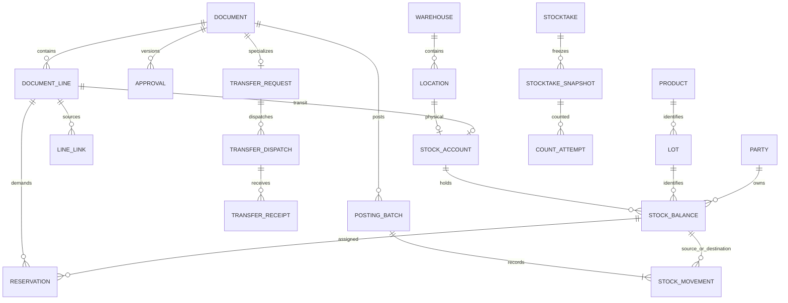

# WMSD — Đề xuất thiết kế cơ sở dữ liệu

> **Công nghệ cần phân biệt:** mô hình quan hệ và DDL SQL trong tài liệu này là **đề xuất phân tích/thiết kế**, dùng để làm rõ thực thể, quan hệ, ràng buộc và giao dịch. Hệ thống khi triển khai **sẽ dùng MongoDB (NoSQL)** theo baseline của Report 3 và tài liệu thiết kế chi tiết. Không triển khai DDL PostgreSQL như database chạy thật.

Ngày lập: **18/10/2026**. Đây là thiết kế đề xuất để review. Quy trình nghiệp vụ chuẩn được đặt tại [Đề xuất 7 quy trình sau review 1](../02_nghiep_vu/De_xuat_7_quy_trinh_sau_review1.md). Thuật ngữ kho, chứng từ, bước BF-01–07 và quy ước swimlane nằm trong tài liệu quy trình để tránh lặp.

## 1. Trạng thái, căn cứ và phạm vi

### 1.1 Nguồn và thứ tự áp dụng

| Mã | Nguồn | Cách áp dụng |
|---|---|---|
| S1 | [Đề xuất 7 quy trình sau review 1](../02_nghiep_vu/De_xuat_7_quy_trinh_sau_review1.md), 17/10/2026 | Baseline nghiệp vụ đề xuất: BF-01–07, năm role, thu hẹp bán hàng, không tích hợp MISA trực tiếp. |
| S2 | [Report 1 trực tuyến](https://docs.google.com/document/d/1kb36v5HuFrM75NFCTXvnJcsg6QnPjYkb/edit), modified 17/10/2026 16:26 giờ Việt Nam | Bối cảnh một cửa hàng Tân Thương, hàng gạch, mục tiêu và giới hạn; đọc qua Drive. |
| S3 | [Report 3 trực tuyến](https://docs.google.com/document/d/1HvhlCmYjfXj7766ZVNUBAU4J063Lmr71/edit), modified 17/10/2026 17:17 giờ Việt Nam | Catalogue 102 UC, actor, quyền, nguyên tắc tồn và dữ liệu; đọc qua Drive. Báo cáo hiện yêu cầu MongoDB. |
| S4 | [WMSD_Bangach.drawio](../04_so_do/WMSD_Bangach.drawio), **21 trang trong file hiện tại** | Kiểm tra BF01–06b, ERD và hai trang cuối. Trang BF03 có lane System; BF02/04/05/06a/06b có lane WMSD. Sơ đồ mới bỏ các lane này theo yêu cầu. |
| S5 | [SAP WM I](../06_tham_khao/sap/Intro_S4HANA_Using_Global_Bike_Case_Study_WM_I_en_v4.1.pdf), [II](../06_tham_khao/sap/Intro_S4HANA_Using_Global_Bike_Case_Study_WM_II_en_v4.1.pdf), [III](../06_tham_khao/sap/Intro_S4HANA_Using_Global_Bike_Case_Study_WM_III_en_v4.1.pdf), [IV](../06_tham_khao/sap/Intro_S4HANA_Using_Global_Bike_Case_Study_WM_IV_en_v4.1.pdf) | Bộ **v4.1** trong repo: I GR tr.10, TO tr.18/21; II STO tr.6, GI tr.12, GR tr.18, TO tr.26/29; III picking tr.14/19, ship tr.25; IV snapshot/đếm/đếm lại/clear tr.4/12/14/21/27. Không tái dùng số trang v4.2 từ đề xuất cũ. |
| S6 | [Tổng hợp quy trình](../06_tham_khao/quy_trinh/Tổng%20hợp%20quy%20trình.pdf), 4 trang | Tham khảo chứng từ giao nhận và bối cảnh; phần công nợ/thanh toán/xe không tự trở thành phạm vi MVP. |
| S7 | [Các link tham khảo](../06_tham_khao/link_tham_khao.md) | Dùng hướng dẫn chính thức MISA, Odoo, Microsoft để đối chiếu khái niệm; các quyết định riêng của WMSD được mô tả dưới đây. |

Thứ tự áp dụng: yêu cầu hiện tại về mô hình SQL → phương án nghiệp vụ S1 → yêu cầu còn tương thích trong S2/S3 → tham khảo S4–S7. SQL ở đây là mô hình phân tích; yêu cầu MongoDB làm database runtime trong Report 3 vẫn được giữ.

### 1.2 Phạm vi và thay đổi kiến trúc

- Một cửa hàng, các warehouse/location được cấu hình; bật điều chuyển liên kho sau khi xác nhận thực tế có từ hai kho.
- Phạm vi nghiệp vụ, actors, chứng từ và bảy BF dùng nguồn chuẩn ở tài liệu quy trình; WMSD không tự nhận thêm kế toán, hóa đơn thuế, thanh toán hoặc live integration MISA.
- SQL DDL minh họa mô hình quan hệ chuẩn hóa để review cấu trúc dữ liệu và các bất biến. Nó không thay đổi quyết định lưu trữ: MongoDB/NoSQL là database runtime.
- FK/UNIQUE/CHECK trong mô hình SQL diễn đạt các quan hệ và quy tắc nghiệp vụ. Khi cài bằng MongoDB, cưỡng chế tương ứng qua collection validation, unique/partial indexes, tham chiếu ID và transaction/service logic. MongoDB không cung cấp FK giữa collection như SQL.

### 1.3 Khác biệt công nghệ

| Lớp | Đề xuất trong tài liệu này | Triển khai thực tế |
|---|---|---|
| Database | SQL quan hệ chuẩn hóa để kiểm tra mô hình | MongoDB/NoSQL, theo Report 3 |
| Định danh | PK/FK minh họa quan hệ | ObjectId và reference IDs |
| Ràng buộc liên collection | FK, UNIQUE, CHECK minh họa ý nghĩa | Schema validation, unique index và kiểm tra trong server/service |
| Ghi stock/ledger/chứng từ | Transaction nhiều bảng trong mô hình | MongoDB transaction nhiều document trên môi trường hỗ trợ; cần atomicity, idempotency và concurrency checks |
| File SQL đính kèm | DDL tham chiếu cho thiết kế/đối chiếu | Không chạy như schema của runtime MongoDB |

### 1.4 Use case cần đồng bộ với thiết kế

| Nhóm | Delta cần ghi trong SRS |
|---|---|
| BF-01 | Sales/Warehouse tạo nhu cầu; Accountant lập PO sau duyệt |
| BF-03 | Tách chuyển cùng kho khỏi liên kho; bỏ vòng duyệt lặp TR → approval → TO liên kho |
| BF-04 | Owner lập phiên; Warehouse đếm/đề nghị; Owner duyệt và Clear Difference |
| BF-05 | Warehouse Issue Request từ đơn ngoài; giữ delivery/picking/PGI; không mở rộng thành invoice |
| BF-06 | Custody và kiểm tra hàng trả trước khi Owner quyết định; tài chính theo dõi ngoài WMS |
| BF-07 | Warehouse đề nghị; Accountant ghi thỏa thuận NCC; Owner duyệt trước xuất hoặc dùng quyết định BF-02 còn hiệu lực |
| Lưu trữ | MongoDB là runtime; SQL là mô hình phân tích và DDL tham chiếu |

## 2. Ánh xạ thiết kế sang MongoDB runtime

Bảng dưới đây mô tả cách ánh xạ các khái niệm của mô hình quan hệ sang MongoDB. Cần đồng bộ cách triển khai với thiết kế hệ thống chi tiết trước khi lập trình.

| Mô hình quan hệ dùng để phân tích | Collection/embedding dự kiến trên MongoDB |
|---|---|
| app_user, app_role, permission, user_warehouse | users, roles, permissions; quan hệ bằng ObjectId reference/role IDs |
| warehouse, location, party, product, uom, lot | warehouses, locations, parties, products, lots; snapshot thuộc tính quan trọng vào dòng chứng từ |
| document + typed header + document_line | business_documents phân loại documentType, hoặc collection theo bounded context cùng documentId; embed header/lines nếu cùng vòng đời và giới hạn kích thước |
| approval + approval_line | approvals, lưu version được duyệt, actor, decision và lượng được phép |
| external_reference + line | external_references, đủ trường nguồn để đối chiếu và khử trùng |
| stock_balance | stock_balances; unique compound index theo account/location + lot + quality + owner |
| stock_movement + posting_batch | stock_movements append-only và posting_batches, liên kết ObjectId, idempotency key unique |
| reservation + demand_supply_allocation | reservations và demand_supply_allocations với trạng thái, lượng và source IDs |
| stocktake + snapshot + count_attempt | stocktakes/stocktake_snapshots và count attempts append-only, lưu cutoff/version |
| evidence, audit_event, outbox_event | evidence_refs, audit_events append-only, outbox_events có event key unique |

Không biến từng bảng SQL thành một MongoDB collection. Chỉ embed dữ liệu khi cùng vòng đời, được đọc/cập nhật như một đơn vị và không tăng vô hạn. Chứng từ đã post, ledger, audit và các lần đếm lại cần lịch sử bền vững, không ghi đè. Transaction cập nhật nhiều document phải commit posting batch, movements, balance, reservations, trạng thái chứng từ, audit và outbox cùng nhau.

Tạo unique indexes cho document number, idempotency key, operation key và các chiều của balance. Xác nhận collation, partial index cho bản ghi active, index báo cáo/truy vết và chiến lược shard theo tải thực; không thêm sharding chỉ vì MongoDB hỗ trợ.

## 3. Mô hình dữ liệu quan hệ tham chiếu (SQL)

### 3.1 Chuẩn hóa và quy ước kiểu SQL

Trong mô hình này, PK là khóa chính, FK là khóa ngoại, UNIQUE bảo đảm giá trị không trùng, CHECK kiểm tra điều kiện, 3NF là dạng chuẩn ba. SQL chỉ mô tả mô hình quan hệ tham chiếu, không mặc định Microsoft SQL Server.
- **1NF:** một ô chứa một giá trị; không lưu danh sách product/lot/warehouse bằng chuỗi CSV, không nhét dòng chứng từ vào JSON làm nguồn giao dịch chính.
- **2NF:** bảng nối có PK đầy đủ; ví dụ quyền theo `(role_code, permission_code)`, phân công theo `(user_id, warehouse_id)`.
- **3NF:** tên kho, sản phẩm, NCC ở master; phiếu tham chiếu FK. `document` là supertype, bảng nghiệp vụ là subtype 1:1, không phải cặp `entity_type/entity_id` không có FK.
- Snapshot tên hàng, địa chỉ giao, hệ số quy đổi trên chứng từ là dữ liệu lịch sử có chủ đích. `stock_balance` là projection/cache được cập nhật cùng ledger, là phi chuẩn hóa có kiểm soát và phải đối soát.
- Trong mô hình SQL tham chiếu: PK `BIGINT GENERATED ALWAYS AS IDENTITY`; lượng `NUMERIC(20,6)`, hệ số `NUMERIC(24,12)`, ngày `DATE`, sự kiện `TIMESTAMP WITH TIME ZONE`. Đây không phải kiểu lưu runtime; MongoDB dùng ObjectId, UTC Date và Decimal128 theo hợp đồng hiện hành. Không dùng kiểu floating point cho lượng kho.
- Trạng thái hữu hạn, tên bảng/cột `snake_case`. Không cascade delete lịch sử. Master ngừng sử dụng bằng `active=false`; lịch sử vẫn tra cứu được.

### 3.2 Master data và phân quyền

| Bảng | Khóa và trường chính | Quy tắc |
|---|---|---|
| `app_user` | PK user_id; username UNIQUE, display_name, credential_hash, active | Hash mật khẩu/credential, không lưu plaintext |
| `app_role`, `user_role` | Role code; PK ghép user-role | Năm role; một user nhiều role vẫn chịu cấm tự duyệt |
| `permission`, `role_permission` | Permission code; role-permission PK | Quyền theo thao tác; Admin không tự có nghiệp vụ |
| `warehouse`, `user_warehouse` | warehouse_id; code UNIQUE; user-warehouse PK | Phạm vi kho được giao |
| `location` | location_id, warehouse_id FK, code, kind, allocatable, active | UNIQUE(warehouse,code); chỉ STORAGE có thể allocatable |
| `party` | party_id, code UNIQUE, kind, contact | STORE/SUPPLIER/CUSTOMER/CARRIER; một STORE trong MVP; không là tài khoản đăng nhập |
| `uom`, `product` | uom_code; product_id, sku UNIQUE, base_uom FK, whole_base_units | Gạch base=PIECE; không hard-code mọi hàng là gạch |
| `product_uom_version` | conversion_id, product_id, uom_code, version, base_per_unit | UNIQUE(product,uom,version); version đã dùng bất biến |
| `product_warehouse_policy` | PK(product,warehouse), minimum_qty | Ngưỡng bổ sung cố định, không trình biên tập policy tổng quát |
| `lot` | lot_id, product_id, manufacturer_lot, tone, calibre, identification_status | Một lot không chứa tổng tồn; UNKNOWN không được phân bổ bán |
| `quality_status` | quality_code | PENDING, GOOD, DAMAGED, BLOCKED; không thêm IN_TRANSIT vào quality |

### 3.3 Mô hình chứng từ

| Bảng | Trường/quan hệ chính | Mục đích |
|---|---|---|
| `document` | document_id PK; document_no UNIQUE; kind, status, version, creator, timestamps | Danh tính chứng từ, trạng thái và phiên bản |
| `document_line` | line_id PK; document_id FK; UNIQUE(document,line_no); product, lot?, conversion, entered_qty, qty_base, snapshots | Dòng kế hoạch có thể chưa xác định lot; dòng post phải có lot đã xác minh hoặc lot tạm bị chặn |
| `document_link` | parent_document_id, child_document_id, relation_code PK | Truy vết header qua FK thật |
| `line_link` | source_line_id, target_line_id, relation_code, linked_qty | RR→PO; PO→GR; WIR→OD→GI; receipt→TO, từng lượng |
| `approval`, `approval_line` | document/version/decision_kind UNIQUE; requester ≠ approver; dòng/lượng/outcome | Lưu quyết định và giới hạn theo lượng; không một boolean approved cho toàn hồ sơ |
| `evidence` | document_id FK, object_key, sha256, MIME, uploader/time | Lưu tham chiếu tệp riêng tư; không URL công khai hoặc base64 trong bảng dòng |
| `external_reference`, `document_external_reference` | UNIQUE(system,kind,number), bảng nối document-reference | Nguồn MISA, chứng từ NCC và kết quả xử lý bên ngoài |
| `external_reference_line` | reference_id, line_key UNIQUE theo reference; product, eligible_qty | Nguồn từng dòng và hạn mức lịch sử; Accountant xác minh |

### 3.4 Các bảng nghiệp vụ

Các bảng header dưới đây có **PK đồng thời là FK `document_id → document`**; bảng line có **PK/FK `line_id → document_line`**. Không tạo hai mã cho cùng một GR chỉ vì có supertype/subtype.

| Nhóm | Bảng và trường riêng quan trọng |
|---|---|
| BF-01 | `replenishment_request`: warehouse, needed_on, trigger_reason. `purchase_order`: supplier, receiving warehouse, expected date, supplier_confirmation. `arrival`: warehouse, supplier?, arrived_at, delivery_reference. |
| Kiểm nhận dùng chung | `inspection_line`: inspected_source_line, quality, ownership_decision, inspector/time. Tách dòng khi khác chất lượng/quyền sở hữu. |
| Nhập mua/trả khách | `goods_receipt`: warehouse, receipt_kind PURCHASE/CUSTOMER_RETURN; nguồn từng dòng qua line_link. |
| BF-03 | `transfer_request`: source/destination warehouses khác nhau. `transfer_dispatch`: request FK, dispatcher/time. `transfer_receipt`: dispatch FK, receiver/time. `transfer_receipt_line`: dispatch_line FK, quality. |
| Bàn giao | `handover`: related_document FK, recipient_name, carrier?, time, confirmer; bằng chứng qua evidence. |
| BF-05 | `issue_request`: customer, requested warehouse, needed date, address snapshot. `issue_request_line`: external_line FK, release_key UNIQUE theo external line, tone/calibre yêu cầu, xác nhận thay thế. `outbound_delivery`: WIR FK, một warehouse, lịch giao. `goods_issue`: warehouse, SALE/SUPPLIER_RETURN. |
| Công việc kho | `warehouse_task`: warehouse, kind, assigned_to. `warehouse_task_line`: from/to location, quality; hai location cùng warehouse của task. |
| BF-02 | `defect_case`: discovered_at, reason. `disposition_line`: defect_line, outcome, approval. Chứng từ SCRAP nằm trong document/line, liên kết DISP. |
| BF-06 | `customer_return`: customer, warehouse, trạng thái tài chính riêng. `customer_return_line`: GI nguồn **hoặc** external historical line, reason; XOR hai nguồn. |
| BF-07 | `supplier_return`: supplier, warehouse, thỏa thuận và trạng thái tài chính. `supplier_return_line`: origin_line, owner_party, agreed_qty, approval. `supplier_ack_line`: dispatch_line, outcome, acknowledged_at. |
| Sai lệch dùng chung | `discrepancy_line`: source_line, SHORT/OVER/DAMAGED/WRONG_LOT/WRONG_PRODUCT, status, resolution_document. |

`SUPPLIER_ACK`, `CUSTODY_RECEIPT`, `CUSTODY_RELEASE`, `HANDOVER`, `REVERSAL`, `SCRAP`, `OPENING` là document kinds. Không cần một bảng header trống riêng cho từng kind khi không có thuộc tính riêng. Một phiếu có nhiều dòng, không có mảng embedded. Mỗi FK nguồn phải được service kiểm tra thêm đúng loại chứng từ và cùng sản phẩm/lô theo quy tắc, vì FK tồn tại chưa chứng minh nguồn hợp lệ về nghiệp vụ.

### 3.5 Tồn, giữ hàng và ledger

| Bảng | Khóa/trường | Bất biến |
|---|---|---|
| `stock_account` | account_id; **location_id XOR transit_dispatch_line_id**, mỗi cột UNIQUE | Một tài khoản là bin vật lý hoặc transit riêng một dòng TD; transit không gán giả vào kho đích |
| `stock_balance` | balance_id; UNIQUE(account,lot,quality,owner_party); qty_base ≥0; version | Không NULL trong dimension để tránh hai số dư “giống nhau” do NULL |
| `posting_batch` | batch_id; document FK; UNIQUE(idempotency_key); UNIQUE(document,operation,operation_key); payload_hash; actor/time; reversal_of UNIQUE | Một lần confirm/post có một batch; retry cùng key khác payload bị từ chối |
| `stock_movement` | batch, document_line, from_balance?, to_balance?, q>0; before/after | Ít nhất một đầu; hai đầu khi di chuyển; một đầu khi nhập/xuất khỏi phạm vi theo dõi |
| `reservation` | demand_line, execution_line, balance, qty, ACTIVE/CONSUMED/RELEASED | Tổng ACTIVE trên balance ≤ balance.qty; chuyển theo hàng, không tạo hai lượt giữ cho cùng nhu cầu |
| `demand_supply_allocation` | PK(demand_line,supply_line), qty, trạng thái | PO/TD dự kiến dành cho nhu cầu; không đưa vào available trước khi đủ điều kiện |
| `audit_event`, `outbox_event` | actor/action/time; event_key UNIQUE, attempts, delivered_at | Audit và sự kiện tạo trong transaction; email sau commit, thất bại không rollback kho |

Tồn sở hữu = tổng số dư có `party_kind=STORE`. Tồn vật lý một kho = số dư sở hữu ở location thuộc kho đó. Transit = số dư sở hữu có transit_dispatch_line_id. Custody = số dư chủ hàng khác STORE, báo cáo riêng.

`available_stock` chỉ tính GOOD, lot VERIFIED, sản phẩm/kho/vị trí active, vị trí allocatable và không khóa kiểm kê; trừ ACTIVE reservations đúng balance. Hàng đang staging hoặc transit đã dành cho một đơn vẫn giữ reservation nhưng **không phải nguồn rảnh cho đơn mới**.

Ledger dùng movement không dấu gồm đầu đi/đầu đến; view `inventory_ledger` tạo bút toán số lượng âm/dương. Đây là sổ **số lượng**, không phải sổ kế toán tiền. Với cùng phạm vi sở hữu: `cuối = đầu + tổng delta`. Chuyển bin/đổi chất lượng có hai vế bằng nhau; đổi chủ custody→STORE tăng sở hữu nhưng không tăng hàng vật lý hiện diện.

### 3.6 Kiểm kê

| Bảng | Nội dung |
|---|---|
| `stocktake` | document_id, warehouse, cutoff, completion, mode=FROZEN |
| `stocktake_scope` | PK(stocktake_id,location_id); phạm vi đếm |
| `location_lock` | location_id PK; stocktake_id FK; mỗi location chỉ một phiên khóa |
| `stocktake_snapshot` | UNIQUE(stocktake,balance), book_qty, found_after_cutoff; dòng gốc bất biến |
| `count_attempt` | UNIQUE(snapshot,attempt_no); counted_qty ≥0, counter/time; không có record nghĩa là chưa đếm |
| `adjustment_line` | line_id, count_id được chọn, delta_qty≠0, approval_id khi được duyệt |

Delta âm/dương dùng trong adjustment_line; `document_line.qty_base` là trị tuyệt đối. Nếu đổi chất lượng, các delta âm/dương liên kết cùng hồ sơ để tổng lượng được bảo toàn. Dòng phát hiện mới phải nằm trong location đã khóa; mở rộng scope cần khóa và snapshot bổ sung trước khi đếm, không tùy tiện thêm vị trí sau cutoff.

### 3.7 ERD rút gọn

Sơ đồ này thể hiện cấu trúc chính; toàn bộ cột, FK, bảng nối và subtype nằm trong DDL.



## 4. Ràng buộc và transaction

### 4.1 Phạm vi DDL và giới hạn ràng buộc

DDL cung cấp PK/FK, UNIQUE, kiểu số chính xác, CHECK cục bộ, XOR nguồn, kiểm tra quantity before/after và index. **DDL này không phải toàn bộ backend đã vận hành được**: chưa cung cấp stored procedure/service post, authorization, trigger bất biến hay API. Quy tắc tổng nhiều dòng không được giả vờ đã giải quyết bằng `CHECK`. PostgreSQL cũng phân biệt CHECK trên một dòng với ràng buộc liên dòng. [PostgreSQL constraints](https://www.postgresql.org/docs/16/ddl-constraints.html).

| ID | Ràng buộc | Cách cưỡng chế khi triển khai |
|---|---|---|
| R-01 | Không tồn âm, không giữ vượt lượng | Lock balance; tính ACTIVE reservation trong transaction; CHECK qty≥0 là lớp cuối |
| R-02 | Đúng kho/vị trí/lô/sản phẩm/chủ hàng | FK + kiểm subtype, location của task, product của lot và nguồn; cấm đổi dimension balance đã có lịch sử |
| R-03 | Không nhận/xuất/trả vượt nguồn | Lock dòng nguồn; cộng toàn bộ batch đã post, reservation/đề nghị mở và hủy/đảo hợp lệ |
| R-04 | MWTR đúng TD, cùng TR và đích | Kiểm receipt.dispatch, receipt_line.dispatch_line và quyền warehouse; tổng q không vượt transit còn lại |
| R-05 | Đúng version và lượng duyệt | Kiểm approval.document/version, từng line/outcome; thay đổi nội dung làm mất hiệu lực duyệt cũ |
| R-06 | Cấm tự duyệt và tách người nhận liên kho | So user thực tế với creator/requester; receiver≠dispatcher. Không tin requested_by do client gửi |
| R-07 | Không post trùng | Hai UNIQUE ở posting_batch + kiểm hash payload; operation_key là mã lần thực hiện nghiệp vụ, không key ngẫu nhiên mỗi lần bấm |
| R-08 | Không sửa/xóa lịch sử đã post | Hạn chế DML, service/stored procedure duy nhất, trigger chặn sửa/xóa ledger/snapshot/approval/posted source; audit quyền admin |
| R-09 | Không chen giao dịch vào kiểm kê | Mọi posting lock cùng các location rows rồi kiểm location_lock; activation cũng dùng protocol đó trước snapshot |
| R-10 | Không cộng custody vào STORE | Kiểm owner_party của balance; acceptance có chứng từ chuyển chủ, không chỉ sửa master party |
| R-11 | Giữ đúng đơn vị/làm tròn | Snapshot conversion; với whole_base_units, kiểm qty nguyên; dữ liệu m² yêu cầu nhập viên/thùng thực khi quy đổi không nguyên |
| R-12 | Cân đối ledger/balance, đúng batch | batch.document_id = movement.document_id; delta balance khớp movement và before/after; không UPDATE balance riêng |

Với gạch 4 viên/thùng và 0,36 m²/viên: 3 thùng +2 viên =14 viên =5,04 m². Lưu thành hai dòng nhập hoặc tách các thành phần đơn vị rõ; không lưu “3,5 thùng” rồi suy ra khả năng xuất nửa thùng mà thiếu thông tin viên. M² dùng hiển thị/đặt nhu cầu; xuất thực phải đạt độ hạt sản phẩm. Version quy đổi sau này không tính lại lịch sử.

### 4.2 Transaction và chống ghi nhận lặp

```text
BEGIN
1. Xác thực user; kiểm role + operation + warehouse + trạng thái.
2. Kiểm idempotency key và payload hash; nếu đã commit, trả kết quả cũ.
3. Lock document, các dòng nguồn, location và balance theo thứ tự thống nhất.
4. Kiểm version, quyết định duyệt, stocktake lock, nguồn và lượng còn lại.
5. Tạo posting_batch; tạo movement; cập nhật balance và reservation nguyên tử.
6. Cập nhật phần đã thực hiện/trạng thái; append audit và outbox.
COMMIT
7. Sau commit mới gửi thông báo/in từ snapshot; lỗi thông báo không đổi tồn.
```

MongoDB không dùng row lock hay `SELECT FOR UPDATE`. Cập nhật từng balance nguyên tử bằng filter theo ObjectId, version và điều kiện đủ lượng; dùng conditional increment. Balance mới dựa trên unique compound index và xử lý duplicate-key/retry. Transaction đọc lại version chứng từ, cờ stocktake freeze và lượng nguồn; retry write conflict với cùng idempotency key. Để stocktake không đua với posting, activation và posting phải cùng cập nhật/kiểm phiên bản phạm vi trong một transaction. Commit posting batch, ledger, balance, reservation, trạng thái chứng từ, audit và outbox cùng nhau. Kiểm tra giới hạn transaction và tải với dữ liệu đại diện.

### 4.3 Ví dụ transaction liên kho

TD xuất 400 viên từ A: `movement(A_GOOD → TRANSIT_TD_LINE,400)`. MWTR nhận 380 đạt +12 vỡ: hai movement `TRANSIT→B_RECEIVING_GOOD,380` và `TRANSIT→B_QUARANTINE_DAMAGED,12`. Còn 8 viên transit. Mọi dòng trên MWTR cùng một batch/transaction; nếu một dòng lỗi thì không nhận một nửa batch. Có thể tạo MWTR thứ hai cho phần nhận sau.

### 4.4 Đảo, sửa sai và đóng phần còn lại

Chỉ đảo toàn batch khi không có nghiệp vụ sau phụ thuộc và đủ tồn/điều kiện tại các đầu cần đảo. `reversal_of UNIQUE` chặn đảo toàn phần hai lần; đảo tạo batch/movement mới, không sửa batch gốc. Sửa một phần hoặc đã có downstream dùng chứng từ điều chỉnh/hoàn trả riêng, không dùng full reversal tùy tiện. Hủy phần PO/WIR/TR chưa thực hiện phải lưu lượng và quyết định, giải phóng reservation/allocation tương ứng; không giảm tổng kế hoạch xuống dưới lượng đã post.

## 5. Phân quyền và truy xuất báo cáo

| Hành động | Sales | Warehouse | Accountant | Owner | Admin |
|---|---:|---:|---:|---:|---:|
| Lập RR | Có | Có | Không | Xem/duyệt | Không |
| PO, thỏa thuận NCC, tham chiếu tài chính ngoài | Xem phần liên quan | Xem phần nhận | Có | Xem/duyệt phần cần | Không |
| GR, TO, TD, MWTR, GI | Không | Theo kho được giao | Đối chiếu | Xem | Không |
| WIR, OD, CR đề nghị | Có | Xem/kiểm/nhận phần kho | Xác minh nguồn | Duyệt CR | Không |
| Cách ly ngay; đề nghị xử lý | Không | Có | Đối chiếu | Duyệt xử lý | Không |
| Đếm/đề nghị ADJ | Không | Có | Đối chiếu | Tạo phiên, duyệt/post ADJ | Không |
| Phân quyền kỹ thuật | Không | Không | Không | Theo quyền đã chốt | Có |

Đây là ma trận thao tác cốt lõi, không mở rộng quyền master data của SRS. Kho nguồn/đích phải kiểm theo user ID và warehouse assignment. User có nhiều role không được tự duyệt đề nghị của mình. Các báo cáo và tệp chứng cứ áp cùng phạm vi truy cập như màn hình; Sales không thấy giá vốn hay toàn bộ dữ liệu cách ly. Accountants chỉ xem chuỗi chứng từ được giao trách nhiệm.

Báo cáo cần có: tồn sở hữu theo kho/bin/lot/quality; available và reservation; custody theo chủ hàng; transit theo TD và tuổi chờ; PO/WIR còn thiếu; chênh lệch chuyển/đếm/trả NCC; truy vết nguồn ngoài→WIR/PO→GR/GI→return/adjustment. Đối soát định kỳ `SUM(inventory_ledger.delta)` với `stock_balance.qty`, tính cả OPENING lúc khởi tạo; không nạp số dư đầu kỳ bằng UPDATE bỏ qua ledger.

## 6. Kịch bản nghiệm thu thiết kế

| ID | Tình huống | Kết quả bắt buộc |
|---|---|---|
| T01 | PO nhận 78/100, trong đó 3 hỏng; 2 từ chối | ARR=80; owned=78; usable tối đa75 sau put-away; PO còn22 |
| T02 | Retry GR cùng key hoặc key mới cùng operation_key | Chỉ một batch; payload khác cùng key báo conflict |
| T03 | Hai người đồng thời giữ 60 và 50 trên balance100 | Không vượt100; transaction thứ hai phải kiểm lại |
| T04 | TO chuyển bin hoặc picking | Tổng sở hữu không đổi; reservation theo vị trí mới |
| T05 | TD100, MWTR95GOOD+3DAMAGED | Transit2; B98; chỉ95 đủ điều kiện sau put-away |
| T06 | MWTR thêm3 khi transit còn2 | Từ chối; sai lệch thừa ghi riêng, không âm transit |
| T07 | Người xuất tự xác nhận nhận liên kho | Từ chối dù có role WAREHOUSE ở cả hai kho |
| T08 | Khách trả10: nhận7 đạt+2 lỗi, từ chối1 | Owned+9, custody1 đến khi trả; không usable+10 |
| T09 | Trả NCC hàng giữ hộ chưa nhập sở hữu | Custody giảm; owned không đổi |
| T10 | Hai SR/disposition cùng xử lý một lượng lỗi | Tổng thực xuất/hủy không vượt lượng còn đủ điều kiện |
| T11 | Snapshot20, đếm18, Owner duyệt −2 | Post−2 một lần; không overwrite balance bằng18 ở thời điểm khác |
| T12 | Chưa đếm và đếm0 | Hai trạng thái khác nhau; không tự tạo thiếu toàn bộ từ ô trống |
| T13 | Posting đua với stocktake activation | Giao dịch được tuần tự hóa; snapshot không bỏ sót movement đã commit trước khóa |
| T14 | Đổi quy cách 4 lên5 viên/thùng | Phiếu cũ giữ4; phiếu mới dùng version mới |
| T15 | Email lỗi sau PGI | GI và tồn giữ nguyên; outbox retry, không PGI lần nữa |
| T16 | Sửa lot/tone hoặc chứng từ đã post | Bị chặn; cần chứng từ đính chính phù hợp và audit |
| T17 | Không lệch kiểm kê | Đóng và mở khóa; không tạo ADJ0 |
| T18 | Lịch sử chưa có GI trong WMS | CR tham chiếu nguồn ngoài được xác minh; không GI giả |

Đây là **acceptance criteria**, không phải tuyên bố toàn bộ backend đã vượt qua kiểm thử. DDL và sơ đồ được kiểm tra độc lập; cần triển khai posting service và chạy concurrency/integration tests trước sử dụng thực tế.

**Kiểm tra artifact ngày 18/10/2026:** DDL tạo thành công 63 bảng và 2 view trên PostgreSQL 18.6 qua PGlite 0.5.10; 21 kiểm tra schema/truy vấn/giao dịch minh họa đã qua, gồm ràng buộc FK, số dư âm/trùng, tự duyệt, khóa post trùng và đối soát ví dụ TD100/MWTR98. Chưa chạy riêng trên PostgreSQL 16, chưa kiểm thử dịch vụ phân quyền hoặc cạnh tranh nhiều kết nối. Cả 16 trang draw.io đã được export PNG để xem bố cục; validator báo 0 lỗi/0 cảnh báo; tên lane đều là actor. Hai bản có cùng 10 mục chính, bao phủ đủ 63 tên bảng và không có liên kết file nội bộ bị thiếu.

## 7. Thứ tự triển khai và quyết định cần chốt

Triển khai theo thứ tự: MongoDB collection validation/index/master data → role/scope → document shape/approval → ledger append-only và posting/idempotency service → BF-01/TO → BF-05 → BF-03 → BF-02/06/07 → BF-04 → báo cáo và đối soát. Dùng dữ liệu mẫu khác biệt tone/calibre, nhận từng phần, custody và transit ngay từ đầu.

Các quyết định cần nhóm/cửa hàng xác nhận trước chốt SRS: hệ quản trị cuối cùng; số kho thực tế; người nhận độc lập ở liên kho; chính sách chấp nhận hàng lỗi và mốc nhận quyền quản lý; độ hạt đơn vị; thời lượng khóa kiểm kê; quy tắc thay lô; tiêu chí xác minh nguồn lịch sử; mẫu in/mã chứng từ. Đề xuất đã chọn baseline để thiết kế tiếp, không coi các điểm này là đã khảo sát xong.

### Tham khảo trực tuyến và giới hạn áp dụng

- [MISA eShop — chuyển kho](https://helpeshop.misa.vn/kb/huong-dan-cach-chuyen-kho-tren-phan-mem-misa-eshop): phân biệt chuyển kho cùng chi nhánh với xuất điều chuyển chi nhánh; WMSD dùng hai checkpoint xuất/nhận theo yêu cầu riêng.
- [Odoo 18 — three-step receipt](https://www.odoo.com/documentation/18.0/applications/inventory_and_mrp/inventory/shipping_receiving/daily_operations/receipts_three_steps.html): tham khảo tách input, quality và stock; không yêu cầu WMSD sao chép mọi bước cấu hình Odoo.
- [Microsoft — transfer order receiving](https://learn.microsoft.com/en-us/dynamics365/supply-chain/warehousing/configure-transfer-order-receiving-process): minh họa nhận điều chuyển và xử lý hậu trường có thể tách; không lấy cấu hình tài chính Dynamics làm phạm vi WMSD.

Toàn bộ tên bảng, mã MWTR, supertype chứng từ, tài khoản transit theo dòng TD và transaction protocol là **thiết kế đề xuất của tài liệu này**, không phải trích nguyên một mô hình dữ liệu của SAP/MISA/Odoo/Microsoft. Các nguồn thuế/hóa đơn không được dùng để đưa ra hướng dẫn pháp lý trong đề xuất kho này.
